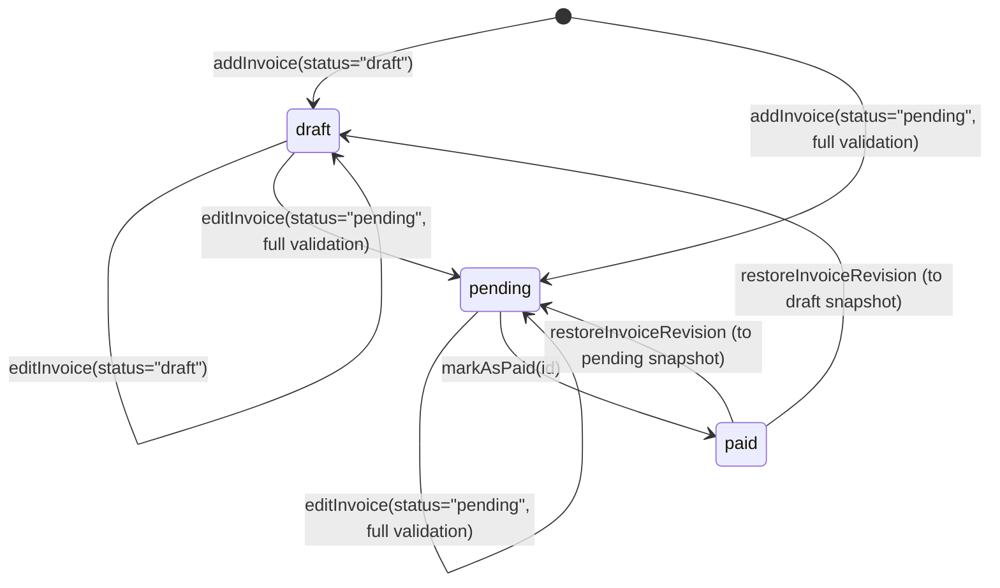

# Invoice App Portfolio Stabilization Plan

> **Document Metadata**
> - **Date**: 2026-10-16
> - **Prerequisite Audits**:
>   - [`docs/audit/repository-archaeology.md`](file:///home/djblackett/dev/invoice-web-app/docs/audit/repository-archaeology.md)
>   - [`docs/audit/runtime-verification.md`](file:///home/djblackett/dev/invoice-web-app/docs/audit/runtime-verification.md)
> - **Constraint Compliance**: Strictly read-only planning artifact. Zero application source files, configurations, branches, migrations, tests, or dependencies were modified during the preparation of this plan.

---

## 1. Executive Recommendation

1. **Stabilization Baseline (`portfolio-stabilization`)**: Create `portfolio-stabilization` directly from **`origin/boxing1` (`c750f889665e31b2dd85a46cce457b5c922a1f85`)**, which is a clean **2-commit fast-forward of `main` (`32a820c`)** containing the working `prisma/seed.mjs` script, `setup.sh` (`fb57af8`), and the full-stack PostgreSQL **Invoice Revision History with Diff & Restore** (`c750f88`).
2. **Conceptual North Star ("Last Coherent Auth0 State")**: Restore the architectural clarity of the **Last Coherent Auth0 State** (`7b93bff` on `dev` / `795c2c8` on `main`, **2025-03-31**), where Auth0 handled real authentication, PostgreSQL served a single clean `PrismaClient`, and Demo Mode was explicitly gated by environment configuration rather than acting as an unauthenticated backdoor into the production database.
3. **Authentication vs. Authorization Separation**:
   - **Retain Auth0 RS256 OIDC** (`jwks-rsa`) for authenticated mode and **abandon `OAuth-phase1`'s unfinished custom JWT/password/OAuth2 subsystem** (~7,000+ lines of partially wired code where `POST /auth/register` crashes with HTTP 500 and backend `tsc --noEmit` fails with 227 errors).
   - **Enforce authorization at the service and repository layers** against a provider-agnostic `AppUserContext` (`{ id, role, username, name, isDemo }`), eliminating the cross-user IDOR vulnerabilities in `getInvoiceById`, `updateInvoice`, `markAsPaid`, `invoiceRevisions`, `invoiceRevision`, `invoiceRevisionDiff`, and `restoreInvoiceRevision`.
4. **User and Role Model**:
   - **`USER`** (Operational Office Staff): Full CRUD, `markAsPaid`, and revision history/restore on **own** invoices (`createdById === user.id`), and zero access to other users' invoices.
   - **`ADMIN`** (Organizational Manager / System Admin): Full oversight (list, view, edit, delete, mark as paid, inspect/restore revisions) across **all** non-demo organizational invoices. Because no user-management UI exists in the product, retire unreferenced user-mutation endpoints (`createUser`, `login`, `deleteUsers`, `deleteUsersKeepAdmins`).
5. **Demo Mode v1 Redesign**:
   - **Remove Demo Admin Mode (`demo-token-admin` / `DemoButton.tsx` role toggle)** from the public demo. It was the direct vector for exposing and mutating all real authenticated users' invoices in production (`DEF-02`).
   - Implement **Per-Session Isolated Demo Users (`demo:<sessionId>`)** (or, at minimum, an environment-gated canonical `demoId` workspace with an explicit `resetDemoData` mutation and lazy seeding on first access) so every portfolio evaluator immediately sees the **7 canonical invoices + 5 revision snapshots on `RT3080`**, can exercise every workflow (create, edit, mark paid, delete, diff, restore, reset), and can **never** read or mutate real Auth0 users' records.
6. **Surgical Salvage from `OAuth-phase1`**:
   - Port only the proven, high-value fixes and test assets from `OAuth-phase1`: `deleteInvoice` De Morgan fix (`&&`), `removeInvoice` `{ acknowledged }` response shape, empty-`id` omission on `create` (`2a7d17a`), `DATABASE_URL` credential redaction (`590becd`), frontend `eslint.config.mjs` flat-config fix (`bb71d11`), `renderWithProviders` test harness + repaired unit/integration suites (`e992b3a`, `2853c99`, `84f5f66`), and Playwright helpers/specs (`5da9bb1`, `789ac9e`).
7. **Execution Strategy**: Execute the stabilization in **12 small, atomic, test-first slices** governed by three explicit quality gates (**Gate A: Core Correctness**, **Gate B: Demo Safety**, **Gate C: Portfolio Release**).

---

## 2. Product Intent and Historical Context

Understanding why the repository looks the way it does requires separating the product's evolution into four distinct eras and distinguishing **core product architecture**, **portfolio/demo infrastructure**, and **historical experiments**.

### 2.1 Evolution of the Product Model

1. **Single-Operator Office Administration Tool (May 2022 – Oct 2024)**:
   - Originating from the Frontend Mentor Invoice App challenge, the application was designed for a single internal office administrator managing client billing (`draft` -> `pending` -> `paid`).
   - There were no users, roles, tenants, or authentication barriers in the original domain model.
2. **Multi-User Office + Manager Hierarchy & Auth0 Integration (Nov 2024 – Mar 2025)**:
   - To evolve the prototype into a realistic full-stack production system, PostgreSQL, Prisma, Apollo GraphQL, InversifyJS DI, and Auth0 RS256 JWT authentication were added (`8667938`, `ad50f24`).
   - A two-tier organizational role model was introduced:
     - **`USER`**: Operational office staff managing their own assigned/created invoices (`Invoice.createdById`).
     - **`ADMIN`**: A manager or IT/system administrator with cross-office visibility and administrative control over invoices.
   - During this period (through March 31, 2025), Demo Mode was strictly a build/environment-scoped convenience (`VITE_DEMO_MODE=true` / `docker-compose.demo.yml`), while production deployments authenticated through Auth0.
3. **Portfolio Presentation & Production Demo Adaptation (Apr 2025)**:
   - To allow course evaluators and portfolio reviewers to inspect the deployed app without creating an Auth0 account, `demo-in-prod` (`3e2029d`, 2025-04-11) made Demo Mode toggleable at runtime in the browser (`DemoModeProvider`), and `79851e3` (2025-04-14) attempted to switch Prisma clients per request (`bindPrismaClient`).
   - A subsequent merge (`9616079` + `9deb149`, 2025-04-24) accidentally deleted `bindPrismaClient`, leaving orphaned `PrismaClientDemo` bindings and causing `Bearer demo-token-admin` in production to query the primary database with full `ADMIN` privileges.
4. **Post-Auth0 Experiments & AI Benchmark Branches (Jun 2025 – May 2026)**:
   - **AI Evaluation Branches (`revision-history`, `reattached`, `feature`, `golang`)**: Converted Prisma to SQLite for self-contained benchmark tasks and experimented with PDF export, partial payments, multi-tenancy, and a Go stub.
   - **Custom Auth Experiment (`security` -> `medium` -> `OAuth-phase1`)**: Triggered by dissatisfaction with Auth0 account/pricing constraints, the developer began building a custom email/password + Passport OAuth2 (Google/Microsoft/Apple) replacement (`bb71d11`..`0b613f7`), alongside test suite improvements and bug fixes (`2a7d17a`), before losing interest mid-migration.
   - **PostgreSQL Revision History (`origin/boxing1`, Apr 2026)**: Re-implemented Invoice Revision History cleanly on top of `main`'s PostgreSQL stack with a complete React UI (`RevisionHistoryPanel`, `RevisionDiffView`).

### 2.2 Architectural Classification

| Category | Capabilities / Subsystems | Disposition in Portfolio Baseline v1 |
|---|---|---|
| **Core Product Architecture** | Invoices (`draft`, `pending`, `paid`), line items, server-authoritative totals, `USER`/`ADMIN` invoice ownership & oversight, PostgreSQL persistence, append-only `InvoiceRevision` history with diff & restore, provider-agnostic user context. | **Stabilize, enforce invariants, and cover with regression tests.** |
| **Portfolio / Demo Infrastructure** | Zero-signup anonymous Demo Mode, pre-seeded canonical sample invoices + revision history, visitor isolation / one-click reset, deterministic `setup.sh` & Docker environments. | **Redesign cleanly for safety and immediate evaluator usability.** |
| **Historical Experiments** | Custom JWT/password auth (`AuthService`, `TokenService`), Google/Microsoft/Apple OAuth strategies, SendGrid email flows, `PrismaClientDemo` per-request DB factory, Demo Admin toggle (`demo-token-admin`), SQLite benchmark branches, `Tenant` model, `Payment` partial payments, `pdfkit` export, `go-backend` stub, unimplemented tactical-DDD markdown drafts. | **Retire or defer; do not preserve broken complexity merely because code exists.** |

---

## 3. Last Coherent Auth0 State

### 3.1 Identification of the Last Coherent Auth0 State

Forensic inspection of the Git graph identifies the **Last Coherent Auth0 State** at the completion of the React 19 + Feature-Slice + Form-Cache stabilization right before `demo-in-prod` (`3e2029d`) was branched:

- **Developer Integration Commit (`dev` / `react-19` merge)**:
  - **Commit Hash**: `7b93bff49e6b21a5fa8f00ce88cb4cc3537be95b` (and trivial lockfile cleanup `102a69f37f54166d5e0d413199bd8c19e1080c8c`)
  - **Branch**: `dev` (merged from `react-19` `9ac585f`)
  - **Date**: **2025-03-31**
- **Corresponding Mainline Release Commit (`main`)**:
  - **Commit Hash**: `795c2c8` (2025-03-31) / `2b34779` (2025-04-04, with Dependabot patch merges `#83`–`#88`)
  - **Branch**: `main`

### 3.2 What Existed and Worked in the Last Coherent Auth0 State

1. **Clean Frontend Architecture**:
   - Vertical feature-slice layout (`src/features/{auth,invoices,shared,users}`) from `domain-frontend` (`31c0eb7`).
   - Decomposed single-responsibility form hooks (`useSubmitNewInvoice`, `useSubmitDraft`, `useSubmitEditedInvoice`, `useAddInvoice`, `useUpdateInvoice`, `useFormCaching`, `useHandleFormReset`) and separated `InvoiceFormController` / `EditFormController` from `form-cache` (`b0f9ff5`).
   - Upgraded React 19, `babel-plugin-react-compiler`, and Vite 6 (`7b93bff`).
2. **Build-Time / Environment-Separated Demo Mode**:
   - In [`102a69f:invoice-frontend/src/config/config.ts`](file:///home/djblackett/dev/invoice-web-app/invoice-frontend/src/config/config.ts), `export const isDemoMode = import.meta.env.VITE_DEMO_MODE === "true"` was evaluated once at startup, and `checkEnvs()` skipped requiring Auth0 env vars when `isDemoMode` was `true`.
   - In [`102a69f:invoice-frontend/src/index.tsx`](file:///home/djblackett/dev/invoice-web-app/invoice-frontend/src/index.tsx), the root component tree mounted **either** `<DemoAuthProvider>` **or** `<Auth0ProviderWrapper>` based on `isDemoMode`—never swapping providers dynamically mid-session.
3. **Clear Docker & Deployment Separation**:
   - `docker-compose.yml`: Production stack (`NODE_ENV: production`, `DEMO_MODE: false`, `VITE_DEMO_MODE: false`) behind Traefik with `postgres:16.1`.
   - `docker-compose.dev.yml`: Local development + Playwright container (`db-dev`, `backend-dev`, `frontend-dev`, `adminer-dev`).
   - `docker-compose.demo.yml`: Self-contained local demo stack (`frontend-demo` with `VITE_DEMO_MODE=true`, `backend-demo` with `DEMO_MODE=true`, and dedicated `db-demo` container).
   - `.github/workflows/backend-deployment.yaml` and `frontend-deploy.yaml`: Automated CI/CD deploying backend to Fly.io and frontend to GitHub Pages.
4. **Single-Database Inversify Container**:
   - `inversify.config.ts` bound a single `TYPES.PrismaClient` singleton with no `PrismaClientDemo` or `PrismaClientFactory` dead bindings.

### 3.3 What Changed Immediately Afterward and Introduced Regressions

| Date | Commit(s) | Change Introduced | Resulting Defect / Complexity |
|---|---|---|---|
| **2025-04-11** | `3e2029d` (`demo-in-prod`) | Added `DemoModeProvider` (`isDemoMode` state in React) and `AppWrapper.tsx` to toggle between Auth0 and Demo Mode at runtime in production; commented out `if (isDemoMode) return;` in `config.ts`. | Required Auth0 `VITE_*` env vars even in Demo Mode; created the two-step login UX quirk on `Login.tsx` and redirect loop on `WelcomePage.tsx`; exposed `demo-token` and `demo-token-admin` usage in production builds. |
| **2025-04-14** | `79851e3` (`main`) | Added `TYPES.PrismaClientDemo`, `TYPES.PrismaClientFactory`, and `bindPrismaClient(childContainer, isDemoUser)` in `createContext.ts` to switch DBs without restarting the server. | Even in `79851e3`, `DatabaseConnection` and repositories were resolved from the parent container rather than rebound in `childContainer`, and `inversify.config.ts` read `DATABASE_URL_DEMO` while `server.config.ts` read `DEMO_DATABASE_URL`. |
| **2025-04-23..24** | `8ac269c` (`strict-types`) -> `9616079` + `9deb149` (`main`) | Refactored `createContext.ts` on `dev`/`strict-types`; when merged into `main` (`9616079`), `9deb149` (`"fix createContext bug"`) deleted `bindPrismaClient` to fix compilation. | Orphaned `PrismaClientDemo` and `PrismaClientFactory` in `inversify.config.ts`; routed all production Demo Mode and Demo Admin requests directly to the primary production database (`DEF-02`). |
| **2025-05-30** | `bb21a2b` (`dev`) -> `a839ce8` (`main`) | Updated `eslint.config.mjs` and TypeScript configs. | Introduced `...pluginJs.configs.recommended` spread bug in `invoice-frontend/eslint.config.mjs`, breaking `npm run lint` (`DEF-14`). |
| **2025-12-01..2026-05-18** | `590becd`..`0b613f7` (`OAuth-phase1`) | Attempted custom JWT + password + Google/Microsoft/Apple OAuth migration on top of `dev` (`f3231e3`). | Left 7,000+ lines of half-wired auth code, broke `POST /auth/register` (HTTP 500), broke `npm run start` (`ts-node` on `dist/`), and introduced 227 TS test errors + 135 ESLint errors (`DEF-07`, `DEF-08`). |

*Note on Pre-Existing Latent Bugs*: The cross-user IDOR in `findByUserIdAndInvoiceId` (`role !== "ADMIN"` always true, `DEF-01`), the inverted `||` in `deleteInvoice` (`DEF-04`), the missing ownership/status check in `markAsPaid` (`DEF-11`), and the broken `seed.js` (`DEF-06`) **already existed** in the Last Coherent Auth0 State (`102a69f`) because unit tests mocked `userContext` as an `ADMIN` who was also the invoice creator.

### 3.4 Comparison: Last Coherent Auth0 State (`102a69f`) vs. Current Branches

| Dimension | Last Coherent Auth0 State (`102a69f`, Mar 2025) | `main` (`32a820c`, Sep 2025) | `origin/boxing1` (`c750f88`, Apr 2026) | `OAuth-phase1` (`0b613f7`, May 2026) |
|---|---|---|---|---|
| **Auth Architecture** | Clean Auth0 RS256 OIDC | Clean Auth0 RS256 OIDC | Clean Auth0 RS256 OIDC | Mixed Auth0 + broken custom JWT/OAuth2/Password |
| **DI Container (`inversify.config.ts`)** | Clean single `PrismaClient` | Has dead `PrismaClientDemo` & `PrismaClientFactory` + noisy `console.log` middleware | Same as `main` + `InvoiceRevisionService` & `PrismaInvoiceRevisionRepository` | Replaces `PrismaClientDemo` with `AuthService`, `TokenService`, `OAuthService`, `EmailService` |
| **`createContext.ts` Structure** | Monolithic 320-line file | Decomposed into clean helpers (`b0c66e3`) | Same as `main` + `invoiceRevisionService` resolution | Bloated with `AUTH_SYSTEM` (`auth0`/`new`/`dual`) & env-var demo tokens |
| **Production Backend Runner** | `ts-node` in `package.json` | Fixed (`ae76833`, `ed12c71`): `tsc && tsc-alias` + `node dist/src/index.js` | Same as `main` (**WORKS**) | Reverted to `ts-node dist/src/index.js` (**CRASHES**) |
| **Database Seed (`npx prisma db seed`)** | `seed.js` (**BROKEN**) | `seed.js` (**BROKEN**) | `seed.mjs` (**WORKS**, seeds 7 invoices + 5 revisions) | `seed.mjs` (**WORKS**, seeds 7 invoices) |
| **Invoice Revision History** | Absent | Absent | **Present (Full-stack PostgreSQL + React UI)** | Absent |

### 3.5 What to Restore Conceptually from the Last Coherent Auth0 State

1. **Single-Database Container Simplicity**: Remove `TYPES.PrismaClientDemo` and `TYPES.PrismaClientFactory` (and the debug `container.applyMiddleware` log) from `inversify.config.ts`, returning to a single `PrismaClient` binding.
2. **Auth0 + Clean Demo Boundary**: Keep Auth0 RS256 OIDC as the sole real authentication mechanism and isolate Demo Mode at the data/context layer rather than running dual custom-auth servers or multi-database DI factories.
3. **Preserve Post-March-2025 Improvements**: Do **not** revert to `102a69f` as a Git base, because `origin/boxing1` (`c750f88`) contains `main`'s decomposed `createContext.ts` (`b0c66e3`), compiled production `node` runner (`ae76833`, `ed12c71`), demo avatar path fix (`dc2bb6b`), working `seed.mjs` + `setup.sh` (`fb57af8`), and full-stack Invoice Revision History (`c750f88`).

---

## 4. Verified Git Baseline

### 4.1 Resolution of Branch Topology Questions

1. **Is `origin/boxing1` one or two commits ahead of `main`?**
   - **`origin/boxing1` is exactly TWO (2) commits ahead of `main` (`32a820c`) and zero (0) commits behind `main`** (`git rev-list --left-right --count main...origin/boxing1` -> `0	2`).
   - *Why the prior reports differed*: [`docs/audit/repository-archaeology.md`](file:///home/djblackett/dev/invoice-web-app/docs/audit/repository-archaeology.md) correctly reported `+2 / -0`, whereas [`docs/audit/runtime-verification.md`](file:///home/djblackett/dev/invoice-web-app/docs/audit/runtime-verification.md) informally referred to `origin/boxing1` as a "1-commit fast-forward" by focusing on the feature commit `c750f88`.
2. **Exact commits unique to `origin/boxing1` (`main..origin/boxing1`)**:
   - **Commit 1**: `fb57af8edb8b58b0e886d1eaef923d83cc80f165` (`2026-04-12 16:15:16 -0300`, *"make setup script for easy startup"*):
     - Renames `invoice-backend/prisma/seed.js` -> `seed.mjs` and fixes all 4 runtime seed bugs (`this.prisma`, missing `await`, missing idempotency check, undefined `prismaErrorHandler`).
     - Updates `invoice-backend/package.json` seed command to `node ./prisma/seed.mjs`.
     - Restores `export const isDemoMode = import.meta.env.VITE_DEMO_MODE === "true"` and `if (isDemoMode) return;` in [`invoice-frontend/src/config/config.ts`](file:///home/djblackett/dev/invoice-web-app/invoice-frontend/src/config/config.ts).
     - Adds root [`setup.sh`](file:///home/djblackett/dev/invoice-web-app/setup.sh) (`./setup.sh [demo|dev]`).
     - Removes `.cursor/rules/rules-test.mdc` and adds `.claude/settings.json`.
   - **Commit 2**: `c750f889665e31b2dd85a46cce457b5c922a1f85` (`2026-04-12 19:25:22 -0300`, *"claude model1 first response"*):
     - Adds `InvoiceRevision` model to `invoice-backend/prisma/schema.prisma` and seeds 5 realistic revision snapshots on `RT3080` in `seed.mjs`.
     - Adds backend `InvoiceRevisionRepo.ts`, `prismaInvoiceRevisionRepository.ts`, `invoiceDiff.ts` (including `withRecomputedTotals`, `toSnapshot`, `diffSnapshots`, `snapshotsEqual`), `invoiceRevision.service.ts`, `invoiceRevisionResolvers.ts`, and reconciles line items by ID in `PrismaInvoiceRepository.update`.
     - Adds frontend `RevisionHistoryPanel.tsx`, `RevisionDiffView.tsx`, `revision.queries.ts`, `styles.ts`, `types.ts`, `formatting.ts`, and integrates the `"History"` button into `ViewInvoice.tsx` and `ToolbarButtons.tsx`.
     - Adds 21 backend unit tests (`invoiceDiff.test.ts`, `invoiceRevisionService.test.ts`, `invoiceService.revisions.test.ts`, `invoiceRevisionResolvers.test.ts`) and 4 frontend unit tests (`RevisionDiffView.test.tsx`).
3. **Exact relationship between `OAuth-phase1` and `dev`**:
   - `OAuth-phase1` (`0b613f7`) is **22 commits ahead of `dev` (`f3231e3`) and 0 commits behind `dev`** (`git rev-list --left-right --count dev...OAuth-phase1` -> `0	22`).
   - `dev` (`f3231e3`) was branched from `bb21a2b` (which was merged into `main` at `a839ce8` on 2025-05-30) plus 1 commit (`f3231e3`, `.gitignore`).
   - Consequently, `OAuth-phase1` is **22 commits ahead of `main` and 31 commits behind `main`** (missing `main`'s April–September 2025 direct commits `ae76833`, `ed12c71`, `dc2bb6b`, `687ac59`, and `origin/boxing1`'s 2 commits `fb57af8` and `c750f88`).
4. **Did `origin/boxing1` lose any stable configuration from `main`?**
   - **No.** Because `git merge-base main origin/boxing1` is `main` (`32a820c`) itself, `origin/boxing1` preserves 100% of `main` plus the working seed script, `setup.sh`, and Invoice Revision History. (It only adds two untracked/agent artifacts `.claude/settings.json` and `.codex` which should be cleaned up in Slice 11).

### 4.2 Baseline Verdict and Exact Future Branch Creation Command

**Verdict**: **`origin/boxing1` (`c750f889665e31b2dd85a46cce457b5c922a1f85`) is confirmed as the optimal baseline for `portfolio-stabilization`.**

When implementation begins (not executed during this planning task), create the stabilization branch while preserving `main` untouched:

```bash
git checkout -b portfolio-stabilization origin/boxing1
```

---

## 5. Portfolio Baseline v1 Scope

Portfolio Baseline v1 includes **only** the capabilities required to deliver a secure, rock-solid, full-stack invoice management system and case study:

1. **Core Invoice Lifecycle (`draft`, `pending`, `paid`)**:
   - Create draft invoice (lenient validation, server-validated `AA9999` ID, server-computed totals).
   - Create pending invoice (strict Zod validation, `paymentDue` derivation, server-computed totals).
   - View invoice list (`allInvoices`, status filtering `draft`/`pending`/`paid`, responsive cards, dark/light theme).
   - View single invoice detail (`getInvoiceById`).
   - Edit draft or pending invoice (`editInvoice`, line-item ID reconciliation, `sessionStorage` draft caching).
   - Mark pending invoice as paid (`markAsPaid`, restricted strictly to `status === "pending"`).
   - Delete invoice (`removeInvoice`, returning `{ acknowledged: true }`).
2. **Append-Only Invoice Revision History (`origin/boxing1`)**:
   - Automatic snapshot recording on `addInvoice` (`changeType: "create"`), `editInvoice` (`changeType: "edit"` when snapshot changed), `markAsPaid` (`changeType: "edit"`, `message: "Marked as paid"`), and `restoreInvoiceRevision` (`changeType: "restore"`).
   - Structured field, address, and line-item diffing (`invoiceRevisionDiff`) and side-by-side/inline UI (`RevisionHistoryPanel`, `RevisionDiffView`).
   - Point-in-time restoration (`restoreInvoiceRevision`) with server-side total recomputation.
3. **Strict Multi-User Authorization (`USER` vs. `ADMIN`)**:
   - Enforced at both the service and repository layers across all invoice and revision queries/mutations.
4. **Auth0 Authentication + Safe Isolated Public Demo Mode**:
   - Auth0 RS256 JWT verification for authenticated users.
   - Zero-signup public Demo Mode with immediate access to the 7 canonical sample invoices + 5 revisions on `RT3080`, complete isolation from real Auth0 users, removal of the Demo Admin privilege-escalation toggle, and one-click `"Reset Demo"` capability.
5. **Deterministic Database, Build, and Test Infrastructure**:
   - Committed Prisma migration for `InvoiceRevision` (`npx prisma migrate deploy` works from scratch).
   - Working `npx prisma db seed` and `./setup.sh`.
   - Clean `tsc --noEmit`, `npm run lint`, `npm run build`, Vitest unit/integration suites, and local-Demo-compatible Playwright E2E suite.

---

## 6. Explicitly Deferred Scope

To prevent stabilization from turning into "Invoice App 2.0", the following items are explicitly excluded from Portfolio Baseline v1:

| Feature / Subsystem | Where Found in Repo | Classification | Rationale |
|---|---|---|---|
| **PDF Invoice Export (`pdfkit`, `getInvoicePdf`)** | `revision-history`, `reattached`, `feature` (`94d53c2`) | **POST-V1 GOOD CANDIDATE** | Self-contained ~140-line backend utility on the SQLite branches with no frontend button wired yet. Clean feature addition *after* v1 stabilization is complete. |
| **Partial Payments (`Payment` model, `applyPayment`, `partially_paid`)** | `feature` (`2c429eb`) | **POST-V1 GOOD CANDIDATE** | Alters the core status state machine (`draft -> pending -> paid`), Prisma schema, and GraphQL contract, and has no React UI. Defer until post-v1. |
| **Tactical DDD / Clean Architecture Layer Extraction (`domain/`, `application/`, `infrastructure/`)** | Untracked root files `frontend-architecture-article.md`, `backend-architecture-anemic-model.md`, `invoice-ddd-domain-current-code.ts` | **POST-V1 GOOD CANDIDATE** | In v1, we centralize the critical domain invariants (total calculation, status transitions, authorization) inside the existing backend service layer. Full folder/layer restructuring can follow as a dedicated refactoring showcase. |
| **Custom Email/Password Authentication (`AuthService`, `/auth/register`, `/auth/login`, SendGrid `EmailService`)** | `OAuth-phase1` (`bb71d11`..`0b613f7`) | **HISTORICAL EXPERIMENT** | Built only after Auth0 plan changes late in the project; broken at runtime (`POST /auth/register` HTTP 500, `passwordHash` dropped, frontend/backend contract mismatch). Adds credential-storage liability with zero product benefit over Auth0 + Demo Mode. |
| **Custom RS256 JWT & Refresh Token Rotation (`TokenService`, `RefreshToken`, `PasswordResetToken`, `EmailVerificationToken`, `SecurityAuditLog`)** | `OAuth-phase1` (`bb71d11`..`3b30735`) | **HISTORICAL EXPERIMENT** | Adds 5 Prisma tables and key-management overhead that duplicate Auth0 OIDC. |
| **Google, Microsoft, and Apple OAuth2 Passport Strategies (`OAuthService`, `/oauth/*`, `OAuthButtons.tsx`)** | `OAuth-phase1` (`dcf7815`, `3b30735`) | **HISTORICAL EXPERIMENT** | Requires external OAuth client secrets for 3 providers; Apple strategy is unimplemented (returns HTTP 400); frontend routes (`/oauth/callback`) are unwired. |
| **Multi-Tenancy (`Tenant` model, `tenantResolvers`)** | `reattached` (`539a855`) | **HISTORICAL EXPERIMENT** | Created for an AI coding benchmark evaluation on SQLite; never part of the intended office-admin product model. |
| **Go Backend (`go-backend/cmd/server/main.go`)** | `golang` (`14037b2`) | **HISTORICAL EXPERIMENT** | 3-file empty Go stub with zero resolvers or business logic. |
| **Per-Request Dual-Database Switching (`PrismaClientDemo`, `PrismaClientFactory`, `bindPrismaClient`)** | `main` (`79851e3`, `9deb149`) | **HISTORICAL EXPERIMENT** | Over-engineered attempt to swap Prisma clients per request that broke during merge and left dead bindings in `inversify.config.ts`. |
| **Enterprise User-Management UI / Admin User CRUD** | `userResolvers.ts` (`createUser`, `deleteUsers`, `allUsers`) | **UNNECESSARY FOR PORTFOLIO** | The frontend has no user-management screen; users are provisioned automatically from Auth0 claims (or demo context). |

---

## 7. User and Role Model

### 7.1 Intended Product Semantics

Based on the project's evolution from an internal office tool into a multi-user application, Portfolio Baseline v1 defines two roles on `User.role` (`enum Role { USER, ADMIN }`):

1. **`USER` (Operational Office Staff)**:
   - Represents an employee or office administrator responsible for creating and managing their own billing records.
   - **Capabilities**:
     - Can create new `draft` or `pending` invoices (automatically assigned `createdById = user.id`).
     - Can list, view, edit, delete, and mark as paid **only** invoices where `invoice.createdById === user.id`.
     - Can list revisions, view revision snapshots/diffs, and restore revisions **only** for invoices where `invoice.createdById === user.id`.
     - Cannot view, mutate, delete, or inspect revisions of any invoice created by another user.
2. **`ADMIN` (Organizational Manager / System Administrator)**:
   - Represents a manager or IT administrator with organization-wide oversight across all operational staff.
   - **Capabilities**:
     - Can list, view, edit, delete, mark as paid, and inspect/restore revisions for **all organizational invoices** (both own invoices and invoices created by any non-demo `USER`), subject to the exact same domain status/total invariants as `USER` (e.g., an `ADMIN` still cannot mark an incomplete `draft` invoice as `paid` without first completing and transitioning it to `pending`).
     - Can subscribe to the `invoiceAdded` WebSocket feed.
   - **What `ADMIN` Does Not Include**:
     - There is **no** enterprise user-management UI in the frontend.
     - Therefore, unused/dangerous GraphQL user mutations (`createUser`, `login`, `deleteUsers`, `deleteUsersKeepAdmins`) and unguarded user listing queries (`allUsers`, `getUserById`) should be retired or restricted rather than inventing new admin UI screens.
     - **Demo Mode visitors are never granted `ADMIN` role.**

---

## 8. Authorization Policy Matrix

### 8.1 Explicit Operation Matrix

In the matrix below:
- **USER own**: Authenticated `Role.USER` (or isolated Demo User) operating on an invoice where `invoice.createdById === user.id`.
- **USER other**: Authenticated `Role.USER` (or isolated Demo User) operating on an invoice where `invoice.createdById !== user.id`.
- **ADMIN own**: Authenticated `Role.ADMIN` operating on an invoice where `invoice.createdById === user.id`.
- **ADMIN other**: Authenticated `Role.ADMIN` operating on an organizational invoice where `invoice.createdById !== user.id` (excluding isolated demo-session records if demo runs on the same DB).

| Operation | GraphQL Field | Service Method | USER own | USER other | ADMIN own | ADMIN other | Denial Behavior (`USER other`) |
|---|---|---|---:|---:|---:|---:|---|
| **List invoices** | `Query.allInvoices` | `InvoiceService.getInvoices` | **ALLOW** (returns own) | **DENY** (filtered out by `WHERE`) | **ALLOW** | **ALLOW** (returns all non-demo) | Excluded from query result set (`WHERE createdById = user.id`). |
| **Get invoice** | `Query.getInvoiceById` | `InvoiceService.getInvoiceById` | **ALLOW** | **DENY** | **ALLOW** | **ALLOW** | Throws `NotFoundException("Invoice not found")` -> GraphQL `NOT_FOUND` (prevents ID enumeration). |
| **Create invoice** | `Mutation.addInvoice` | `InvoiceService.addInvoice` | **ALLOW** (`createdById` forced to `user.id`) | **N/A** (`createdById` ignored from client) | **ALLOW** (`createdById` forced to `user.id`) | **N/A** | Server overwrites `createdById` with `userContext.id`. |
| **Edit invoice** | `Mutation.editInvoice` | `InvoiceService.updateInvoice` | **ALLOW** (if `draft` or `pending`) | **DENY** | **ALLOW** (if `draft` or `pending`) | **ALLOW** (if `draft` or `pending`) | Throws `NotFoundException("Invoice not found")` -> GraphQL `NOT_FOUND`. |
| **Delete invoice** | `Mutation.removeInvoice` | `InvoiceService.deleteInvoice` | **ALLOW** | **DENY** | **ALLOW** | **ALLOW** | Throws `NotFoundException("Invoice not found")` -> GraphQL `NOT_FOUND`. |
| **Mark paid** | `Mutation.markAsPaid` | `InvoiceService.markAsPaid` | **ALLOW** (only if `status === "pending"`) | **DENY** | **ALLOW** (only if `status === "pending"`) | **ALLOW** (only if `status === "pending"`) | Throws `NotFoundException("Invoice not found")` -> GraphQL `NOT_FOUND`. |
| **Revision list** | `Query.invoiceRevisions` | `InvoiceRevisionService.listRevisions` | **ALLOW** | **DENY** | **ALLOW** | **ALLOW** | Throws `NotFoundException("Invoice not found")` -> GraphQL `NOT_FOUND`. |
| **Revision get** | `Query.invoiceRevision` | `InvoiceRevisionService.getRevision` | **ALLOW** | **DENY** | **ALLOW** | **ALLOW** | Throws `NotFoundException("Revision not found")` -> GraphQL `NOT_FOUND`. |
| **Revision diff** | `Query.invoiceRevisionDiff` | `InvoiceRevisionService.getDiff` | **ALLOW** (both revisions must belong to permitted invoice) | **DENY** | **ALLOW** | **ALLOW** | Throws `NotFoundException("Revision not found")` -> GraphQL `NOT_FOUND`. |
| **Revision restore** | `Mutation.restoreInvoiceRevision` | `InvoiceService.restoreRevision` | **ALLOW** | **DENY** | **ALLOW** | **ALLOW** | Throws `NotFoundException("Invoice not found")` -> GraphQL `NOT_FOUND`. |

> [!IMPORTANT]
> **Why `NotFoundException` (`NOT_FOUND`) on Cross-User Single-Record Access**: Returning `NOT_FOUND` when a `USER` queries or mutates an `invoiceId` or `revisionId` they do not own (because the repository query `WHERE id = :invoiceId AND createdById = :userId` matches 0 rows) prevents attackers from enumerating valid 6-character `AA9999` invoice IDs belonging to other users.

### 8.2 Defense-in-Depth Enforcement Architecture (Preventing IDOR by Construction)

Authorization must **not** rely solely on GraphQL resolvers or post-fetch `if` checks. We enforce ownership at two layers:

1. **Layer 1 — Repository Query Construction (`PrismaInvoiceRepository` & `PrismaInvoiceRevisionRepository`)**:
   - Replace `findById(id)` + broken `findByUserIdAndInvoiceId(userId, role, invoiceId)` in [`prismaInvoiceRepository.ts:63-119`](file:///home/djblackett/dev/invoice-web-app/invoice-backend/src/repositories/implementations/prismaInvoiceRepository.ts#L63-L119) with a single scope-aware query helper:
     ```ts
     private buildAccessWhere(invoiceId: string, scope: { userId: string; role: Role; isDemo?: boolean }): Prisma.InvoiceWhereInput {
       if (scope.role === "ADMIN" && !scope.isDemo) {
         // Admin can access any non-demo invoice (or own invoices)
         return { id: invoiceId, NOT: { createdById: { startsWith: "demo:" } } };
       }
       // USER (and any demo user) is strictly scoped by createdById in SQL
       return { id: invoiceId, createdById: scope.userId };
     }
     ```
   - `findByUserIdAndInvoiceId(userId, role, invoiceId)` executes `this.prisma.invoice.findFirst({ where: this.buildAccessWhere(invoiceId, { userId, role }), include: ... })` and throws `new NotFoundException("Invoice not found")` if `null`.
   - Crucially, **every** write method on `PrismaInvoiceRepository` (`update`, `markAsPaid`, `delete`) must either verify the scoped record inside its transaction or filter by `buildAccessWhere` before mutating.
2. **Layer 2 — Domain/Service Policy Guard (`InvoiceService` & `InvoiceRevisionService`)**:
   - `InvoiceService.getAuthorizedInvoice(invoiceId)` is called at the entry of `getInvoiceById`, `updateInvoice`, `markAsPaid`, `deleteInvoice`, and `restoreRevision`:
     - Requires `this.userContext?.id` and `this.userContext?.role` (throws `UnauthorizedException` / `ValidationException("Unauthorized")` if absent).
     - Fetches the invoice via `findByUserIdAndInvoiceId(id, role, invoiceId)`.
     - Explicitly asserts `if (role !== "ADMIN" && invoice.createdById !== id) throw new NotFoundException("Invoice not found");`.
   - `InvoiceRevisionService` (`listRevisions`, `getRevision`, `getDiff`) must not trust callers to pre-check invoice access:
     - `listRevisions(invoiceId)`: Verifies invoice access before calling `revisionRepo.listByInvoice(invoiceId)`.
     - `getRevision(revisionId)`: Fetches the revision, then verifies the caller has access to `revision.invoiceId` before returning it.
     - `getDiff(fromRevisionId, toRevisionId)`: Fetches `to` (and `from` if non-null), verifies `from.invoiceId === to.invoiceId` (throws `ValidationException("Revisions belong to different invoices")` if mismatched), and verifies the caller has access to `to.invoiceId`.

---

## 9. Authentication Strategy

### 9.1 Separation of Authentication from Authorization

- **Authentication** answers *"Who is this caller?"* and lives exclusively in [`invoice-backend/src/GraphQL/createContext.ts`](file:///home/djblackett/dev/invoice-web-app/invoice-backend/src/GraphQL/createContext.ts) (and its token verification helper). Its sole output is an application-level identity object bound to `TYPES.UserContext`:
  ```ts
  export interface UserIdAndRole {
    id: string;        // Stable internal user ID (e.g. "auth0|..." or "demo:<sessionId>")
    role: Role;        // "USER" | "ADMIN"
    username: string;  // Email / identifier
    name: string;      // Display name
    isDemo?: boolean;  // True when authenticated via Demo Mode token
  }
  ```
- **Authorization and Domain Services** (`InvoiceService`, `InvoiceRevisionService`, `UserService`) consume **only** `TYPES.UserContext` (`UserIdAndRole`). They have zero knowledge of Auth0, JWKS, JWT claims, or HTTP headers.

### 9.2 Evaluation of Realistic Authentication Options for Portfolio Baseline v1

| Option | Architecture & Effort | External Dependencies | Portfolio Demonstration Value | Verdict |
|---|---|---|---|---|
| **Option A — Retain Auth0 RS256 OIDC + Redesigned Demo Mode** | Uses existing ~90-line `jwks-rsa` RS256 verification in `createContext.ts` + `Auth0ProviderWrapper.tsx` on frontend, paired with isolated Demo Mode. **Zero new auth code required.** | Requires Auth0 tenant (`DOMAIN`, `AUDIENCE`, `VITE_DOMAIN`, `VITE_CLIENT_ID`, `VITE_AUDIENCE`) only when signing in via Auth0; **not required** when using Demo Mode once `config.ts` is fixed. | **High**: Demonstrates standards-compliant OIDC/JWKS RS256 JWT validation, custom namespace claim extraction, per-request DI context binding, plus zero-friction anonymous demo access. | **RECOMMENDED (Primary)** |
| **Option B — Minimal Alternative Managed Auth (Clerk / Supabase / Firebase)** | Requires replacing `@auth0/auth0-react` on frontend and `createContext.ts` claim parsing on backend. | Requires new external vendor account and env vars. | **Low incremental value**: Swapping one managed OIDC provider for another adds churn without improving architecture. | **Not Recommended** |
| **Option C — Demo-First Public Deployment with Auth0 Architecture Retained in Code** | Identical code to Option A, deployed with `VITE_DEMO_MODE=true` / `DEMO_MODE_ENABLED=true` so portfolio visitors land directly in the app or click 1-button Demo Login without needing a live Auth0 tenant. | **Zero external dependencies** for the public hosted demo; Auth0 remains fully tested via local RS256 JWKS in integration tests. | **High**: Eliminates any dependency on Auth0 pricing/tenant availability for live portfolio hosting while keeping real RS256 OIDC verification active and verified in automated tests. | **RECOMMENDED (Deployment Companion to Option A)** |
| **Option D — Finish `OAuth-phase1` Custom Auth (Password + JWT + Google/MS/Apple OAuth)** | Requires fixing `POST /auth/register` HTTP 500, `prismaUserRepo.createUser` dropping `passwordHash`, frontend/backend token contract mismatch, unwired `/oauth/callback` route, 227 TS test errors, 135 ESLint errors, and 5 extra Prisma tables. | Requires RSA keypair management, SendGrid API key, Google/MS/Apple OAuth credentials. | **Negative**: Distracts from the invoice domain and introduces a large surface area of security/credential-management code that was never the product goal. | **Explicitly Rejected** |

### 9.3 Recommended Strategy: Option A + Option C

Retain the clean **Auth0 RS256 OIDC** implementation from `origin/boxing1` (`createContext.ts` + `Auth0ProviderWrapper.tsx`) and pair it with the redesigned **Demo Mode v1** (Section 11) so that:
1. When Auth0 credentials (`VITE_DOMAIN`, `VITE_CLIENT_ID`, `VITE_AUDIENCE`, `DOMAIN`, `AUDIENCE`) are configured, full Auth0 Universal Login and RS256 JWKS verification work out of the box.
2. When deployed as a public portfolio demo (or run locally via `./setup.sh demo`), visitors can enter Demo Mode in **one click** without requiring an external Auth0 tenant to be reachable.
3. In automated integration and security tests, `retrieveUserFromToken` is verified against a real local RS256 JWKS server (eliminating reliance on external Auth0 availability in CI).

---

## 10. Invoice Domain Invariants

Regardless of what the React frontend validates or computes, `InvoiceService` on the backend must enforce the following domain invariants before persisting any change to PostgreSQL:

### 10.1 Invoice IDs (`Invoice.id`)

- **Format**: 2 uppercase ASCII letters followed by 4 digits (`^[A-Z]{2}[0-9]{4}$`, e.g., `RT3080`, `XM9141`).
- **Who Creates IDs**:
  - The client *may* supply a candidate `id` matching `^[A-Z]{2}[0-9]{4}$` (used by Apollo optimistic UI updates in `createInvoiceObject`), **or** omit `id` / pass `""`.
  - If `id` is omitted or `""`, the server generates a random `^[A-Z]{2}[0-9]{4}$` ID (`generateInvoiceId()`).
  - If a client supplies a non-empty `id` that does **not** match `^[A-Z]{2}[0-9]{4}$`, the server rejects it with `ValidationException("Invalid invoice ID format")`.
- **Collision Handling**:
  - Never pass `id: ""` to `prisma.invoice.create` (`DEF-10`).
  - When the server generates an ID, check `prisma.invoice.findUnique({ where: { id } })` (up to 5 retries) before inserting; if a client-supplied ID collides (`P2002`), throw `BadRequestException("Unique constraint failed on the fields: (\`id\`)")`.

### 10.2 Ownership (`Invoice.createdById`)

- **Creation**: `InvoiceService.addInvoice` **always** sets `createdById = this.userContext.id` and `createdBy = this.userContext`. Any client-supplied `createdById` or `createdBy` is unconditionally overwritten.
- **Updates & Restorations**: `createdById` is immutable after creation. `updateInvoice` and `restoreRevision` never modify `createdById`, even when an `ADMIN` edits or restores another user's invoice.

### 10.3 Line-Item Totals and Invoice Total (`DEF-09`)

- **Server-Derived Authority**: Neither `item.total` nor `invoice.total` is ever trusted from client input on `addInvoice`, `editInvoice`, or `restoreInvoiceRevision`.
- **Calculation Rule**:
  - Every item must have `quantity >= 0` (integer) and `price >= 0` (finite number).
  - For each line item: `item.total = Math.round(Number(item.quantity) * Number(item.price) * 100) / 100`.
  - For the invoice: `invoice.total = Math.round(items.reduce((sum, item) => sum + item.total, 0) * 100) / 100`.
- **Implementation**: Reuse `withRecomputedTotals` (already present on `origin/boxing1` in [`invoice-backend/src/services/invoiceDiff.ts:389-400`](file:///home/djblackett/dev/invoice-web-app/invoice-backend/src/services/invoiceDiff.ts#L389-L400)) inside `mapPartialInvoiceToInvoice` (`addInvoice`), `InvoiceService.updateInvoice` (`editInvoice`), and `PrismaInvoiceRepository.create`/`update` so stale or omitted client `total` values can never corrupt database state.

### 10.4 Status Lifecycle and Valid Transitions (`DEF-11`)

The valid invoice status values are strictly `"draft"`, `"pending"`, and `"paid"`.



- **Creation (`addInvoice`)**:
  - Allowed initial statuses: `"draft"` or `"pending"` (defaults to `"draft"` in `mapPartialInvoiceToInvoice` if omitted).
  - Creating an invoice directly with `status: "paid"` via `addInvoice` is **invalid** -> throw `ValidationException("New invoices cannot be created with status 'paid'")`.
  - If `status === "pending"`, strict field validation applies: `clientName`, `clientEmail` (valid email), `description`, `createdAt`, `paymentTerms > 0`, `clientAddress` (non-empty `street`, `city`, `postCode`, `country`), `senderAddress` (non-empty `street`, `city`, `postCode`, `country`), and at least 1 line item (`items.length >= 1` with non-empty `name`, `quantity >= 1`, `price >= 0`).
- **Editing (`editInvoice`)**:
  - Allowed on invoices currently in `"draft"` or `"pending"` status.
  - Allowed target statuses on `editInvoice`: `"draft"` (only if currently `"draft"`) or `"pending"` (validates full required fields).
  - Transitioning `pending -> draft` via `editInvoice` or transitioning to `"paid"` via `editInvoice` (instead of `markAsPaid`) is **invalid** -> throw `ValidationException`.
  - Editing a `"paid"` invoice directly via `editInvoice` is **invalid** -> throw `ValidationException("Paid invoices cannot be edited")`. (A `"paid"` invoice can only be reverted via an explicit audited `restoreInvoiceRevision`).
- **Marking as Paid (`markAsPaid`)**:
  - Allowed **only** when `invoice.status === "pending"`.
  - If `invoice.status === "draft"`, throw `ValidationException("Draft invoices cannot be marked as paid")` (`DEF-11`).
  - If `invoice.status === "paid"`, throw `ValidationException("Invoice is already marked as paid")`.
  - **Does `ADMIN` have exceptional transition authority?** **No.** `ADMIN` grants cross-user *access* (`USER other` vs. `ADMIN other`), not permission to violate accounting invariants (an `ADMIN` cannot mark an incomplete `"draft"` invoice as `"paid"`).

### 10.5 Revision Invariants

- **Append-Only Audit Log**: `InvoiceRevision` rows are never updated or deleted (except via `ON DELETE CASCADE` when the parent `Invoice` itself is deleted).
- **Operations That Record Revisions**:
  1. `addInvoice` -> records revision `#1` (`changeType: "create"`, `message: "Invoice created"`).
  2. `editInvoice` -> records revision `#N+1` (`changeType: "edit"`) **if and only if** `snapshotsEqual(latest.snapshot, nextSnapshot)` is `false` (no-op edits do not create duplicate revisions).
  3. `markAsPaid` -> records revision `#N+1` (`changeType: "edit"`, `message: "Marked as paid"`) after transitioning `pending -> paid` (fixing the missing hook on `origin/boxing1` so live behavior matches `seed.mjs`).
  4. `restoreInvoiceRevision` -> updates the `Invoice` to the target revision's snapshot (with recomputed totals via `withRecomputedTotals`) and records a new revision `#N+1` (`changeType: "restore"`, `restoredFromRevisionId: revision.id`, `message: "Restored from revision #<revisionNumber>"`).
- **Coherent Domain Helper Placement (Without Full DDD Rewrite)**:
  - Consolidate pure invoice domain rules—`generateInvoiceId()`, ` isValidInvoiceId()`, `recomputeInvoiceTotals()`, `assertValidCreateStatus()`, `assertValidEditTransition()`, `assertCanMarkAsPaid()`—into a single pure module `invoice-backend/src/services/invoiceDomainRules.ts` (adjacent to `invoiceDiff.ts`) invoked by `InvoiceService`. This eliminates rule scattering across React, resolvers, and repositories without undertaking a multi-directory Clean Architecture rewrite.

---

## 11. Demo Mode v1 Design

### 11.1 First-Principles Evaluation of Demo Mode Options

| Option | How It Works | Pros | Cons / Risks | Verdict |
|---|---|---|---|---|
| **A. Shared Dedicated Demo Database (`DEMO_DATABASE_URL`)** | Runs a second PostgreSQL database instance for demo users. | Physical DB separation from real users. | Requires provisioning and paying for a 2nd managed PostgreSQL instance in production; still suffers from cross-visitor state collisions (`demoId` shared by all visitors) and empty state if deleted. | **Not Recommended** |
| **B. Per-Session Isolated Demo User + Lazy Canonical Clone (`demo:<sessionId>`)** | Frontend generates a random UUID `demoSessionId` in `sessionStorage` (or `localStorage`) and sends `Authorization: Bearer demo-session:<uuid>`. Backend (when `DEMO_MODE_ENABLED=true`) maps this to `id: "demo:<uuid>"`, `role: "USER"`, `isDemo: true`, and on first request lazily clones the 7 canonical invoices + 5 revisions on `RT3080` (with session-scoped IDs or user-scoped ownership) and provides a `resetDemoData` mutation + TTL cleanup. | Zero cross-visitor collisions; zero contamination of real users; single PostgreSQL database; supports 1-click `"Reset Demo"`; every evaluator immediately sees all 7 sample invoices + revision history. | Note: `Invoice.id` (`RT3080`) is a global `@id` primary key in `schema.prisma`, so two users in the same `Invoice` table cannot both own a row with `id = "RT3080"` unless either (1) Demo Mode uses a single canonical `demoId` user with 1-click `resetDemoData`, or (2) session demo users generate fresh `AA9999` IDs when cloning. | **See Hybrid Recommendation (Option D/B) below** |
| **C. Read-Only or Reset-on-Mutation Demo** | Blocks mutations or resets immediately after every mutation. | Never gets graffitied. | Evaluators cannot test creating an invoice, editing it, viewing the newly created revision diff, and restoring it. | **Not Recommended** |
| **D. Canonical `demoId` Workspace with Lazy Self-Healing Seed + Explicit `"Reset Demo"` Button + Strict Isolation** | When `DEMO_MODE_ENABLED=true` (or `DEMO_MODE=true`), `Bearer demo-token` authenticates as `id: "demoId"`, `role: "USER"`, `isDemo: true`. All 7 canonical invoices (`RT3080`, `XM9141`, `RG0314`, `RT2080`, `AA1449`, `TY9141`, `FV2353`) + 5 revisions on `RT3080` are seeded directly under `createdById: "demoId"`. If `demoId` ever has 0 invoices (or when the user clicks `"Reset Demo"` in the header), `InvoiceService.resetDemoWorkspace()` atomically restores the exact 7 canonical invoices (`RT3080`..`FV2353`) + 5 revisions for `demoId`. | **Preserves exact canonical IDs (`RT3080`, `XM9141`, etc.)** across the UI, URLs, and E2E tests; requires **zero schema changes** to `Invoice.id`; guarantees `demoId` is never empty on initial load; strictly isolated to `createdById === "demoId"`; costs \$0 extra infrastructure. | Concurrent simultaneous visitors share `demoId`, mitigated by the 1-click `"Reset Demo"` button in the top bar and automatic re-seeding if all demo invoices are deleted. | **RECOMMENDED for Portfolio Baseline v1** |

### 11.2 Critical Schema Insight: Why Canonical `demoId` + Self-Healing Reset (Option D) Wins for v1

In [`invoice-backend/prisma/schema.prisma`](file:///home/djblackett/dev/invoice-web-app/invoice-backend/prisma/schema.prisma), `Invoice.id` (`String @id`) is a globally unique primary key (`"RT3080"`, `"XM9141"`, `"RG0314"`, `"RT2080"`, `"AA1449"`, `"TY9141"`, `"FV2353"`).
- If per-session users cloned invoices into the same `Invoice` table, they could not use the canonical IDs `"RT3080"`, `"XM9141"`, etc. without changing the database primary key to a composite `@@id([createdById, id])` (which would ripple through every GraphQL query, resolver, foreign key in `Item` and `InvoiceRevision`, and test).
- By assigning the 7 canonical invoices (`RT3080`..`FV2353`) and the 5 revision snapshots on `RT3080` directly to `createdById: "demoId"` (`role: "USER"`) and providing an idempotent **`resetDemoWorkspace()`** service method (exposed via `Mutation.resetDemoData` and a `"Reset Demo"` button in `Header.tsx`, and automatically triggered if `demoId` has 0 invoices on login), every evaluator:
  1. Immediately sees all 7 canonical invoices (`RT3080` with 5 revisions, `XM9141`, `RG0314`, `RT2080`, `AA1449`, `TY9141`, `FV2353`) upon clicking **"Try Demo Mode"** (`DEF-05` solved).
  2. Can create, edit, mark paid, delete, inspect diffs, and restore revisions on real `AA9999` IDs.
  3. Can click **"Reset Demo"** in the header at any time to restore the exact 7 canonical invoices + 5 revisions in <100ms.
  4. Is strictly confined to `createdById = "demoId"` (`role: "USER"`), making it mathematically impossible to read or mutate any real Auth0 user's invoices (`DEF-01` & `DEF-02` solved).

### 11.3 Explicit Decision on Demo Admin Mode

> **Decision: REMOVE Demo Admin Mode (`demo-token-admin`, `demoAdminId`, `toggleAdmin`, and `DemoButton.tsx`'s User/Admin switcher) completely in Portfolio Baseline v1.**

**Rationale**:
1. **Eliminates Critical Data Exposure (`DEF-02`)**: Demo Admin Mode existed only so a local developer could toggle between `USER` and `ADMIN`. In a deployed environment, granting `Role.ADMIN` to an unauthenticated `"demo-token-admin"` bearer header exposes every real authenticated user's private invoices to read, edit, and deletion.
2. **Fixes the Empty-Demo Workaround**: Historically, the only reason a portfolio reviewer needed to click the `"User" -> "Admin"` button in Demo Mode was that `seed.mjs` seeded invoices under `"user1"` while Demo Mode logged in as `"demoId"` (so `"User"` showed 0 invoices and `"Admin"` showed `"user1"`'s 7 invoices). Once the 7 canonical invoices are seeded under `"demoId"` (and/or reset via `"Reset Demo"`), the `"User"` view immediately displays the full dataset.
3. **Repurpose the Header Button into `"Reset Demo"`**: Instead of a confusing `"User / Admin"` toggle button in [`Header.tsx`](file:///home/djblackett/dev/invoice-web-app/invoice-frontend/src/features/shared/components/Header.tsx), render a **"Reset Demo"** button when `isDemoMode` is active that invokes `Mutation.resetDemoData` and refetches `ALL_INVOICES`.

### 11.4 One-Click Demo Entry & Environment Gating

1. **Backend Token Gating (`createContext.ts`)**:
   - Accept `Bearer demo-token` **only** when `process.env.DEMO_MODE === "true"` or `process.env.DEMO_MODE_ENABLED === "true"` (defaulting to enabled in development/test/demo deployments, and explicitly configurable via env var in production).
   - Never accept `Bearer demo-token-admin` under any circumstance.
   - Remove the `process.env.DEMO_DATABASE_URL` global overwrite footgun in `server.config.ts` if `DEMO_DATABASE_URL` is unset (only use `DEMO_DATABASE_URL` if both `DEMO_MODE === "true"` **and** `Boolean(process.env.DEMO_DATABASE_URL)`).
2. **Frontend One-Click Demo Activation (`Login.tsx` & `WelcomePage.tsx`)**:
   - Fix the two-step login quirk in [`Login.tsx`](file:///home/djblackett/dev/invoice-web-app/invoice-frontend/src/features/auth/pages/Login.tsx) and [`DemoAuthProvider.tsx`](file:///home/djblackett/dev/invoice-web-app/invoice-frontend/src/features/auth/components/DemoAuthProvider.tsx): when `DemoAuthProvider` mounts (because the user clicked **"Try Demo Mode"** / **"Enter Demo Mode"**), initialize `isAuthenticated = true` and `user = demoUser` immediately so the user lands directly on `/invoices` in a single click without having to click `"Demo mode: ON"` and then click `"Login"` a second time.
   - Fix [`config.ts`](file:///home/djblackett/dev/invoice-web-app/invoice-frontend/src/config/config.ts) so missing Auth0 `VITE_DOMAIN` / `VITE_CLIENT_ID` / `VITE_AUDIENCE` env vars do not crash app startup when running in Demo Mode.
---

## 12. OAuth-phase1 Salvage Matrix

Every candidate change across the 22 commits in `dev..OAuth-phase1` has been inspected against `origin/boxing1` and classified into one of four categories:
- **`CHERRY-PICK`**: Commit can be cherry-picked directly with clean or trivial conflict resolution.
- **`SELECTIVE PORT`**: Extract specific file/function hunks from the commit while leaving unrelated custom-auth or noisy hunks behind.
- **`REIMPLEMENT`**: The commit identified a real bug, but the implementation on `OAuth-phase1` was incomplete or entangled; reimplement cleanly on `portfolio-stabilization`.
- **`DISCARD`**: Custom-auth experiment, broken test, binary artifact, or root markdown dump that must not enter `portfolio-stabilization`.

| Commit (`OAuth-phase1`) | Summary | Classification | Target Files / Hunks to Port or Discard | Rationale |
|---|---|---|---|---|
| `590becd` (`security updates`) | Masks `DATABASE_URL` password in startup logs; adds `defaultDevOrigins` CORS list; adds `DEMO_USER_TOKEN` env vars in `createContext.ts` | **`SELECTIVE PORT`** | **Port**: [`invoice-backend/src/config/server.config.ts`](file:///home/djblackett/dev/invoice-web-app/invoice-backend/src/config/server.config.ts) (`sanitizedDbUrl` regex `/:[^:@]+@/` -> `:***@` and `defaultDevOrigins` array).<br>**Discard**: `DEMO_USER_TOKEN` / `DEMO_ADMIN_TOKEN` changes in `createContext.ts`. | Log credential sanitization and structured dev CORS origins are clean security wins; the `DEMO_USER_TOKEN` change broke the frontend `"demo-token"` contract. |
| `35cef5e` (`medium`) & `78409b6` (`finish medium updates`) | Closes new-invoice modal & shows error toast in `useAddInvoice.ts`; removes debug container middleware; injects `ILogger` into all repos/services | **`SELECTIVE PORT`** | **Port**: [`invoice-frontend/src/features/invoices/hooks/useAddInvoice.ts`](file:///home/djblackett/dev/invoice-web-app/invoice-frontend/src/features/invoices/hooks/useAddInvoice.ts) (`setIsNewInvoiceOpen(false)` + `toast.error`) and removal of `container.applyMiddleware(logger)` in [`invoice-backend/src/inversify.config.ts:88-93`](file:///home/djblackett/dev/invoice-web-app/invoice-backend/src/inversify.config.ts#L88-L93).<br>**Discard**: Constructor signature changes adding `ILogger` to every repo/service. | `origin/boxing1` added `InvoiceRevisionService` and `PrismaInvoiceRevisionRepository`; changing all DI constructors for `ILogger` creates unnecessary merge churn, whereas removing the noisy `Resolving:` DI middleware and fixing `useAddInvoice` are high-value surgical fixes. |
| `bb71d11` (`Add authentication service...`) | Fixes ESLint 9 flat config spread error in `invoice-frontend/eslint.config.mjs`; adds `AuthService`, `TokenService`, `PasswordResetToken` | **`SELECTIVE PORT`** | **Port**: [`invoice-frontend/eslint.config.mjs`](file:///home/djblackett/dev/invoice-web-app/invoice-frontend/eslint.config.mjs) (`pluginJs.configs.recommended` without `...` spread + browser/node globals).<br>**Discard**: All custom auth (`AuthService`, `TokenService`, Prisma models). | The 10-line `eslint.config.mjs` fix repairs `npm run lint` (`DEF-13`) from crash to 0 errors (`0 warnings`). |
| `2a7d17a` (`Update invoice handling and authorization logic`) | Fixes `deleteInvoice` `\|\|` -> `&&` bug (`DEF-03`), `removeInvoice` `{ acknowledged: result }` (`DEF-08`), `id: ""` item/invoice creation bug (`DEF-10`), and item total calculation (`DEF-09`) | **`SELECTIVE PORT`** | **Port/Refine**:<br>1. [`invoice-backend/src/services/invoice.service.ts:304`](file:///home/djblackett/dev/invoice-web-app/invoice-backend/src/services/invoice.service.ts#L304) (`\|\|` -> `&&` / unified `getAuthorizedInvoice`).<br>2. [`invoice-backend/src/resolvers/invoiceResolvers.ts:171`](file:///home/djblackett/dev/invoice-web-app/invoice-backend/src/resolvers/invoiceResolvers.ts#L171) (`return { acknowledged: result }`).<br>3. [`invoice-backend/src/repositories/implementations/prismaInvoiceRepository.ts:262`](file:///home/djblackett/dev/invoice-web-app/invoice-backend/src/repositories/implementations/prismaInvoiceRepository.ts#L262) (`...(invoice.id && invoice.id !== "" && { id: invoice.id })`). | Directly fixes 4 confirmed runtime defects (`DEF-03`, `DEF-08`, `DEF-09`, `DEF-10`). Note: `prismaInvoiceRepository.ts` on `origin/boxing1` already has item reconciliation in `update()`, so port only the `create()` `id` guard and total calculation cleanly. |
| `8832b95` (`Enhance invoice form handling and UI interactions`) | Fixes `EditFormController.tsx` instant-close race (`canClose` 50ms timer), `MarkAsPaidButton` case-insensitive status check, and `useSubmitDraft` / `useSubmitNewInvoice` submission flow | **`SELECTIVE PORT`** | **Port**: [`EditFormController.tsx`](file:///home/djblackett/dev/invoice-web-app/invoice-frontend/src/features/invoices/components/EditFormController.tsx), [`EditButton.tsx`](file:///home/djblackett/dev/invoice-web-app/invoice-frontend/src/features/invoices/components/EditButton.tsx), [`MarkAsPaidButton.tsx`](file:///home/djblackett/dev/invoice-web-app/invoice-frontend/src/features/invoices/components/MarkAsPaidButton.tsx), [`useSubmitDraft.ts`](file:///home/djblackett/dev/invoice-web-app/invoice-frontend/src/features/invoices/hooks/useSubmitDraft.ts), [`useSubmitNewInvoice.ts`](file:///home/djblackett/dev/invoice-web-app/invoice-frontend/src/features/invoices/hooks/useSubmitNewInvoice.ts).<br>**Discard**: `demo.spec.ts` screenshot hack. | Fixes real UI interaction bugs when opening the Edit Invoice drawer and submitting draft/new invoices under React 19. |
| `e992b3a`, `2853c99`, `84f5f66`, `c15de45` | Repairs broken frontend Vitest unit and integration tests using `tests/testUtils.tsx` and `tests/setup.ts` | **`SELECTIVE PORT`** | **Port**: [`invoice-frontend/tests/testUtils.tsx`](file:///home/djblackett/dev/invoice-web-app/invoice-frontend/tests/testUtils.tsx), [`invoice-frontend/tests/setup.ts`](file:///home/djblackett/dev/invoice-web-app/invoice-frontend/tests/setup.ts), repaired unit tests in `invoice-frontend/tests/unit/*.test.tsx` (excluding `OAuthButtons.test.tsx`), and repaired integration tests in `invoice-frontend/tests/integration/{allInvoicesView,newInvoiceForm,deleteInvoiceFlow}.test.tsx`.<br>**Discard**: `OAuthButtons.test.tsx` and `authenticationFlow.test.tsx`. | Restores 16+ frontend unit/integration test suites that currently fail on `main` and `origin/boxing1` due to missing `ThemeProvider`/`MemoryRouter`/`DemoModeProvider` wrappers (`DEF-14`). |
| `5da9bb1`, `789ac9e`, `6a945df` | Adds Playwright E2E test helpers (`qa/helpers/*.ts`), `qa/factories/invoice.factory.ts`, `qa/tests/api/invoiceApi.spec.ts`, `qa/tests/invoiceFiltering.spec.ts` | **`SELECTIVE PORT`** | **Port**: `invoice-frontend/qa/helpers/{api.helper.ts,assertions.helper.ts,date.helper.ts,test.utils.ts}`, `invoice-frontend/qa/factories/invoice.factory.ts`, and `invoice-frontend/qa/tests/api/invoiceApi.spec.ts` (adapted for Demo Mode / local JWT).<br>**Discard**: Root `.md` summary dumps (`ARCHITECTURE_ANALYSIS.md`, `TEST_COVERAGE_*.md`, etc.). | Provides clean GraphQL API and Playwright helper utilities without polluting the repo root with 7 AI-generated markdown dump files. |
| `eef1646`, `dcf7815`, `3b30735`, `4745638`, `11b3436`, `0bd26ca`, `0b613f7`, `e4de57d`, `855d08d`, `c9f5891`, `58c5dac` | Custom JWT/password/OAuth2 backend & frontend, `bcrypt`, `googleapis`, `@azure/msal-node`, `apple-signin-auth`, broken auth unit tests, binary Playwright report artifacts | **`DISCARD`** | **Discard completely** | Abandoned custom-auth migration (`DEF-06`, `DEF-07`) and binary report clutter. |

---

## 13. Code and Configuration to Retire

Every dubious artifact across `origin/boxing1` and `OAuth-phase1` is classified below into:
- **`REMOVE IN V1`**: Delete or clean up during stabilization on `portfolio-stabilization`.
- **`RETAIN`**: Keep as part of the working baseline.
- **`VERIFY BEFORE REMOVAL`**: Confirm no build/runtime references before deleting.
- **`HISTORICAL ONLY`**: Exists only on unmerged branches (`OAuth-phase1`); keep branch preserved as history, never merge.

| Item / Path | Branch Location | Classification | Exact Action |
|---|---|---|---|
| `demo-token-admin`, `demoAdminId`, `toggleAdmin`, and `DemoButton.tsx` User/Admin role toggle | `origin/boxing1` (`createContext.ts`, `DemoModeProvider.tsx`, `DemoButton.tsx`, `Header.tsx`) | **`REMOVE IN V1`** | Remove `demo-token-admin` branch in `createContext.ts`; remove `isAdmin`/`toggleAdmin` from `DemoModeProvider.tsx`; replace `DemoButton.tsx` role switcher with a **"Reset Demo"** action button in `Header.tsx`. |
| Unconditional `DEMO_DATABASE_URL` overwrite (`server.config.ts:18-24`) | `origin/boxing1` (`invoice-backend/src/config/server.config.ts`) | **`REMOVE IN V1`** | Change `if (process.env.DEMO_MODE === "true")` so `DATABASE_URL` is only overridden if `process.env.DEMO_DATABASE_URL` is actually non-empty; otherwise use `DATABASE_URL` with isolated `demoId` rows. |
| Noisy InversifyJS debug logger middleware (`inversify.config.ts:88-93`) | `origin/boxing1` (`invoice-backend/src/inversify.config.ts`) | **`REMOVE IN V1`** | Remove `container.applyMiddleware(logger)` that prints `Resolving: Symbol(...)` on every request. |
| Unused `express-jwt` dependency in `invoice-backend/package.json` | `origin/boxing1` (`invoice-backend/package.json`) | **`VERIFY BEFORE REMOVAL`** | Confirmed unused across `invoice-backend/src/` (`jwks-rsa` + `jsonwebtoken` are used directly in `createContext.ts`); remove or leave untouched if avoiding lockfile churn. |
| Duplicate `prisma/schema.prisma` inside `invoice-frontend/prisma/schema.prisma` | `origin/boxing1` (`invoice-frontend/prisma/schema.prisma`) | **`VERIFY BEFORE REMOVAL`** | Inspect whether any frontend script or codegen references `invoice-frontend/prisma/schema.prisma`. Neither `package.json` nor `codegen.ts` uses it; remove so there is a single source of truth at `invoice-backend/prisma/schema.prisma`. |
| Stale `.claude/settings.json` with hardcoded `/Users/danblackett/...` paths | `origin/boxing1` (`.claude/settings.json`) | **`REMOVE IN V1`** | Remove `.claude/settings.json` (committed accidentally in `fb57af8` with local macOS paths). |
| `render.yaml`, `fly.toml`, `railway.toml`, `Procfile` | `origin/boxing1` (root & `invoice-backend/`) | **`RETAIN`** (with env var doc alignment) | Retain deployment manifests, ensuring `render.yaml` and `README.md` document the canonical env vars (`DATABASE_URL`, `DEMO_MODE`, `DOMAIN`, `AUDIENCE`). |
| Custom JWT/OAuth2/Password Auth (`auth.service.ts`, `token.service.ts`, `oauth.service.ts`, `authRoutes.ts`, `OAuthButtons.tsx`, `OAuthCallback.tsx`) | `OAuth-phase1` only | **`HISTORICAL ONLY`** | Do not merge or cherry-pick onto `portfolio-stabilization`. |
| Root AI markdown dump files (`ARCHITECTURE_ANALYSIS.md`, `COMPLETE_TEST_IMPLEMENTATION_SUMMARY.md`, `TEST_COVERAGE_*.md`, `TESTING_GAPS_*.md`, `invoice-frontend/qa/*.md`, `invoice-frontend/playwright-report/`) | `OAuth-phase1` only | **`HISTORICAL ONLY`** | Do not cherry-pick onto `portfolio-stabilization`. |

---

## 14. InvoiceRevision Migration Plan

### 14.1 Schema vs. Migration Audit on `origin/boxing1` (`DEF-12`)

On `origin/boxing1`, commit `c750f88` added the `InvoiceRevision` model and relations (`User.invoiceRevisions`, `Invoice.revisions`) to [`invoice-backend/prisma/schema.prisma`](file:///home/djblackett/dev/invoice-web-app/invoice-backend/prisma/schema.prisma#L22-L73), but [`invoice-backend/prisma/migrations/`](file:///home/djblackett/dev/invoice-web-app/invoice-backend/prisma/migrations) still ends at `20250411181718_cascade_delete`.

As a result:
- Running `npx prisma migrate deploy` (used in production and CI) **does not create the `"InvoiceRevision"` table**.
- Any call to `addInvoice`, `editInvoice`, `invoiceRevisions`, `restoreInvoiceRevision`, or `npm run seed` against a database provisioned via `prisma migrate deploy` fails with `P2021: The table public.InvoiceRevision does not exist in the current database`.

### 14.2 Exact Prisma Migration File to Create

Create [`invoice-backend/prisma/migrations/20260412000000_add_invoice_revisions/migration.sql`](file:///home/djblackett/dev/invoice-web-app/invoice-backend/prisma/migrations) with the exact DDL matching `schema.prisma`:

```sql
-- CreateTable
CREATE TABLE "InvoiceRevision" (
    "id" TEXT NOT NULL,
    "invoiceId" TEXT NOT NULL,
    "revisionNumber" INTEGER NOT NULL,
    "createdAt" TIMESTAMP(3) NOT NULL DEFAULT CURRENT_TIMESTAMP,
    "createdById" TEXT,
    "changeType" TEXT NOT NULL,
    "restoredFromRevisionId" TEXT,
    "message" TEXT,
    "snapshot" JSONB NOT NULL,

    CONSTRAINT "InvoiceRevision_pkey" PRIMARY KEY ("id")
);

-- CreateIndex
CREATE INDEX "InvoiceRevision_invoiceId_idx" ON "InvoiceRevision"("invoiceId");

-- CreateIndex
CREATE INDEX "InvoiceRevision_createdById_idx" ON "InvoiceRevision"("createdById");

-- CreateIndex
CREATE UNIQUE INDEX "InvoiceRevision_invoiceId_revisionNumber_key" ON "InvoiceRevision"("invoiceId", "revisionNumber");

-- AddForeignKey
ALTER TABLE "InvoiceRevision" ADD CONSTRAINT "InvoiceRevision_invoiceId_fkey" FOREIGN KEY ("invoiceId") REFERENCES "Invoice"("id") ON DELETE CASCADE ON UPDATE CASCADE;

-- AddForeignKey
ALTER TABLE "InvoiceRevision" ADD CONSTRAINT "InvoiceRevision_createdById_fkey" FOREIGN KEY ("createdById") REFERENCES "User"("id") ON DELETE SET NULL ON UPDATE CASCADE;
```

### 14.3 Foreign-Key & Index Verification

1. `InvoiceRevision_invoiceId_fkey`: `ON DELETE CASCADE ON UPDATE CASCADE` — deleting an `Invoice` automatically deletes all of its `InvoiceRevision` rows (matching `Item_invoiceId_fkey`).
2. `InvoiceRevision_createdById_fkey`: `ON DELETE SET NULL ON UPDATE CASCADE` — deleting a `User` preserves the audit revision history on surviving invoices with `createdById = NULL`.
3. `InvoiceRevision_invoiceId_revisionNumber_key`: `UNIQUE ("invoiceId", "revisionNumber")` — prevents duplicate revision numbers on the same invoice under concurrent writes.
4. `InvoiceRevision_invoiceId_idx` & `InvoiceRevision_createdById_idx`: Supports fast lookup in `listByInvoice(invoiceId)` and user audit queries.

### 14.4 Update `setup.sh` to Use `prisma migrate deploy`

In [`setup.sh`](file:///home/djblackett/dev/invoice-web-app/setup.sh#L131), replace `npx prisma db push --skip-generate` with `npx prisma migrate deploy` so local setup, CI, and production all execute the exact same migration chain.

### 14.5 Clean-Database and Existing-Database Verification

- **Clean Database**:
  1. `npx prisma migrate reset --force --skip-seed`
  2. `npx prisma migrate status` -> must report `"Database schema is up to date!"` (8 migrations applied).
  3. `npx prisma migrate diff --from-migrations prisma/migrations --to-schema-datamodel prisma/schema.prisma --exit-code` -> must exit `0` (empty diff).
  4. `npm run seed` -> must seed users, 7 canonical invoices, and 5 `InvoiceRevision` rows on `RT3080` without error.
- **Existing `db push` Database**:
  - If a local dev DB already had `"InvoiceRevision"` pushed via `db push`, run `npx prisma migrate resolve --applied 20260412000000_add_invoice_revisions` or `npx prisma migrate reset --force`.

---

## 15. Regression Test Plan

Tests are mapped to the **lowest test layer that proves the behavior**, avoiding redundant duplication across unit, integration, and E2E suites.

### 15.1 Multi-User Security Tests (Backend Service + GraphQL Integration Layer)

| Test Case | Layer | File | Expected Assertion |
|---|---|---|---|
| **S-01**: `USER A` cannot `getInvoiceById` on `USER B`'s invoice | Unit (`InvoiceService`) + Integration (`resolvers.integration.test.ts`) | `invoice-backend/src/__tests__/invoice.service.test.ts`, `invoice-backend/src/resolvers/__tests__/resolvers.integration.test.ts` | Throws `NotFoundException("Invoice not found")`; repository `findByUserIdAndInvoiceId` filters by `createdById` in SQL. |
| **S-02**: `USER A` cannot `editInvoice` on `USER B`'s invoice | Unit (`InvoiceService`) + Integration (`resolvers.integration.test.ts`) | `invoice.service.test.ts`, `resolvers.integration.test.ts` | Throws `NotFoundException("Invoice not found")`; `USER B`'s invoice remains untouched in PostgreSQL (`DEF-01` regression test). |
| **S-03**: `USER A` cannot `markAsPaid` on `USER B`'s invoice | Unit (`InvoiceService`) + Integration (`resolvers.integration.test.ts`) | `invoice.service.test.ts`, `resolvers.integration.test.ts` | Throws `NotFoundException("Invoice not found")`; `USER B`'s invoice remains `"pending"` (`DEF-01` regression test). |
| **S-04**: `USER A` cannot `deleteInvoice` on `USER B`'s invoice | Unit (`InvoiceService`) + Integration (`resolvers.integration.test.ts`) | `invoice.service.test.ts`, `resolvers.integration.test.ts` | Throws `NotFoundException("Invoice not found")`; `USER B`'s invoice still exists (`DEF-03` `\|\|` vs `&&` regression test). |
| **S-05**: `USER A` cannot list, view, diff, or restore revisions on `USER B`'s invoice | Unit (`InvoiceRevisionService`) + Integration | `invoice-backend/src/services/__tests__/invoiceRevision.service.test.ts` | `invoiceRevisions`, `invoiceRevision(id)`, `invoiceRevisionDiff(from, to)`, and `restoreInvoiceRevision` all throw `NotFoundException("Invoice not found")`. |
| **S-06**: `invoiceRevisionDiff` rejects revisions belonging to two different invoices | Unit (`InvoiceRevisionService`) | `invoiceRevision.service.test.ts` | Throws `ValidationException("Revisions belong to different invoices")`. |
| **S-07**: Unauthenticated caller cannot execute any query or mutation | Integration (`resolvers.integration.test.ts`) | `resolvers.integration.test.ts` | Returns GraphQL error (`Unauthorized` / `ValidationException`) for `allInvoices`, `getInvoiceById`, `addInvoice`, `editInvoice`, `markAsPaid`, `removeInvoice`, `invoiceRevisions`, `restoreInvoiceRevision`. |

### 15.2 Positive Role Behavior Tests (Backend Service + Integration Layer)

| Test Case | Layer | File | Expected Assertion |
|---|---|---|---|
| **P-01**: `USER A` can create, list, view, edit, mark paid, delete, and restore revisions on own invoices | Unit + Integration | `invoice.service.test.ts`, `invoiceRevision.service.test.ts`, `resolvers.integration.test.ts` | All operations succeed; `removeInvoice` returns `{ acknowledged: true }` (`DEF-08` regression test). |
| **P-02**: `ADMIN` can list, view, edit, mark paid, delete, and restore revisions across all users' invoices while preserving original `createdById` | Unit + Integration | `invoice.service.test.ts`, `invoiceRevision.service.test.ts` | Operations succeed for `role: "ADMIN"`; `invoice.createdById` remains `USER B`'s ID after `ADMIN` edit or revision restore. |

### 15.3 Invoice Invariant Tests (Backend Domain Rules + Service Layer)

| Test Case | Layer | File | Expected Assertion |
|---|---|---|---|
| **I-01**: Server generates valid `^[A-Z]{2}[0-9]{4}$` ID when `id: ""` or omitted (`DEF-10`) | Unit (`invoiceDomainRules.test.ts`, `invoice.service.test.ts`) + Integration | `invoice-backend/src/services/__tests__/invoiceDomainRules.test.ts`, `resolvers.integration.test.ts` | Two sequential `addInvoice` calls with `id: ""` both succeed with distinct valid `AA9999` IDs and zero `P2002` errors. |
| **I-02**: Server recomputes `item.total` and `invoice.total` on `addInvoice`, `editInvoice`, and `restoreInvoiceRevision` (`DEF-09`) | Unit + Integration | `invoiceDomainRules.test.ts`, `invoice.service.test.ts` | Passing `quantity: 3, price: 50, total: 999999` persists `item.total = 150` and `invoice.total = 150`. |
| **I-03**: `markAsPaid` rejects `"draft"` and already-`"paid"` invoices (`DEF-11`), even for `ADMIN` | Unit (`invoice.service.test.ts`) | `invoice.service.test.ts` | Throws `ValidationException("Draft invoices cannot be marked as paid")`. |
| **I-04**: `markAsPaid` on `"pending"` invoice transitions to `"paid"` and records a `"Marked as paid"` revision | Unit (`invoice.service.test.ts`) | `invoice.service.test.ts` | `status` becomes `"paid"` and `revisionService.recordIfChanged` is called with `changeType: "edit", message: "Marked as paid"`. |
| **I-05**: `editInvoice` rejects editing a `"paid"` invoice or transitioning `pending -> draft` | Unit (`invoice.service.test.ts`) | `invoice.service.test.ts` | Throws `ValidationException`. |

### 15.4 Demo Mode & Frontend Regression Tests

| Test Case | Layer | File | Expected Assertion |
|---|---|---|---|
| **D-01**: `Bearer demo-token-admin` is rejected by `createContext` (`DEF-02`) | Unit (`createContext.test.ts`) | `invoice-backend/src/GraphQL/__tests__/createContext.test.ts` | Returns empty context `{}` (unauthenticated); never grants `Role.ADMIN`. |
| **D-02**: `Bearer demo-token` is rejected when `DEMO_MODE !== "true"` and `DEMO_MODE_ENABLED !== "true"` | Unit (`createContext.test.ts`) | `createContext.test.ts` | Returns empty context `{}` when demo mode env flags are disabled. |
| **D-03**: `Bearer demo-token` authenticates as `id: "demoId", role: "USER"` when `DEMO_MODE=true` and sees all 7 canonical invoices (`DEF-05`) | Integration + E2E (`demo.spec.ts`) | `resolvers.integration.test.ts`, `invoice-frontend/qa/tests/demo.spec.ts` | `allInvoices` returns 7 invoices (`RT3080`..`FV2353`), `RT3080` has 5 revisions, and `demoId` cannot access `"user1"` invoices. |
| **D-04**: `Mutation.resetDemoData` restores all 7 canonical invoices + 5 revisions for `demoId` without touching non-demo users | Integration (`resolvers.integration.test.ts`) | `resolvers.integration.test.ts` | After deleting or editing `RT3080` as `demoId`, calling `resetDemoData` restores `RT3080` (`total: 1800.90`, 5 revisions) while `"user1"`'s invoices remain unchanged. |
| **D-05**: Frontend renders without Auth0 env vars in Demo Mode (`DEF-04`) and 1-click Demo Login lands on `/invoices` with 7 invoices + Revision History drawer | Frontend Unit + Playwright E2E | `invoice-frontend/tests/unit/WelcomePage.test.tsx`, `invoice-frontend/qa/tests/demo.spec.ts` | Clicking **"Try Demo Mode"** navigates directly to `/invoices`, renders 7 invoice cards, opens `RT3080`, opens Revision History panel, views diff, and resets demo. |

---

## 16. Ordered Implementation Sequence

Each implementation step is designed as a small, independently verifiable commit on `portfolio-stabilization`.

---

### Step 1: Create `portfolio-stabilization` Branch & Hygiene Cleanup

- **Purpose**: Establish the clean `portfolio-stabilization` branch from `origin/boxing1` (`c750f88`) and remove stray artifacts (`.claude/settings.json`, duplicate `invoice-frontend/prisma/schema.prisma`, noisy DI logger middleware).
- **Files Modified**:
  - Delete [`.claude/settings.json`](file:///home/djblackett/dev/invoice-web-app/.claude/settings.json)
  - Delete [`invoice-frontend/prisma/schema.prisma`](file:///home/djblackett/dev/invoice-web-app/invoice-frontend/prisma/schema.prisma)
  - Edit [`invoice-backend/src/inversify.config.ts`](file:///home/djblackett/dev/invoice-web-app/invoice-backend/src/inversify.config.ts#L88-L93)
  - Edit [`invoice-backend/src/config/server.config.ts`](file:///home/djblackett/dev/invoice-web-app/invoice-backend/src/config/server.config.ts#L18-L62)
- **Existing Code to Reuse**:
  - `OAuth-phase1` commit `590becd` -> [`invoice-backend/src/config/server.config.ts`](file:///home/djblackett/dev/invoice-web-app/invoice-backend/src/config/server.config.ts) (`sanitizedDbUrl` password masking and `defaultDevOrigins` CORS list).
  - `OAuth-phase1` commit `35cef5e` -> [`invoice-backend/src/inversify.config.ts`](file:///home/djblackett/dev/invoice-web-app/invoice-backend/src/inversify.config.ts) (removal of `container.applyMiddleware(logger)`).
- **Strategy**: `SELECTIVE PORT`
- **Tests to Add/Change First**: Verify existing backend test suite runs (`npm test` in `invoice-backend`).
- **Implementation**:
  1. Run `git checkout -b portfolio-stabilization origin/boxing1`.
  2. Remove `.claude/settings.json` and `invoice-frontend/prisma/schema.prisma`.
  3. Remove `container.applyMiddleware(logger)` from `inversify.config.ts`.
  4. In `server.config.ts`, guard `DEMO_DATABASE_URL` so it only overrides `DATABASE_URL` when `process.env.DEMO_MODE === "true" && Boolean(process.env.DEMO_DATABASE_URL)`, and mask credentials in startup logs (`sanitizedDbUrl`).
- **Verification Commands**:
  - `npm --prefix invoice-backend run build`
  - `npm --prefix invoice-backend test`
- **Expected Result**: Backend builds with zero TypeScript errors and all existing tests pass without noisy `Resolving: Symbol(...)` stdout spam.
- **Risks**: Low.
- **Dependencies**: None.
- **Suggested Commit Message**: `chore(baseline): initialize portfolio-stabilization and clean up config hygiene`

---

### Step 2: Add Missing `InvoiceRevision` Prisma Migration & Align `setup.sh` (`DEF-12`)

- **Purpose**: Close the Prisma migration gap on `origin/boxing1` so `prisma migrate deploy` creates `"InvoiceRevision"` with all indexes and foreign keys.
- **Files Modified**:
  - Create `invoice-backend/prisma/migrations/20260412000000_add_invoice_revisions/migration.sql`
  - Edit [`setup.sh`](file:///home/djblackett/dev/invoice-web-app/setup.sh#L131)
- **Existing Code to Reuse**:
  - `origin/boxing1` commit `c750f88` -> [`invoice-backend/prisma/schema.prisma`](file:///home/djblackett/dev/invoice-web-app/invoice-backend/prisma/schema.prisma#L57-L73) (`model InvoiceRevision`).
- **Strategy**: `REIMPLEMENT` (generate exact SQL migration matching `schema.prisma`).
- **Tests to Add/Change First**:
  - Check `npx prisma migrate diff --from-migrations prisma/migrations --to-schema-datamodel prisma/schema.prisma --exit-code` (fails before migration is added, exits `0` after).
- **Implementation**:
  1. Create `invoice-backend/prisma/migrations/20260412000000_add_invoice_revisions/migration.sql` with the exact DDL from Section 14.2.
  2. Update `setup.sh` line 131 from `npx prisma db push --skip-generate` to `npx prisma migrate deploy`.
- **Verification Commands**:
  - `npx --prefix invoice-backend prisma migrate diff --from-migrations invoice-backend/prisma/migrations --to-schema-datamodel invoice-backend/prisma/schema.prisma --exit-code`
  - `npx --prefix invoice-backend prisma migrate deploy`
- **Expected Result**: Zero schema drift between `prisma/migrations` and `prisma/schema.prisma`; `migrate deploy` applies all 8 migrations cleanly.
- **Risks**: If a developer's local DB already had `InvoiceRevision` created via `db push`, run `npx prisma migrate reset --force` once.
- **Dependencies**: Step 1.
- **Suggested Commit Message**: `fix(prisma): add missing InvoiceRevision migration and use migrate deploy in setup`

---

### Step 3: Enforce Repository & Service Authorization Boundaries (`DEF-01`, `DEF-03`, `DEF-08`)

- **Purpose**: Eliminate all cross-user IDOR vulnerabilities across `InvoiceRepository`, `InvoiceService`, `InvoiceRevisionService`, and `invoiceResolvers`.
- **Files Modified**:
  - [`invoice-backend/src/repositories/interfaces/invoiceRepository.interface.ts`](file:///home/djblackett/dev/invoice-web-app/invoice-backend/src/repositories/interfaces/invoiceRepository.interface.ts)
  - [`invoice-backend/src/repositories/implementations/prismaInvoiceRepository.ts`](file:///home/djblackett/dev/invoice-web-app/invoice-backend/src/repositories/implementations/prismaInvoiceRepository.ts)
  - [`invoice-backend/src/services/invoice.service.ts`](file:///home/djblackett/dev/invoice-web-app/invoice-backend/src/services/invoice.service.ts)
  - [`invoice-backend/src/services/invoiceRevision.service.ts`](file:///home/djblackett/dev/invoice-web-app/invoice-backend/src/services/invoiceRevision.service.ts)
  - [`invoice-backend/src/resolvers/invoiceResolvers.ts`](file:///home/djblackett/dev/invoice-web-app/invoice-backend/src/resolvers/invoiceResolvers.ts)
  - [`invoice-backend/src/resolvers/invoiceRevisionResolvers.ts`](file:///home/djblackett/dev/invoice-web-app/invoice-backend/src/resolvers/invoiceRevisionResolvers.ts)
- **Existing Code to Reuse**:
  - `OAuth-phase1` commit `2a7d17a` -> `invoice.service.ts:304` (`||` -> `&&`) and `invoiceResolvers.ts:171` (`return { acknowledged: result }`).
  - `origin/boxing1` commit `c750f88` -> `InvoiceService.restoreRevision` (`getInvoiceById` check pattern).
- **Strategy**: `SELECTIVE PORT` + `REIMPLEMENT` (defense-in-depth at both repository and service layers).
- **Tests to Add/Change First**:
  - Add multi-user authorization unit tests (`S-01` through `S-06`, `P-01`, `P-02`) to [`invoice-backend/src/__tests__/invoice.service.test.ts`](file:///home/djblackett/dev/invoice-web-app/invoice-backend/src/__tests__/invoice.service.test.ts) and [`invoice-backend/src/services/__tests__/invoiceRevision.service.test.ts`](file:///home/djblackett/dev/invoice-web-app/invoice-backend/src/services/__tests__/invoiceRevision.service.test.ts).
- **Implementation**:
  1. In `PrismaInvoiceRepository.findByUserIdAndInvoiceId(userId, role, invoiceId)`, push ownership filtering into the Prisma query: `where: role === "ADMIN" ? { id: invoiceId } : { id: invoiceId, createdById: userId }`.
  2. In `InvoiceService`, add private `getAuthorizedInvoice(invoiceId: string): Promise<Invoice>` that requires valid `this.userContext` (`id` and `role`), calls `findByUserIdAndInvoiceId`, and verifies `role === "ADMIN" || invoice.createdById === id` (throwing `NotFoundException("Invoice not found")` otherwise).
  3. Call `await this.getAuthorizedInvoice(id)` at the start of `getInvoiceById`, `updateInvoice`, `markAsPaid`, `deleteInvoice`, and `restoreRevision`.
  4. In `InvoiceRevisionService`:
     - Inject `InvoiceService` (or verify ownership via `invoiceRepo.findByUserIdAndInvoiceId`) inside `listRevisions(invoiceId)`, `getRevision(id)` (checking `revision.invoiceId`), and `getDiff(fromId, toId)` (checking `from.invoiceId === to.invoiceId` and caller access to `to.invoiceId`).
  5. In `invoiceResolvers.ts:171`, return `{ acknowledged: result }` from `Mutation.removeInvoice`.
- **Verification Commands**:
  - `npm --prefix invoice-backend test`
- **Expected Result**: All `S-01`..`S-06` and `P-01`..`P-02` unit tests pass; `USER A` is blocked from viewing, editing, marking paid, deleting, or inspecting/restoring revisions on `USER B`'s invoices; `removeInvoice` returns `{ acknowledged: true }`.
- **Risks**: Existing unit tests in `invoice.service.test.ts` that call `updateInvoice` or `markAsPaid` without mocking `findByUserIdAndInvoiceId` must have their mock setup updated to return the owned invoice.
- **Dependencies**: Step 2.
- **Suggested Commit Message**: `fix(security): enforce ownership and ADMIN authorization across invoice and revision services`

---

### Step 4: Enforce Server-Side Invoice Domain Invariants (`DEF-09`, `DEF-10`, `DEF-11`)

- **Purpose**: Enforce server-side ID generation (`^[A-Z]{2}[0-9]{4}$`), line-item & invoice total recomputation, status lifecycle transitions, and revision recording on `markAsPaid`.
- **Files Modified**:
  - Create `invoice-backend/src/services/invoiceDomainRules.ts`
  - Create `invoice-backend/src/services/__tests__/invoiceDomainRules.test.ts`
  - Edit [`invoice-backend/src/services/invoice.service.ts`](file:///home/djblackett/dev/invoice-web-app/invoice-backend/src/services/invoice.service.ts)
  - Edit [`invoice-backend/src/repositories/implementations/prismaInvoiceRepository.ts`](file:///home/djblackett/dev/invoice-web-app/invoice-backend/src/repositories/implementations/prismaInvoiceRepository.ts)
  - Edit [`invoice-backend/src/utils/mapPartialInvoiceToInvoice.ts`](file:///home/djblackett/dev/invoice-web-app/invoice-backend/src/utils/mapPartialInvoiceToInvoice.ts)
- **Existing Code to Reuse**:
  - `origin/boxing1` commit `c750f88` -> [`invoice-backend/src/services/invoiceDiff.ts:389-400`](file:///home/djblackett/dev/invoice-web-app/invoice-backend/src/services/invoiceDiff.ts#L389-L400) (`withRecomputedTotals`).
  - `OAuth-phase1` commit `2a7d17a` -> [`invoice-backend/src/repositories/implementations/prismaInvoiceRepository.ts:262`](file:///home/djblackett/dev/invoice-web-app/invoice-backend/src/repositories/implementations/prismaInvoiceRepository.ts#L262) (`...(invoice.id && invoice.id !== "" && { id: invoice.id })`).
- **Strategy**: `SELECTIVE PORT` + `REIMPLEMENT`
- **Tests to Add/Change First**:
  - Add domain invariant unit tests (`I-01` through `I-05`) in `invoiceDomainRules.test.ts` and `invoice.service.test.ts`.
- **Implementation**:
  1. Create `invoiceDomainRules.ts` exporting `generateInvoiceId()`, `isValidInvoiceId(id)`, `recomputeInvoiceTotals(invoice)`, `assertValidCreateStatus(status)`, `assertValidEditTransition(currentStatus, nextStatus)`, and `assertCanMarkAsPaid(currentStatus)`.
  2. In `InvoiceService.addInvoice`:
     - Validate/assign `id` (if omitted or `""`, generate via `generateInvoiceId()`; if provided, validate `isValidInvoiceId(id)`).
     - Enforce `assertValidCreateStatus(invoice.status)`.
     - Always recompute item and invoice totals via `recomputeInvoiceTotals`.
     - Force `createdById = this.userContext.id`.
  3. In `InvoiceService.updateInvoice`:
     - Enforce `assertValidEditTransition(existingInvoice.status, updateData.status ?? existingInvoice.status)`.
     - Recompute item and invoice totals via `recomputeInvoiceTotals`.
     - Preserve `createdById = existingInvoice.createdById`.
  4. In `InvoiceService.markAsPaid`:
     - Enforce `assertCanMarkAsPaid(existingInvoice.status)` (rejects `"draft"` and already-`"paid"` invoices with `ValidationException`).
     - After `invoiceRepository.markAsPaid(id)`, call `await this.revisionService?.recordIfChanged({ invoiceId: id, invoice: result, createdById: this.userContext.id || null, changeType: "edit", message: "Marked as paid" })`.
  5. In `PrismaInvoiceRepository.create`:
     - Never pass `id: ""` to Prisma; strip empty item `id`s (`...(item.id && item.id !== "" && { id: item.id })`).
- **Verification Commands**:
  - `npm --prefix invoice-backend test`
- **Expected Result**: All domain invariant tests (`I-01`..`I-05`) pass; `id: ""` never causes `P2002`; client-supplied bogus totals are overwritten by server calculation; draft invoices cannot be marked paid; `markAsPaid` records an audit revision.
- **Risks**: Check existing `invoice.service.test.ts` fixtures to ensure mock invoices tested with `markAsPaid` have `status: "pending"` and valid item numbers.
- **Dependencies**: Step 3.
- **Suggested Commit Message**: `fix(domain): enforce server-side ID generation, total calculation, and status transitions`

---

### Step 5: Redesign Demo Mode v1 — Canonical `demoId` Seed, `resetDemoData`, and Removal of Demo Admin (`DEF-02`, `DEF-05`)

- **Purpose**: Make Demo Mode safe, isolated, populated out-of-the-box with all 7 canonical invoices + 5 revisions on `RT3080`, and equipped with a 1-click `resetDemoData` mutation, while permanently removing `demo-token-admin`.
- **Files Modified**:
  - [`invoice-backend/src/GraphQL/createContext.ts`](file:///home/djblackett/dev/invoice-web-app/invoice-backend/src/GraphQL/createContext.ts)
  - [`invoice-backend/prisma/seed.mjs`](file:///home/djblackett/dev/invoice-web-app/invoice-backend/prisma/seed.mjs)
  - Create `invoice-backend/src/data/canonicalDemoData.ts` (shared canonical dataset for `demoId` used by both `seed.mjs` and `InvoiceService.resetDemoWorkspace()`)
  - [`invoice-backend/src/services/invoice.service.ts`](file:///home/djblackett/dev/invoice-web-app/invoice-backend/src/services/invoice.service.ts)
  - [`invoice-backend/src/GraphQL/typeDefs/invoice.graphql`](file:///home/djblackett/dev/invoice-web-app/invoice-backend/src/GraphQL/typeDefs/invoice.graphql)
  - [`invoice-backend/src/resolvers/invoiceResolvers.ts`](file:///home/djblackett/dev/invoice-web-app/invoice-backend/src/resolvers/invoiceResolvers.ts)
- **Existing Code to Reuse**:
  - `origin/boxing1` commit `c750f88` -> [`invoice-backend/prisma/seed.mjs`](file:///home/djblackett/dev/invoice-web-app/invoice-backend/prisma/seed.mjs) (7 canonical invoices + 5 revisions on `RT3080`).
- **Strategy**: `REIMPLEMENT`
- **Tests to Add/Change First**:
  - Add unit tests `D-01` and `D-02` in `invoice-backend/src/GraphQL/__tests__/createContext.test.ts` verifying `demo-token-admin` is rejected and `demo-token` is gated by `DEMO_MODE === "true" || DEMO_MODE_ENABLED === "true"` and maps strictly to `id: "demoId", role: Role.USER`.
- **Implementation**:
  1. In `createContext.ts`:
     - Remove the `if (token === "demo-token-admin")` block completely.
     - Gate `if (token === "demo-token")` behind `process.env.DEMO_MODE === "true" || process.env.DEMO_MODE_ENABLED === "true"`.
     - Return `{ id: "demoId", role: Role.USER, username: "demo@user.com", name: "Demo User" }`.
  2. In `seed.mjs` (and `canonicalDemoData.ts`):
     - Assign the 7 canonical invoices (`RT3080`..`FV2353`) and the 5 revisions on `RT3080` to `createdById: "demoId"` (and remove the `demoAdminId` user from `seed.mjs`).
     - Keep `"user1"` and `"admin1"` seeded as distinct test users (or with separate test invoices in integration tests).
  3. Add `resetDemoWorkspace()` to `InvoiceService` (and expose `resetDemoData: Boolean!` in `invoice.graphql` / `invoiceResolvers.ts`):
     - Allowed **only** when `this.userContext.id === "demoId"` (throws `ForbiddenError` / `ValidationException` for any non-demo user).
     - Inside a Prisma `$transaction`, deletes all invoices where `createdById = "demoId"` and re-inserts the 7 canonical invoices (`RT3080`..`FV2353`) + 5 revisions on `RT3080` for `demoId`.
     - Also auto-invoke `resetDemoWorkspace()` in `getAllInvoices()` if `this.userContext.id === "demoId"` and `count({ where: { createdById: "demoId" } }) === 0` (self-healing empty state).
- **Verification Commands**:
  - `npm --prefix invoice-backend run seed`
  - `npm --prefix invoice-backend test`
- **Expected Result**: `npm run seed` populates 7 invoices + 5 revisions for `demoId`; `demo-token-admin` is rejected; `resetDemoData` atomically restores `demoId`'s 7 invoices without affecting any other user.
- **Risks**: Any test assuming `seed.mjs` assigns `RT3080` to `"user1"` should be updated to expect `"demoId"` (or seed its own fixture user).
- **Dependencies**: Step 4.
- **Suggested Commit Message**: `feat(demo): isolate Demo Mode to demoId user, remove demo-token-admin, and add resetDemoData`

---

### Step 6: Backend Integration & Multi-User Security Test Suite (`DEF-15`)

- **Purpose**: Replace the placeholder `expect(true).toBe(true)` in [`invoice-backend/src/resolvers/__tests__/resolvers.integration.test.ts`](file:///home/djblackett/dev/invoice-web-app/invoice-backend/src/resolvers/__tests__/resolvers.integration.test.ts) with a comprehensive GraphQL + PostgreSQL integration suite covering multi-user isolation, `ADMIN` capabilities, domain invariants, revision lifecycle, and Demo Mode reset.
- **Files Modified**:
  - [`invoice-backend/src/resolvers/__tests__/resolvers.integration.test.ts`](file:///home/djblackett/dev/invoice-web-app/invoice-backend/src/resolvers/__tests__/resolvers.integration.test.ts)
  - Create `invoice-backend/src/GraphQL/__tests__/createContext.test.ts`
- **Existing Code to Reuse**:
  - `origin/boxing1` -> `invoice-backend/src/services/__tests__/invoiceRevision.service.test.ts` (revision assertions).
- **Strategy**: `REIMPLEMENT`
- **Tests to Add/Change First**: This step *is* the integration test implementation (`S-01`..`S-07`, `P-01`..`P-02`, `I-01`..`I-05`, `D-01`..`D-04`).
- **Implementation**:
  1. In `createContext.test.ts`, test:
     - Unauthenticated request returns `{}`.
     - `demo-token-admin` is rejected.
     - `demo-token` is rejected when `DEMO_MODE=false` and accepted as `demoId` (`Role.USER`) when `DEMO_MODE=true`.
     - Valid RS256 JWT signed by a local test RSA keypair + mock `jwks-rsa` key resolver extracts `id`, `role`, `username`, and `name`.
  2. In `resolvers.integration.test.ts`, execute full Apollo Server `executeOperation` calls against test contexts for `userA` (`Role.USER`), `userB` (`Role.USER`), `adminUser` (`Role.ADMIN`), `demoUser` (`id: "demoId", role: Role.USER`), and `unauthenticated` (`{}`):
     - Verify `userA` CRUD + `removeInvoice` `{ acknowledged: true }`.
     - Verify `userB` cannot read, edit, mark paid, delete, or view/diff/restore revisions on `userA`'s invoice.
     - Verify `adminUser` can view, edit, mark paid, restore revisions, and delete `userA`'s invoice while preserving `createdById: userA.id`.
     - Verify `markAsPaid` fails on a `"draft"` invoice and succeeds on a `"pending"` invoice (creating a `"Marked as paid"` revision).
     - Verify `resetDemoData` restores `demoId`'s 7 canonical invoices without touching `userA`'s invoices.
- **Verification Commands**:
  - `npm --prefix invoice-backend test`
- **Expected Result**: All backend unit and integration tests pass against PostgreSQL with zero skipped/placeholder tests.
- **Risks**: Ensure the integration test cleans up only its own test user IDs (`test-user-a`, `test-user-b`, `test-admin`) or re-seeds cleanly afterward.
- **Dependencies**: Step 5.
- **Suggested Commit Message**: `test(backend): add multi-user security, domain invariant, and demo isolation integration tests`

---

### Step 7: Fix Frontend ESLint Config, Startup Env Guard, and One-Click Demo UX (`DEF-04`, `DEF-13`)

- **Purpose**: Make `npm run lint` pass with 0 errors, allow the frontend to boot in Demo Mode without Auth0 env vars (`VITE_DOMAIN`, `VITE_CLIENT_ID`, `VITE_AUDIENCE`), replace the header User/Admin demo toggle with **"Reset Demo"**, and make **"Try Demo Mode"** log in with a single click.
- **Files Modified**:
  - [`invoice-frontend/eslint.config.mjs`](file:///home/djblackett/dev/invoice-web-app/invoice-frontend/eslint.config.mjs)
  - [`invoice-frontend/src/config/config.ts`](file:///home/djblackett/dev/invoice-web-app/invoice-frontend/src/config/config.ts)
  - [`invoice-frontend/src/features/auth/context/DemoModeProvider.tsx`](file:///home/djblackett/dev/invoice-web-app/invoice-frontend/src/features/auth/context/DemoModeProvider.tsx)
  - [`invoice-frontend/src/features/auth/components/DemoAuthProvider.tsx`](file:///home/djblackett/dev/invoice-web-app/invoice-frontend/src/features/auth/components/DemoAuthProvider.tsx)
  - [`invoice-frontend/src/features/auth/components/DemoButton.tsx`](file:///home/djblackett/dev/invoice-web-app/invoice-frontend/src/features/auth/components/DemoButton.tsx)
  - [`invoice-frontend/src/features/auth/pages/Login.tsx`](file:///home/djblackett/dev/invoice-web-app/invoice-frontend/src/features/auth/pages/Login.tsx)
  - [`invoice-frontend/src/features/shared/components/Header.tsx`](file:///home/djblackett/dev/invoice-web-app/invoice-frontend/src/features/shared/components/Header.tsx)
  - [`invoice-frontend/src/features/invoices/graphql/invoice.mutations.ts`](file:///home/djblackett/dev/invoice-web-app/invoice-frontend/src/features/invoices/graphql/invoice.mutations.ts)
- **Existing Code to Reuse**:
  - `OAuth-phase1` commit `bb71d11` -> [`invoice-frontend/eslint.config.mjs`](file:///home/djblackett/dev/invoice-web-app/invoice-frontend/eslint.config.mjs).
- **Strategy**: `SELECTIVE PORT` + `REIMPLEMENT`
- **Tests to Add/Change First**:
  - Run `npm --prefix invoice-frontend run lint` (crashes before fix, exits `0` after).
- **Implementation**:
  1. Port the fixed `invoice-frontend/eslint.config.mjs` from `bb71d11`.
  2. In `invoice-frontend/src/config/config.ts`:
     - Only require `VITE_DOMAIN`, `VITE_CLIENT_ID`, and `VITE_AUDIENCE` when `!isDemoMode && import.meta.env.VITE_DEMO_MODE !== "true"`. Provide safe empty-string fallbacks when in Demo Mode so booting without an Auth0 `.env` never throws.
  3. In `DemoModeProvider.tsx`:
     - Remove `isAdmin` and `toggleAdmin`.
     - Always provide `token = "demo-token"` and `user = { name: "Demo User", email: "demo@user.com", role: "USER", sub: "demoId" }` when `isDemoMode` is `true`.
  4. In `DemoAuthProvider.tsx` & `Login.tsx`:
     - Initialize `isAuthenticated = true` immediately when `DemoAuthProvider` mounts (`isDemoMode === true`) so clicking **"Try Demo Mode"** on `WelcomePage` or `Login` enters `/invoices` in **one click** (eliminating the two-step `"Demo mode: ON"` -> `"Login"` quirk).
  5. In `DemoButton.tsx` & `Header.tsx`:
     - Repurpose `DemoButton.tsx` (rendered in `Header.tsx` when `isDemoMode` is `true`) from a `"User / Admin"` toggle into a **"Reset Demo"** button that executes `Mutation.resetDemoData`, refetches `ALL_INVOICES`, and shows a toast (`"Demo workspace reset to default invoices"`).
- **Verification Commands**:
  - `npm --prefix invoice-frontend run lint`
  - `npm --prefix invoice-frontend run build`
- **Expected Result**: `npm run lint` exits `0` with 0 errors and 0 warnings; `npm run build` succeeds; clicking **"Try Demo Mode"** immediately opens `/invoices` with all 7 canonical invoices and a working **"Reset Demo"** button in the header.
- **Risks**: Update any unit test that imported `toggleAdmin` or `isAdmin` from `DemoModeProvider` (`Header.test.tsx`).
- **Dependencies**: Step 5.
- **Suggested Commit Message**: `fix(frontend): repair eslint flat config, allow Auth0-free demo boot, and streamline 1-click Demo Mode`

---

### Step 8: Port Validated Frontend Invoice Form & Hook Fixes from `OAuth-phase1`

- **Purpose**: Port the genuine UI interaction and invoice mutation hook fixes from `OAuth-phase1` (`35cef5e`, `8832b95`) without bringing in any custom-auth code.
- **Files Modified**:
  - [`invoice-frontend/src/features/invoices/hooks/useAddInvoice.ts`](file:///home/djblackett/dev/invoice-web-app/invoice-frontend/src/features/invoices/hooks/useAddInvoice.ts)
  - [`invoice-frontend/src/features/invoices/hooks/useSubmitDraft.ts`](file:///home/djblackett/dev/invoice-web-app/invoice-frontend/src/features/invoices/hooks/useSubmitDraft.ts)
  - [`invoice-frontend/src/features/invoices/hooks/useSubmitNewInvoice.ts`](file:///home/djblackett/dev/invoice-web-app/invoice-frontend/src/features/invoices/hooks/useSubmitNewInvoice.ts)
  - [`invoice-frontend/src/features/invoices/components/EditFormController.tsx`](file:///home/djblackett/dev/invoice-web-app/invoice-frontend/src/features/invoices/components/EditFormController.tsx)
  - [`invoice-frontend/src/features/invoices/components/EditButton.tsx`](file:///home/djblackett/dev/invoice-web-app/invoice-frontend/src/features/invoices/components/EditButton.tsx)
  - [`invoice-frontend/src/features/invoices/components/MarkAsPaidButton.tsx`](file:///home/djblackett/dev/invoice-web-app/invoice-frontend/src/features/invoices/components/MarkAsPaidButton.tsx)
- **Existing Code to Reuse**:
  - `OAuth-phase1` commits `35cef5e` and `8832b95` for the 6 files above.
- **Strategy**: `SELECTIVE PORT`
- **Tests to Add/Change First**:
  - Port `invoice-frontend/tests/integration/newInvoiceForm.test.tsx` to verify modal closing and form submission behavior.
- **Implementation**:
  1. Port the 50ms `canClose` outside-click guard in `EditFormController.tsx` and `stopPropagation()` in `EditButton.tsx` so clicking **"Edit"** on an invoice never immediately closes the drawer.
  2. Port `setIsNewInvoiceOpen(false)` and error toast handling in `useAddInvoice.ts`, `useSubmitDraft.ts`, and `useSubmitNewInvoice.ts`.
  3. Port case-insensitive `invoice.status?.toLowerCase() === "pending"` check in `MarkAsPaidButton.tsx`.
- **Verification Commands**:
  - `npm --prefix invoice-frontend run lint`
  - `npm --prefix invoice-frontend run build`
- **Expected Result**: New invoice creation, draft saving, and invoice editing modals open and close deterministically with proper toast feedback.
- **Risks**: Ensure the `getInvoiceById` refetch on edit (`origin/boxing1`'s `c750f88` revision history refresh) is preserved when porting.
- **Dependencies**: Step 7.
- **Suggested Commit Message**: `fix(invoices-ui): port modal outside-click guard and invoice submission hook fixes`

---

### Step 9: Repair Frontend Unit & Integration Test Suites (`DEF-14`)

- **Purpose**: Restore all failing frontend Vitest unit and integration test suites on `origin/boxing1` by porting `tests/testUtils.tsx`, `tests/setup.ts`, and the updated component/integration tests from `OAuth-phase1` (`e992b3a`, `2853c99`, `84f5f66`, `c15de45`), adapted to our Auth0 + Demo Mode v1 baseline.
- **Files Modified**:
  - Create [`invoice-frontend/tests/testUtils.tsx`](file:///home/djblackett/dev/invoice-web-app/invoice-frontend/tests)
  - Edit [`invoice-frontend/tests/setup.ts`](file:///home/djblackett/dev/invoice-web-app/invoice-frontend/tests/setup.ts)
  - Edit [`invoice-frontend/vite.config.ts`](file:///home/djblackett/dev/invoice-web-app/invoice-frontend/vite.config.ts) (scope Vitest `include` to `tests/unit/**/*.test.{ts,tsx}`, `tests/integration/**/*.test.{ts,tsx}`, and `src/**/__tests__/*.test.{ts,tsx}` so Playwright `qa/` specs are never picked up by Vitest)
  - Edit unit tests in `invoice-frontend/tests/unit/{AllInvoices,App,CheckboxSelection,DateAndPayment,DeleteModal,FilterDropDown,Header,InvoiceItem,InvoiceStatus,ItemList,Login,ToolbarButtons,ViewInvoice,WelcomePage}.test.tsx`
  - Edit integration tests in `invoice-frontend/tests/integration/{allInvoicesView,deleteInvoiceFlow,newInvoiceForm}.test.tsx`
- **Existing Code to Reuse**:
  - `OAuth-phase1` commits `e992b3a`, `2853c99`, `84f5f66`, `c15de45` -> `tests/testUtils.tsx`, `tests/setup.ts`, `tests/unit/*.test.tsx`, `tests/integration/*.test.tsx`.
  - Keep `origin/boxing1` commit `c750f88`'s [`invoice-frontend/src/features/invoices/components/__tests__/RevisionHistoryPanel.test.tsx`](file:///home/djblackett/dev/invoice-web-app/invoice-frontend/src/features/invoices/components/__tests__/RevisionHistoryPanel.test.tsx).
- **Strategy**: `SELECTIVE PORT`
- **Tests to Add/Change First**: This step repairs all 18 frontend unit/integration test files.
- **Implementation**:
  1. Port `tests/testUtils.tsx` (wrapping components in `Provider`, `ThemeProvider`, `DemoModeProvider`, `InvoiceContextProvider`, `MockedProvider`, and `MemoryRouter`).
  2. Port `tests/setup.ts` (`motion/react` and `@shelf/react-outside-click` mocks).
  3. Port the updated unit and integration tests, updating `Login.test.tsx`, `WelcomePage.test.tsx`, and `Header.test.tsx` to match the 1-click Demo Mode and `"Reset Demo"` button from Step 7.
- **Verification Commands**:
  - `npm --prefix invoice-frontend run test:unit`
  - `npm --prefix invoice-frontend test -- --run`
  - `npm --prefix invoice-frontend run lint`
- **Expected Result**: All 18 frontend Vitest unit and integration test suites (including `RevisionHistoryPanel.test.tsx`) pass with 0 failures and 0 lint errors.
- **Risks**: None; do not port `OAuthButtons.test.tsx` or `authenticationFlow.test.tsx`.
- **Dependencies**: Step 8.
- **Suggested Commit Message**: `test(frontend): repair Vitest unit and integration suites with shared testUtils providers`

---

### Step 10: Update Playwright E2E Suite for Demo Mode, CRUD, and Revision History

- **Purpose**: Make Playwright E2E tests deterministic and self-contained against local Demo Mode (without requiring external Auth0 credentials or brittle pixel snapshots).
- **Files Modified**:
  - [`invoice-frontend/playwright.config.ts`](file:///home/djblackett/dev/invoice-web-app/invoice-frontend/playwright.config.ts)
  - [`invoice-frontend/qa/tests/demo.spec.ts`](file:///home/djblackett/dev/invoice-web-app/invoice-frontend/qa/tests/demo.spec.ts)
  - Port `invoice-frontend/qa/helpers/{api.helper.ts,assertions.helper.ts,date.helper.ts}` and `invoice-frontend/qa/factories/invoice.factory.ts` from `OAuth-phase1` (`5da9bb1`)
- **Existing Code to Reuse**:
  - `OAuth-phase1` commit `5da9bb1` -> `invoice-frontend/qa/helpers/*.ts`, `invoice-frontend/qa/factories/invoice.factory.ts`.
- **Strategy**: `SELECTIVE PORT` + `REIMPLEMENT`
- **Tests to Add/Change First**: Update `invoice-frontend/qa/tests/demo.spec.ts` (`D-05`).
- **Implementation**:
  1. In `playwright.config.ts`, make `globalSetup` optional (only run Auth0 `global-setup.ts` when `E2E_AUTH0=true`), so default `npx playwright test qa/tests/demo.spec.ts` runs deterministically in Demo Mode without external network dependencies.
  2. In `qa/tests/demo.spec.ts`, replace the OS-dependent `toHaveScreenshot("after-login.png")` check with deterministic DOM and functional assertions:
     - Visit `/welcome`, click **"Try Demo Mode"**, assert redirect to `/invoices` in 1 click.
     - Assert all 7 canonical invoices (`RT3080`..`FV2353`) render.
     - Create a new invoice, assert it appears in the list.
     - Open `RT3080`, open **Revision History**, inspect a diff between two revisions, and restore a previous revision.
     - Click **"Reset Demo"** in the header and assert the workspace returns to the exact 7 canonical invoices.
- **Verification Commands**:
  - `npx --prefix invoice-frontend playwright test qa/tests/demo.spec.ts --project=chromium`
- **Expected Result**: Full end-to-end browser verification of 1-click Demo Mode entry, invoice creation, revision diff/restore, and `"Reset Demo"` passes reliably.
- **Risks**: Requires backend (`:8080`) and frontend (`:5173`) running during E2E execution.
- **Dependencies**: Step 9.
- **Suggested Commit Message**: `test(e2e): verify 1-click Demo Mode, invoice CRUD, revision history, and demo reset in Playwright`

---

### Step 11: Align Docker, Setup Script, and Documentation for Deterministic Onboarding

- **Purpose**: Ensure `./setup.sh`, `./setup.sh demo`, `docker compose`, `.env.example` templates, and `README.md` work out-of-the-box and accurately describe Portfolio Baseline v1.
- **Files Modified**:
  - [`setup.sh`](file:///home/djblackett/dev/invoice-web-app/setup.sh)
  - [`README.md`](file:///home/djblackett/dev/invoice-web-app/README.md)
  - [`render.yaml`](file:///home/djblackett/dev/invoice-web-app/render.yaml)
- **Existing Code to Reuse**:
  - `origin/boxing1` commit `fb57af8` -> [`setup.sh`](file:///home/djblackett/dev/invoice-web-app/setup.sh).
- **Strategy**: `REIMPLEMENT` (lightweight doc/script polish).
- **Tests to Add/Change First**: Dry-run `./setup.sh --help` and verify `.env` generation in `setup.sh`.
- **Implementation**:
  1. Ensure `setup.sh` sets `DEMO_MODE=true` and `VITE_DEMO_MODE=true` in generated default `.env` files so fresh clones work immediately in Demo Mode without requiring Auth0 keys, while documenting where to add `DOMAIN`/`AUDIENCE`/`VITE_DOMAIN`/`VITE_CLIENT_ID`/`VITE_AUDIENCE` for Auth0 login.
  2. Update `README.md` with:
     - 1-command quickstart (`./setup.sh demo`).
     - Architecture overview (React 19 + Apollo Client, Express + Apollo Server 4 + InversifyJS + Prisma + PostgreSQL).
     - Role model (`USER` vs `ADMIN`), Demo Mode isolation (`demoId` + `"Reset Demo"`), and `InvoiceRevision` audit history.
- **Verification Commands**:
  - `bash -n setup.sh`
  - `npm --prefix invoice-backend run build && npm --prefix invoice-frontend run build`
- **Expected Result**: Fresh developer or portfolio evaluator can start the entire stack in one command (`./setup.sh demo`) with zero manual database or Auth0 configuration.
- **Risks**: None.
- **Dependencies**: Step 10.
- **Suggested Commit Message**: `docs(setup): align setup.sh and README with Portfolio Baseline v1 architecture`

---

## 17. Quality Gates

Stabilization is tracked through three progressive quality gates. Every command below must exit `0` before a gate is considered passed.

### Gate A — Core Correctness (Security, Domain Invariants & Schema Integrity)

1. **Zero Prisma Schema Drift**:
   ```bash
   npx --prefix invoice-backend prisma migrate diff \
     --from-migrations invoice-backend/prisma/migrations \
     --to-schema-datamodel invoice-backend/prisma/schema.prisma \
     --exit-code
   ```
2. **Clean Migration & Seed**:
   ```bash
   npx --prefix invoice-backend prisma migrate deploy
   npm --prefix invoice-backend run seed
   ```
3. **Backend Typecheck & Build**:
   ```bash
   npm --prefix invoice-backend run build
   ```
4. **Backend Unit & Multi-User Security Integration Suite**:
   ```bash
   npm --prefix invoice-backend test
   ```
   - *Must verify*: `USER A` cannot read, edit, mark paid, delete, or view/diff/restore revisions on `USER B`'s invoices; `ADMIN` can manage across users while preserving `createdById`; `removeInvoice` returns `{ acknowledged: true }`; `id: ""` generates valid `AA9999` IDs; server recomputes line-item and invoice totals; `markAsPaid` rejects `"draft"` invoices and records a revision on `"pending"` -> `"paid"`.

### Gate B — Demo Safety & Frontend Quality

1. **Frontend ESLint (Zero Errors)**:
   ```bash
   npm --prefix invoice-frontend run lint
   ```
2. **Frontend Typecheck & Production Bundle Build**:
   ```bash
   npm --prefix invoice-frontend run build
   ```
3. **Frontend Unit & Integration Suite**:
   ```bash
   npm --prefix invoice-frontend test -- --run
   ```
4. **Demo Isolation & Self-Healing Verification**:
   - `Bearer demo-token-admin` is rejected (`createContext.test.ts`).
   - `Bearer demo-token` is scoped strictly to `createdById = "demoId"` (`Role.USER`).
   - Frontend boots in Demo Mode without `VITE_DOMAIN` / `VITE_CLIENT_ID` / `VITE_AUDIENCE`.
   - Clicking **"Try Demo Mode"** logs in with 1 click and displays all 7 canonical invoices (`RT3080`..`FV2353`) + 5 revisions on `RT3080`.
   - Clicking **"Reset Demo"** restores the 7 canonical invoices + 5 revisions in place.

### Gate C — Portfolio Release Readiness

1. **End-to-End Playwright Verification**:
   ```bash
   npx --prefix invoice-frontend playwright test qa/tests/demo.spec.ts --project=chromium
   ```
2. **Clean Git Status & Branch Hygiene**:
   - `git status` reports clean working tree on `portfolio-stabilization`.
   - Zero root markdown dump files, zero committed `playwright-report/` binaries, zero `.claude/settings.json` local path leaks, and single Prisma schema at `invoice-backend/prisma/schema.prisma`.

---

## 18. Case-Study Evidence to Capture

This project's true engineering arc is a compelling, authentic software engineering case study—provided it is presented honestly and backed by concrete technical artifacts.

### 18.1 The Verified Engineering Narrative (Honest 10-Stage Evolution)

1. **Origin**: Began as an implementation of the Frontend Mentor Invoice App challenge—conceived as a single-operator internal office administration tool without users, roles, or authentication.
2. **Full-Stack Evolution**: Evolved into a full-stack TypeScript system with React, Apollo Client, Express, Apollo Server, InversifyJS dependency injection, Prisma ORM, and PostgreSQL, adding `USER` (office staff) and `ADMIN` (manager/IT oversight) roles.
3. **Healthy Auth0 & Docker Milestone (`7b93bff` / `102a69f`, March 2025)**: Reached a coherent production state with Auth0 RS256 OIDC authentication, React 19, multi-environment Docker Compose (`dev`, `prod`, `test`), and local-only Demo Mode.
4. **Production Demo Mode Complexity (`3e2029d`..`a4a0c42`, April 2025)**: Adapting Demo Mode for public portfolio reviewers introduced `DEMO_DATABASE_URL` environment switching, `demo-token-admin`, and `seed.js` / `demoId` ownership mismatches.
5. **Abandoned Custom-Auth Experiment (`OAuth-phase1`, Oct–Nov 2025)**: When Auth0 account/pricing changes made vendor lock-in undesirable, an ambitious custom JWT + password + multi-provider OAuth2 migration was started on `OAuth-phase1` alongside valuable bug fixes, before the developer paused the project.
6. **Domain Feature Addition (`origin/boxing1`, April 2026)**: Added an append-only `InvoiceRevision` audit log, structural diff engine (`invoiceDiff.ts`), revision restore capability, and interactive React diff UI (`RevisionHistoryPanel.tsx`, `RevisionDiffView.tsx`), plus a one-command `setup.sh` script.
7. **Forensic Audit & Runtime Verification**: Conducted systematic repository archaeology and live runtime verification across all branches (`main`, `origin/boxing1`, `OAuth-phase1`), uncovering 15 concrete defects including cross-user IDOR vulnerabilities (`DEF-01`..`DEF-03`), a missing Prisma migration (`DEF-12`), and server-side domain invariant gaps (`DEF-08`..`DEF-11`).
8. **Disciplined Architectural Triage**: Separated core product requirements (invoice domain invariants, `USER`/`ADMIN` authorization, audit revisions) from portfolio infrastructure (1-click isolated Demo Mode with `"Reset Demo"`) and retired the unfinished custom-auth experiment rather than falling into sunk-cost scope creep.
9. **Defense-in-Depth Remediation**: Enforced ownership and role checks at both the Prisma repository query layer and the domain service layer, unified server-side invoice total and status transition rules, closed the Prisma migration gap, and selectively salvaged verified bug fixes and test utilities from `OAuth-phase1`.
10. **Verified Stabilization**: Proved every security boundary, domain invariant, and user flow across backend unit tests, PostgreSQL GraphQL integration tests, frontend Vitest suites, and Playwright E2E automation.

### 18.2 Concrete Artifacts to Capture During Implementation

Capture and save the following before/after evidence during the execution of Steps 1–11 for inclusion in a portfolio write-up:

| Artifact | Before Stabilization (`origin/boxing1`) | After Stabilization (`portfolio-stabilization`) |
|---|---|---|
| **1. Authorization IDOR Proof** | GraphQL mutation showing `USER A` successfully calling `editInvoice`, `markAsPaid`, and `removeInvoice` on `USER B`'s invoice (`createdById !== id \|\| role !== "ADMIN"` bug). | Integration test output (`resolvers.integration.test.ts`) showing `NotFoundException("Invoice not found")` for all cross-user access by `USER` and authorized access by `ADMIN`. |
| **2. Demo Admin Privilege Escalation Proof** | Request with `Authorization: Bearer demo-token-admin` returning all private users' invoices (`Role.ADMIN`). | `createContext.test.ts` & integration test output showing `demo-token-admin` rejected and `demo-token` strictly isolated to `createdById = "demoId"`. |
| **3. Domain Invariant Enforcement** | `addInvoice(id: "")` failing on 2nd call with `P2002`; `markAsPaid` succeeding on a `"draft"` invoice; client-spoofed `total: 999999` persisted verbatim. | `invoiceDomainRules.test.ts` & `invoice.service.test.ts` showing auto-generated `AA9999` IDs, server-recomputed totals, and rejected `draft -> paid` transitions. |
| **4. Prisma Migration Integrity** | `prisma migrate diff` showing missing `"InvoiceRevision"` table (`P2021` on `migrate deploy`). | `prisma migrate status` & `prisma migrate diff --exit-code` exiting `0` across all 8 migrations. |
| **5. Automated Test & Lint Scoreboard** | Frontend lint crashing (`TypeError`), 16/21 frontend test suites failing, backend integration test containing `expect(true).toBe(true)`. | Terminal output showing `0` ESLint errors, 100% passing backend unit + integration tests, 100% passing frontend Vitest suites, and passing Playwright E2E run. |
| **6. UI Walkthrough Captures** | Empty `"There is nothing here"` screen on Demo Login (`seed.mjs` `user1` vs `demoId` mismatch) and 2-step login quirk. | Screenshots/GIF of 1-click **"Try Demo Mode"** -> 7 canonical invoices -> `RT3080` Revision History diff view -> 1-click **"Reset Demo"**. |

---

## 19. Risks and Decision Points

| Risk / Decision Point | Impact if Unaddressed | Mitigation in This Plan |
|---|---|---|
| **R-01: Concurrent visitors in public Demo Mode modifying the same `demoId` invoices** | Visitor B might see an invoice edited or deleted by Visitor A minutes earlier. | 1. **Self-healing empty check**: If `demoId` ever reaches 0 invoices, `getAllInvoices` automatically runs `resetDemoWorkspace()`.<br>2. **1-click `"Reset Demo"` button** in the top header restores the exact 7 canonical invoices + 5 revisions on `RT3080` in <100ms.<br>3. Preserves exact canonical IDs (`RT3080`, `XM9141`, etc.) without invasive composite-PK schema changes. |
| **R-02: Local developer PostgreSQL database already has `InvoiceRevision` from `prisma db push`** | Running `npx prisma migrate deploy` on an existing `db push` database will fail with `relation "InvoiceRevision" already exists`. | Run `npx prisma migrate reset --force` (or `npx prisma migrate resolve --applied 20260412000000_add_invoice_revisions`) once when applying Step 2 locally. |
| **R-03: Existing backend unit tests (`invoice.service.test.ts`) mocking only `invoiceRepository.update` without `findByUserIdAndInvoiceId`** | Adding `await this.getAuthorizedInvoice(id)` in `InvoiceService.updateInvoice` and `markAsPaid` will cause existing unit tests with incomplete mocks to fail with `NotFoundException`. | In Step 3, update the mock setup in `invoice.service.test.ts` so `mockInvoiceRepository.findByUserIdAndInvoiceId` returns the existing invoice owned by `mockUserContext.id` for positive tests and `null` for negative authorization tests. |
| **R-04: Selective port of `OAuth-phase1` frontend unit tests (`e992b3a`..`c15de45`)** | Some `OAuth-phase1` test files reference custom-auth components (`OAuthButtons`) or old `DemoModeProvider` props (`isAdmin`, `toggleAdmin`). | Port only the 17 invoice/shared component test files and `tests/testUtils.tsx`, excluding `OAuthButtons.test.tsx` and `authenticationFlow.test.tsx`, and align `Header.test.tsx` / `Login.test.tsx` with Step 7's 1-click Demo Mode. |

---

## 20. Final Implementation Checklist

Use this sequential checklist when executing the stabilization plan in the implementation phase:

- [ ] **1. Branch Setup & Hygiene (Step 1)**
  - [ ] Run `git checkout -b portfolio-stabilization origin/boxing1` (verifying HEAD starts at `c750f889665e31b2dd85a46cce457b5c922a1f85`).
  - [ ] Delete `.claude/settings.json` and duplicate `invoice-frontend/prisma/schema.prisma`.
  - [ ] Remove noisy `container.applyMiddleware(logger)` in `invoice-backend/src/inversify.config.ts`.
  - [ ] Port `sanitizedDbUrl` log masking, `defaultDevOrigins`, and safe `DEMO_DATABASE_URL` guard in `invoice-backend/src/config/server.config.ts`.
- [ ] **2. Prisma Migration & Setup Alignment (Step 2)**
  - [ ] Create `invoice-backend/prisma/migrations/20260412000000_add_invoice_revisions/migration.sql`.
  - [ ] Update `setup.sh` to run `npx prisma migrate deploy` instead of `npx prisma db push --skip-generate`.
  - [ ] Verify zero drift via `npx prisma migrate diff --from-migrations prisma/migrations --to-schema-datamodel prisma/schema.prisma --exit-code`.
- [ ] **3. Multi-User Authorization Enforcement (Step 3)**
  - [ ] Enforce `where: role === "ADMIN" ? { id: invoiceId } : { id: invoiceId, createdById: userId }` in `PrismaInvoiceRepository.findByUserIdAndInvoiceId`.
  - [ ] Implement `InvoiceService.getAuthorizedInvoice(invoiceId)` and invoke it at the entry of `getInvoiceById`, `updateInvoice`, `markAsPaid`, `deleteInvoice`, and `restoreRevision`.
  - [ ] Fix `deleteInvoice` boolean defect (`||` -> `&&`) and `Mutation.removeInvoice` return payload (`{ acknowledged: result }`).
  - [ ] Enforce invoice ownership and same-invoice validation (`from.invoiceId === to.invoiceId`) in `InvoiceRevisionService` (`listRevisions`, `getRevision`, `getDiff`).
- [ ] **4. Invoice Domain Invariants (Step 4)**
  - [ ] Create `invoice-backend/src/services/invoiceDomainRules.ts` (`generateInvoiceId`, `isValidInvoiceId`, `recomputeInvoiceTotals`, `assertValidCreateStatus`, `assertValidEditTransition`, `assertCanMarkAsPaid`).
  - [ ] Never pass `id: ""` to Prisma (`DEF-10`); auto-generate `^[A-Z]{2}[0-9]{4}$` IDs when omitted/empty.
  - [ ] Always recompute line-item `total` and invoice `total` on the server (`DEF-09`).
  - [ ] Block `markAsPaid` on `"draft"` invoices (`DEF-11`) and record a `"Marked as paid"` revision when transitioning `pending -> paid`.
- [ ] **5. Demo Mode v1 Isolation & Reset (Step 5)**
  - [ ] Remove `demo-token-admin` from `createContext.ts` (`DEF-02`) and gate `demo-token` behind `DEMO_MODE=true` / `DEMO_MODE_ENABLED=true`.
  - [ ] Seed the 7 canonical invoices (`RT3080`..`FV2353`) + 5 revisions on `RT3080` under `createdById: "demoId"` in `seed.mjs` (`DEF-05`).
  - [ ] Add `InvoiceService.resetDemoWorkspace()` and `Mutation.resetDemoData` (restricted strictly to `demoId`), plus automatic self-healing if `demoId` has 0 invoices.
- [ ] **6. Backend Security & Integration Tests (Step 6)**
  - [ ] Add `createContext.test.ts` and replace placeholder in `resolvers.integration.test.ts` with full multi-user (`USER A`, `USER B`, `ADMIN`, `demoId`, unauthenticated) and invariant tests (`DEF-15`).
  - [ ] Verify Gate A commands pass 100%.
- [ ] **7. Frontend Lint, Config & 1-Click Demo UX (Step 7)**
  - [ ] Port `invoice-frontend/eslint.config.mjs` fix from `bb71d11` (`DEF-13`).
  - [ ] Update `invoice-frontend/src/config/config.ts` so missing Auth0 env vars do not crash Demo Mode (`DEF-04`).
  - [ ] Remove `isAdmin`/`toggleAdmin` from `DemoModeProvider.tsx`, make **"Try Demo Mode"** log in with 1 click, and replace the header role switcher with a **"Reset Demo"** button.
- [ ] **8. Frontend Form Hooks & Test Suite Repair (Steps 8–9)**
  - [ ] Port `EditFormController.tsx`, `EditButton.tsx`, `MarkAsPaidButton.tsx`, `useAddInvoice.ts`, `useSubmitDraft.ts`, and `useSubmitNewInvoice.ts` fixes from `OAuth-phase1`.
  - [ ] Port `tests/testUtils.tsx`, `tests/setup.ts`, and repaired Vitest unit/integration tests (`DEF-14`).
  - [ ] Verify Gate B commands pass 100%.
- [ ] **9. Playwright E2E & Documentation Polish (Steps 10–11)**
  - [ ] Update `invoice-frontend/qa/tests/demo.spec.ts` to verify 1-click Demo Mode, CRUD, Revision History diff/restore, and `"Reset Demo"`.
  - [ ] Update `README.md` and verify Gate C commands pass 100%.

