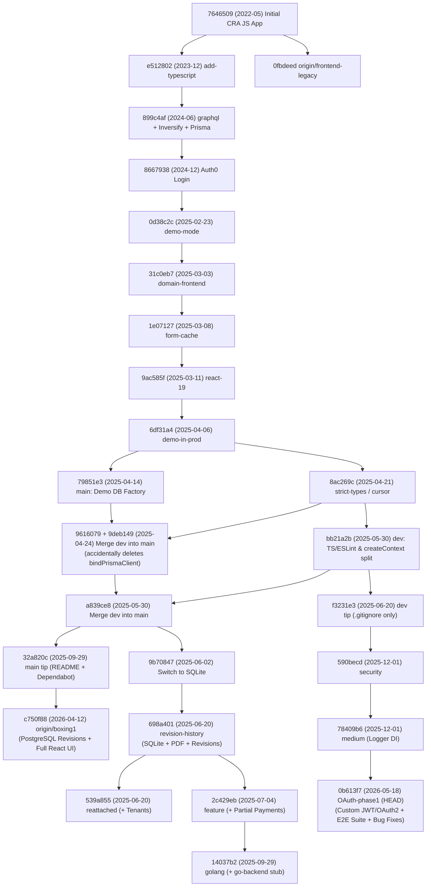
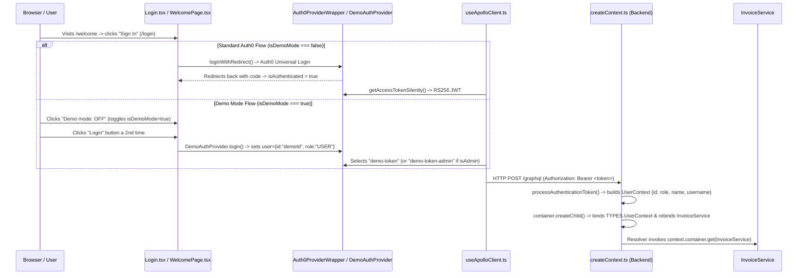

# Invoice App Repository Archaeology

> **Audit Metadata**
> - **Audit Date**: 2026-10-16
> - **Repository Root**: `/home/djblackett/dev/invoice-web-app`
> - **Recorded Starting Branch**: `OAuth-phase1` (`0b613f7`, in sync with `origin/OAuth-phase1`)
> - **Working Tree State**: 0 modified/staged tracked files; 5 untracked root files (`frontend-architecture-article.md`, `backend-architecture-anemic-model.md`, `invoice-ddd-domain-current-code.ts`, `ai-error-handling-snippets.md`, `ai-error-handling-snippets.ts`); 10 Git stash entries (`stash@{0}` through `stash@{9}`).
> - **Audit Constraint Compliance**: Strictly read-only inspection across Git object database; zero application files, configurations, branches, or working tree files were modified.

---

## 1. Executive Summary

This audit reconstructed the commit history, branch topology, runtime architecture, and feature inventory of the `invoice-web-app` repository across 20 local branches, 33 remote-tracking branches, 10 stashes, and 5 untracked workspace files.

### Evaluation of Initial Hypotheses

1. **Hypothesis 1: "`dev` may contain important newer functionality that never reached `main`."**
   - **Verdict: Refuted for `dev` itself; Confirmed for unmerged branches that forked from `dev` and `main`.**
   - `dev` (`f3231e3`, 2025-06-20) was merged into `main` (`32a820c`, 2025-09-29) on 2025-05-30 via commit `a839ce8`. Since that merge, `dev` has **only 1 unique commit** (`f3231e3 — "fix: update .gitignore to include .env* files"`), whereas `main` is **31 commits ahead of `dev`** (including direct commits from April–September 2025 such as Demo DB factory bindings `79851e3`, production Docker build fixes `ae76833`/`ed12c71`, demo avatar fix `dc2bb6b`, and Dependabot merges).
   - However, substantial newer work **does** exist outside `main` on four unmerged branch lineages:
     - **`OAuth-phase1` (`0b613f7`, May 2026 — 22 commits ahead of `dev`, branched via `security` -> `medium`)**: Implements a custom JWT + OAuth 2.0 (Google, Microsoft, Apple) + local email/password authentication system, logger dependency injection, Docker hardening, an expanded Playwright E2E/API/visual regression suite, and critical fixes for broken `deleteInvoice` / `removeInvoice` authorization and GraphQL return shapes.
     - **`origin/boxing1` (`c750f88`, April 2026 — 2 commits ahead of `main`)**: Implements full-stack **Invoice Revision History** on top of PostgreSQL and `main`, complete with a `RevisionHistoryPanel` and `RevisionDiffView` React UI, `invoiceDiff.ts`, and a root `setup.sh` script.
     - **`revision-history` (`698a401`) / `reattached` (`539a855`) / `feature` (`2c429eb`, June–July 2025)**: Branches originally created for AI coding benchmark/evaluation tasks (`da-*`, `sonnet edit`, `clean-and-zip.sh`) that converted the database to SQLite and added **PDF invoice export** (`pdfkit`), **Invoice Revisions** (`jsondiffpatch`), **Partial Payments** (`Payment` model + `applyPayment` mutation on `feature`), and **Multi-Tenancy** (`Tenant` model on `reattached`).

2. **Hypothesis 2: "`domain-frontend` may be where I began refactoring the frontend toward a more domain-driven / DDD-friendly architecture."**
   - **Verdict: Partially True in Intent, Refuted in Unmerged Status and Tactical DDD Depth.**
   - `domain-frontend` (`31c0eb7`, 2025-03-03) was **already merged** into both `dev` (`a9bdd17`, PR #63) and `main` (`3593f6d`, PR #64) on the same day it was created (`main` is 204 commits ahead; `domain-frontend` is 0 commits ahead).
   - `domain-frontend` reorganized `invoice-frontend/src/` from technical layers (`components/`, `hooks/`, `pages/`, `graphql/`) into vertical feature directories (`features/auth/`, `features/invoices/`, `features/shared/`, `features/users/`). Subsequent commits on `dev`/`main` (`783a910`, `form-cache` `66c5310`..`b0f9ff5`, March 4–10, 2025) carried that refactor further by decomposing `useNewInvoiceForm.tsx` into single-purpose hooks (`useSubmitNewInvoice`, `useSubmitDraft`, `useSubmitEditedInvoice`, `useAddInvoice`, `useUpdateInvoice`, `useFormCaching`, `useHandleFormReset`) and splitting `InvoiceFormController` / `EditFormController`.
   - Crucially, the **true tactical DDD frontend & backend architecture** (with `domain/invoiceRules.ts`, `domain/invoiceCalculations.ts`, `domain/invoiceFactory.ts`, `application/markInvoicePaid.ts`, `InvoiceRepository.ts`, and `infrastructure/graphqlInvoiceRepository.ts`) **does not exist in any Git branch or commit**. It exists **solely in the untracked root markdown articles** `frontend-architecture-article.md` and `backend-architecture-anemic-model.md`.

3. **Hypothesis 3: "Some of the account/demo functionality introduced complexity that I never completely resolved."**
   - **Verdict: 100% Confirmed — Multiple Interacting Defects Verified.**
   - Static forensic inspection uncovered seven concrete defects across the authentication, authorization, and demo subsystems:
     1. **Orphaned Per-Request Demo Database Switching (`main`)**: Commit `79851e3` (2025-04-14) attempted to switch Prisma databases per request based on whether the user was a demo user (`bindPrismaClient(childContainer, isDemoUser)`). Ten days later, merging `dev` into `main` (`9616079` + `9deb149`, 2025-04-24) deleted `bindPrismaClient` from `createContext.ts`, leaving `TYPES.PrismaClientDemo` and `TYPES.PrismaClientFactory` as dead bindings in `main:invoice-backend/src/config/inversify.config.ts`. Demo users read and mutate the primary production database unless the entire server process runs with `DEMO_MODE=true`.
     2. **Broken `deleteInvoice` Boolean Logic (`main`, `dev`)**: `InvoiceService.deleteInvoice` checks `if (invoice.createdById !== id || role !== "ADMIN") throw new ValidationException("Unauthorized")`. Because of `||` instead of `&&`, regular `USER` accounts cannot delete their own invoices and `ADMIN` accounts cannot delete other users' invoices. (Fixed on `OAuth-phase1` in `2a7d17a`).
     3. **Broken `removeInvoice` GraphQL Return Shape (`main`, `dev`)**: The GraphQL schema expects `deleteResult { acknowledged: Boolean }`, but `PrismaInvoiceRepository.delete` returns a raw `boolean`, causing a GraphQL type error on deletion. (Fixed on `OAuth-phase1` in `2a7d17a`).
     4. **Always-True Authorization Bypass in `findByUserIdAndInvoiceId` (`main`, `dev`, `OAuth-phase1`)**: `PrismaInvoiceRepository.findByUserIdAndInvoiceId` queries by `id: invoiceId` alone and then checks `if (result.createdById === userId || role !== "ADMIN") return result`. Because this method is only called when `role !== "ADMIN"`, the condition is **always `true`**, allowing any authenticated `USER` to view or edit any other user's invoice by ID.
     5. **Unchecked `markAsPaid` Ownership (`main`, `dev`, `OAuth-phase1`)**: `InvoiceService.markAsPaid` verifies `this.userContext` exists but never checks invoice ownership (`createdById`), `role`, or whether the invoice is in `pending` status.
     6. **Broken `seed.js` User Creation & Demo ID Mismatch (`main`, `dev`, `OAuth-phase1`)**: `seed.js` calls `let dbUser = getUserByIdSafely(user.id)` without `await` (and `getUserByIdSafely` references `this.prisma` where `this` is `undefined`), so `dbUser` is an unawaited Promise (always truthy) and `createUserWithAuth0` is never called. Furthermore, `seed.js` seeds all 7 sample invoices under `createdById: "user1"`, while Demo Mode logs in as `id: "demoId"` (`Role.USER`) or `id: "demoAdminId"` (`Role.ADMIN`)—meaning a Demo User sees an empty invoice list until switching to Admin.
     7. **Broken Demo Token Env Var Handshake (`security`, `medium`, `OAuth-phase1`)**: Commit `590becd` replaced hardcoded `"demo-token"` / `"demo-token-admin"` checks in `createContext.ts` with `process.env["DEMO_USER_TOKEN"]` / `process.env["DEMO_ADMIN_TOKEN"]` (without fallback defaults), while `useApolloClient.ts` on the frontend still sends literal `"demo-token"` / `"demo-token-admin"`.

---

## 2. Repository and Git Topology

### 2.1 Pre-Audit Repository State Recording

Before inspecting any code, the repository state was recorded via read-only Git commands:

1. **Current Checked-Out Branch**: `OAuth-phase1` at commit `0b613f7932b5046374b3e5a659fb55586395119b` (`2026-05-18 19:22:07 -0300`), tracking `origin/OAuth-phase1` (up to date).
2. **Working Tree Status**:
   - Tracked files modified or staged: **None**.
   - Untracked files in repository root (**5 files**):
     - `frontend-architecture-article.md` (491 lines)
     - `backend-architecture-anemic-model.md` (717 lines)
     - `invoice-ddd-domain-current-code.ts` (374 lines)
     - `ai-error-handling-snippets.md` (440 lines)
     - `ai-error-handling-snippets.ts` (428 lines)
   - Git Stashes (**10 entries**):
     - `stash@{0}`: `WIP on main: 32a820c` (`docker-compose.dev.yml` env_file addition, `inversify.config.ts` Prisma query logging, `invoiceResolvers.ts` `UNAUTHENTICATED` GraphQL error code).
     - `stash@{1}`: `WIP on strict-types: 2fb11d1` (ESLint config and `invoiceView.spec.ts` adjustments).
     - `stash@{2}`: `WIP on cursor: 102a69f` (`createContext.ts` decomposition draft).
     - `stash@{3}`: `WIP on cursor: 102a69f` (`.cursorrules` addition).
     - `stash@{4}`: `WIP on cursor: 102a69f` (`.cursorrules` + `e2e/tests/invoiceView-da-ideal.spec.ts` Page Object Model E2E test).
     - `stash@{5}`–`stash@{9}`: Minor `.env.production`, `.yarn/install-state.gz`, and `playwright-report/index.html` stashes on `demo-in-prod`, `react-19`, `form-cache`, and `dev`.

### 2.2 Complete Inventory of Local and Remote Branches

#### Local Branches (20)

| Local Branch | Tip Commit | Commit Date | Upstream Tracking | Ahead / Behind vs `main` (`32a820c`) | Ahead / Behind vs `dev` (`f3231e3`) | Summary of Branch Purpose |
|---|---|---|---|---|---|---|
| `main` | `32a820c` | 2025-09-29 | `origin/main` | `0 / 0` | `+31 / -1` | Primary mainline branch; includes `dev` up to `bb21a2b` (2025-05-30) plus direct production/Demo DB/README commits |
| `dev` | `f3231e3` | 2025-06-20 | `origin/dev` | `+1 / -31` | `0 / 0` | Former integration branch; merged into `main` at `a839ce8`, plus 1 `.gitignore` commit (`f3231e3`) |
| `domain-frontend` | `31c0eb7` | 2025-03-03 | `origin/domain-frontend` (behind 2 merge commits) | `+0 / -204` | `+0 / -174` | Feature-slice directory reorganization of `invoice-frontend/src`; fully merged into `dev` and `main` on 2025-03-03 |
| `OAuth-phase1` *(HEAD)* | `0b613f7` | 2026-05-18 | `origin/OAuth-phase1` | `+22 / -31` | `+22 / -0` | Custom JWT/OAuth2/Password auth system, logger DI, Playwright test suite overhaul, and invoice deletion fixes |
| `medium` | `78409b6` | 2025-12-01 | `origin/medium` | `+3 / -31` | `+3 / -0` | Logger dependency injection refactor (`ILogger` injected into services/repos) and Dockerfile multi-stage cleanup |
| `security` | `590becd` | 2025-12-01 | `origin/security` (behind 3) | `+1 / -31` | `+1 / -0` | Demo token env vars, dependency bumps, and `useAddInvoice.ts` modal/toast timing fix |
| `feature` | `2c429eb` | 2025-07-04 | `origin/feature` | `+24 / -1` | `+54 / -1` | SQLite conversion + PDF generation + Invoice Revisions + Partial Payments (`Payment` model) |
| `golang` | `14037b2` | 2025-09-29 | *(none)* | `+25 / -1` | `+55 / -1` | 1 commit on top of `feature` adding a 3-file Go backend stub (`go-backend/cmd/server/main.go`) |
| `revision-history` | `698a401` | 2025-06-20 | `origin/revision-history` | `+23 / -1` | `+23 / -0` | SQLite + PDF generation + Invoice Revisions (`jsondiffpatch`) + setup script & Postman collection |
| `reattached` | `539a855` | 2025-06-20 | `origin/reattached` (+1/-1) | `+20 / -1` | `+50 / -1` | AI evaluation branch adding Multi-Tenancy (`Tenant` model, `tenantResolvers`) on top of `revision-history` base |
| `cline-new` | `37ee87f` | 2025-06-02 | `origin/cline-new` | `+6 / -1` | `+36 / -1` | Early AI evaluation branch (`createContext` decomposition + `sonnet edit`) |
| `da-test-cline` | `b2ee4a7` | 2025-05-26 | *(none)* | `+1 / -5` | `+26 / -3` | Single config commit off `main` (`687ac59`) |
| `strict-types` | `8ac269c` | 2025-04-21 | `origin/strict-types` | `+0 / -38` | `+0 / -13` | Strict TypeScript & ESLint cleanup; fully merged into `dev` and `main` |
| `cursor` | `2ff375f` | 2025-04-21 | *(none)* | `+0 / -39` | `+0 / -14` | Strict TypeScript fixes & `.cursorrules`; merged into `strict-types` (`8ac269c`) |
| `demo-in-prod` | `6df31a4` | 2025-04-06 | `origin/demo-in-prod` | `+0 / -98` | `+0 / -73` | Runtime Demo Mode toggle in production; merged into `dev` and `main` |
| `react-19` | `9ac585f` | 2025-03-11 | `origin/react-19` | `+0 / -115` | `+0 / -90` | React 19, React Compiler, Vite 6, Apollo 3.13 upgrade; merged into `dev` and `main` |
| `form-cache` | `1e07127` | 2025-03-08 | `origin/form-cache` (+1) | `+0 / -153` | `+0 / -128` | Form draft `sessionStorage` caching & hook decomposition; merged into `dev` and `main` |
| `docker-config` | `7510a91` | 2025-03-02 | `origin/docker-config` | `+0 / -215` | `+0 / -185` | Docker cleanup; merged into `dev` and `main` |
| `demo-mode` | `0d38c2c` | 2025-02-23 | `origin/demo-mode` | `+0 / -261` | `+0 / -231` | Initial Demo Mode implementation; merged into `dev` and `main` |
| `bypass-tls` | `09de2fe` | 2025-02-12 | *(none)* | `+1 / -347` | `+1 / -317` | 1-commit local experiment bypassing TLS in `createContext.ts` (`NODE_TLS_REJECT_UNAUTHORIZED = "0"`) |

#### Relevant Remote-Only Branches (Excluding Dependabot PRs)

| Remote Branch | Tip Commit | Commit Date | Relationship to `main` (`32a820c`) | Summary |
|---|---|---|---|---|
| `origin/boxing1` | `c750f88` | 2026-04-12 | **+2 ahead / 0 behind `main`** | Full-stack Invoice Revision History + UI (`RevisionHistoryPanel`, `RevisionDiffView`) + `setup.sh` on PostgreSQL |
| `origin/security` | `6181530` | 2025-12-01 | +4 ahead / -31 behind `main` | Merge commit of `medium` (`78409b6`) into `security` (`590becd`) |
| `origin/reattached` | `811a228` | 2025-06-11 | +19 ahead / -1 behind `main` | Pre-tenant snapshot (`da-postedit`) of the `reattached` AI benchmark branch |
| `origin/raven-unit-test` | `f8da369` | 2025-06-08 | +11 ahead / -1 behind `main` | SQLite + Docker test runner script (`run_tests.sh`) for AI unit-test evaluation |
| `origin/domain-frontend` | `2c6308c` | 2025-03-03 | +0 ahead / -202 behind `main` | Merge of `docker-config` into `domain-frontend` (`31c0eb7`); merged into `dev` (`a9bdd17`) and `main` (`3593f6d`) |
| `origin/conflict` | `7602b10` | 2025-03-02 | +0 ahead / -219 behind `main` | Merge conflict resolution branch during `docker-config`; merged |
| `origin/login` | `8667938` | 2024-12-23 | +0 ahead / -390 behind `main` | Initial Auth0 login integration; merged into `dev` and `main` |
| `origin/backend-lint` | `add5653` | 2024-12-10 | +3 ahead / -441 behind `main` | Abandoned ESLint/Prettier config experiment |
| `origin/dto` | `4aceee1` | 2024-10-19 | +0 ahead / -511 behind `main` | Zod validation & DTO layer; merged |
| `origin/graphql` | `899c4af` | 2024-06-21 | +0 ahead / -534 behind `main` | Initial GraphQL + Repository pattern implementation; merged |
| `origin/add-backend` | `58d3d64` | 2024-04-28 | +0 ahead / -546 behind `main` | Initial Express/Prisma backend; merged |
| `origin/add-typescript` | `e512802` | 2023-12-09 | +0 ahead / -553 behind `main` | Initial TypeScript conversion of frontend; merged |
| `origin/frontend-legacy` | `0fbdeed` | 2024-12-03 | +36 ahead / -560 behind `main` | Preserved Create React App + JavaScript frontend-only version (plus Dependabot bumps) |
| `origin/gh-pages` | `9bcc60b` | 2023-02-09 | Orphan deployment branch | Static build artifact deployed to GitHub Pages in Feb 2023 |

### 2.3 Branch Topology Diagram



### 2.4 Divergence & Ancestry of `main`, `dev`, and `domain-frontend`

1. **Where they diverged**:
   - `domain-frontend` (`31c0eb7`) branched from `e92b1e5` on 2025-03-03, added 9 commits reorganizing `invoice-frontend/src/features/`, merged `docker-config` (`2c6308c`), and was immediately merged into `dev` (`a9bdd17`, PR #63) and `main` (`3593f6d`, PR #64) on 2025-03-03.
   - `git merge-base main domain-frontend` is `31c0eb7` (`domain-frontend` itself).
   - `git merge-base main dev` is `bb21a2b` (2025-05-30, `"chore: update TypeScript configuration and ESLint setup"`), which was merged into `main` via `a839ce8` on 2025-05-30.
2. **Which commits exist only on each branch**:
   - **Unique to `domain-frontend` vs `main` or `dev`**: **0 commits** (2 merge commits `1ca5c18` and `2c6308c` exist on `origin/domain-frontend`, both of which are ancestors of `dev` and `main`).
   - **Unique to `dev` vs `main`**: **1 commit** — `f3231e3` (`2025-06-20`, `"fix: update .gitignore to include .env* files"`).
   - **Unique to `main` vs `dev`**: **31 commits** (19 non-merge commits and 12 merge commits):
     - `ff2b1c1` (2025-04-06): `"Revert 'update user parsing logic in createContext...'"`
     - `3c18f75` (2025-04-13): `"switch demo mode to use different database"`
     - `3da2669` (2025-04-13): `"set demo mode to always pass true"`
     - `30801cf` (2025-04-13): `"revert demo variable on front end"`
     - `9c4b0e9` (2025-04-14): `"add explicit connect before first db operation"`
     - `79851e3` (2025-04-14): `"update backend to switch to demo database without shutting down server"`
     - `5f2e851` (2025-04-14): `"prevent tests running in watch mode during github workflows"`
     - `4a7f2ee`, `f68bcfa`, `b7385c3` (2025-04-14..24): Lockfile and workflow updates
     - `9deb149` (2025-04-24): `"fix createContext bug"` (deleted broken `bindPrismaClient` call after merging `dev`)
     - `bef6c12` (2025-04-24): `"fix strict typing issue in inversify config"`
     - `ae76833` (2025-04-25): `"update production build to use node instead of ts-node"`
     - `ed12c71` (2025-04-25): `"update prod docker build comand to also run tsc-alias"`
     - `dc2bb6b` (2025-04-26): `"fix avatar pic in demo mode"`
     - `687ac59` (2025-05-21): `"remove unnecceesary package files from root"`
     - `7d540a9`, `91669e5`, `35147db` (2025-04..09): Dependabot updates and `README.md` update (`32a820c`).
3. **Does one branch contain another plus additional work?**
   - Both `main` and `dev` completely contain `domain-frontend` (`31c0eb7`) plus 3–6 months of subsequent work.
   - `main` completely contains `dev` (except for the 1-line `.gitignore` change in `f3231e3`) plus 31 commits of production Docker fixes, Demo DB experiments, and dependency updates.
4. **Were features independently reimplemented across branches?**
   - **Yes — Invoice Revision History** was implemented **twice independently**:
     1. In June 2025 on `revision-history` (`85b2e30`, carried into `reattached` and `feature`), using **SQLite**, `jsondiffpatch`, backend-only resolvers, and no frontend UI.
     2. In April 2026 on `origin/boxing1` (`c750f88`, branched directly off `main` `32a820c`), using **PostgreSQL**, a custom `invoiceDiff.ts` utility, `PrismaInvoiceRevisionRepository`, and a full **React UI** (`RevisionHistoryPanel.tsx` and `RevisionDiffView.tsx`) integrated into `ViewInvoice.tsx`.

---

## 3. Development Timeline

| Era / Date Range | Key Branches & Commits | Architectural & Feature Milestones |
|---|---|---|
| **Era 1: Frontend-Only Prototype**<br>*(May 2022 – Feb 2023)* | `7646509`..`0fbdeed` (`origin/frontend-legacy`), `origin/gh-pages` (`9bcc60b`) | Built as a Create React App (JavaScript) frontend-only invoice tracker for the Frontend Mentor challenge. Used `styled-components`, `framer-motion`, `react-hook-form` (`72dfa0e`), and local JSON/LocalStorage state (after removing an early Firebase experiment in `98f9063`). Deployed statically to GitHub Pages. |
| **Era 2: Full-Stack TypeScript, GraphQL & DI**<br>*(Nov 2023 – Aug 2024)* | `origin/add-typescript` (`e512802`), `origin/add-backend` (`58d3d64`), `origin/graphql` (`899c4af`), `cf92d0b` | Migrated frontend to TypeScript (`e512802`) and Vite (`cf92d0b`). Created `invoice-backend` with Express, Apollo Server 4, Prisma ORM (PostgreSQL), and InversifyJS Dependency Injection (`899c4af`) using a Service + Repository pattern (`InvoiceService`, `PrismaInvoiceRepository`). |
| **Era 3: Validation, Testing, CI/CD & Auth0**<br>*(Oct – Dec 2024)* | `origin/dto` (`4aceee1`), `52acf44`, `953683e`, `216b3a7`, `origin/login` (`8667938`) | Added Zod schema validation and DTOs (`4aceee1`), Vitest unit/integration test suites (`52acf44`), Playwright E2E tests (`953683e`), Docker Compose + Traefik reverse proxy + GitHub Actions CI/CD (`216b3a7`), and Auth0 JWT authentication with `jwks-rsa` (`8667938`). |
| **Era 4: Request-Scoped DI, Demo Mode & Frontend Refactor**<br>*(Jan – Mar 2025)* | `ad50f24`, `demo-mode` (`0d38c2c`), `domain-frontend` (`31c0eb7`), `form-cache` (`1e07127`), `react-19` (`9ac585f`) | Refactored backend DI to create a per-request `childContainer` binding `UserContext` (`ad50f24`). Added Demo Mode (`demo-mode` `27b41b2`). Reorganized frontend into vertical feature folders (`domain-frontend` `31c0eb7`), decomposed `useNewInvoiceForm` into single-responsibility hooks and added `sessionStorage` draft caching (`form-cache` `66c5310`..`b0f9ff5`). Upgraded to React 19, `babel-plugin-react-compiler`, and Vite 6 (`react-19` `7b93bff`). |
| **Era 5: Production Demo Mode & Strict Types**<br>*(Apr – May 2025)* | `demo-in-prod` (`6df31a4`), `79851e3` (`main`), `strict-types` (`8ac269c`), `a839ce8` (`main`) | Enabled runtime toggling between Auth0 and Demo Mode (`demo-in-prod` `3e2029d`). Attempted per-request Demo DB switching on `main` (`79851e3`), which was broken and deleted during the `strict-types`/`dev` merge (`9616079`, `9deb149`). Decomposed `createContext.ts` (`b0c66e3`) and merged `dev` into `main` (`a839ce8`, 2025-05-30). |
| **Era 6: AI Benchmark & Feature Branches (SQLite Lineage)**<br>*(Jun – Sep 2025)* | `cline-new` (`37ee87f`), `origin/raven-unit-test` (`f8da369`), `revision-history` (`698a401`), `reattached` (`539a855`), `feature` (`2c429eb`), `golang` (`14037b2`) | Switched database to SQLite (`9b70847`) for self-contained AI model evaluation tasks (`da-broken unit tests`, `da-fixed`, `sonnet edit`, `clean-and-zip.sh`). Built PDF generation (`94d53c2`), Invoice Revisions (`85b2e30`), Multi-Tenancy (`539a855`), and Partial Payments (`2c429eb`). Added a 3-file Go backend stub on `golang` (`14037b2`). |
| **Era 7: Security, Custom OAuth2 Auth & Boxing1 Revisions**<br>*(Dec 2025 – May 2026)* | `security` (`590becd`), `medium` (`78409b6`), `OAuth-phase1` (`0b613f7`), `origin/boxing1` (`c750f88`) | On `security` -> `medium` -> `OAuth-phase1` (forked from `dev`): injected `ILogger` via DI (`78409b6`), built a custom JWT + Passport OAuth2 (Google/Microsoft/Apple) + password auth system (`bb71d11`..`0b613f7`), fixed `deleteInvoice` / `removeInvoice` (`2a7d17a`), and expanded Playwright E2E/API/visual tests. Separately on `origin/boxing1` (forked from `main`): built full-stack Invoice Revisions with React UI (`c750f88`). |

---

## 4. Branch Comparison: `main`, `dev`, and `domain-frontend`

### 4.1 High-Level Structural Comparison

| Dimension | `main` (`32a820c`) | `dev` (`f3231e3`) | `domain-frontend` (`31c0eb7`) |
|---|---|---|---|
| **Last Commit Date** | 2025-09-29 | 2025-06-20 | 2025-03-03 |
| **React / Vite Version** | React `^19.0.0` + React Compiler, Vite `^6.2.0` | React `^19.0.0` + React Compiler, Vite `^6.2.0` | React `^18.3.1`, Vite `^5.4.14` |
| **Frontend Folder Layout** | `src/features/{auth,invoices,shared,users}` | `src/features/{auth,invoices,shared,users}` | `src/features/{auth,invoices,shared,users}` (initial move) |
| **Invoice Form Hook Architecture** | Decomposed into 7 focused hooks (`useSubmitNewInvoice`, `useSubmitDraft`, `useSubmitEditedInvoice`, `useAddInvoice`, `useUpdateInvoice`, `useFormCaching`, `useHandleFormReset`) | Identical to `main` | Monolithic 319-line `useNewInvoiceForm.tsx` handling add, edit, draft, and validation together |
| **Form Draft Caching** | Present (`useFormCaching.ts` using `sessionStorage`) | Identical to `main` | Absent |
| **Form Controllers** | Split into `InvoiceFormController.tsx` (create) and `EditFormController.tsx` (edit) | Identical to `main` | Single `InvoiceFormController.tsx` for both create and edit |
| **Demo Mode Architecture** | Runtime-toggleable `DemoModeProvider` (`localStorage` + `VITE_DEMO_MODE`) wrapping `Auth0ProviderWrapper` or `DemoAuthProvider` | Identical to `main` (except missing `dc2bb6b` avatar path fix) | Build-time only (`import.meta.env.VITE_DEMO_MODE === "true"` in `main.tsx`) |
| **Backend `inversify.config.ts`** | Binds `PrismaClient`, plus dead `PrismaClientDemo` & `PrismaClientFactory` bindings (`79851e3`), plus `await prisma.$connect()` (`9c4b0e9`) | Binds single `PrismaClient` only (no `PrismaClientDemo` or `$connect()`) | Binds single `PrismaClient` only |
| **Backend `createContext.ts`** | Decomposed into helper functions (`extractTokenFromRequest`, `processAuthenticationToken`, `createChildContainerWithContext`, etc.) | Identical to `main` (`b0c66e3`) | Monolithic `createContext` function; uses `process.env.DEMO_MODE` for demo token handling |
| **Production Backend Docker Runner** | Compiles TypeScript (`tsc && tsc-alias`) and runs `node dist/src/index.js` (`ae76833`, `ed12c71`) | Runs `npx ts-node -r tsconfig-paths/register src/index.ts` in production | Runs `ts-node` in production |

### 4.2 Exact File Diff Between `main` (`32a820c`) and `dev` (`f3231e3`)

Running `git diff dev..main --stat` reveals **only 13 files differ** between `dev` and `main`:

1. `.gitignore`: `dev` has `.env*` ignore patterns from `f3231e3`; `main` does not.
2. `.github/workflows/ run-tests-on-pull.yml`: `main` (`5f2e851`) adds `--watch=false` to Vitest commands so CI does not hang.
3. `README.md`: `main` (`35147db`) updates documentation slightly.
4. `invoice-backend/Dockerfile.prod`: `main` (`ae76833`, `ed12c71`) builds with `yarn build` (`tsc && tsc-alias`) and runs `node dist/src/index.js` instead of `ts-node`.
5. `invoice-backend/package.json`: `main` adds `tsc-alias` and Dependabot bumps (`formidable`, etc.).
6. `invoice-backend/src/config/inversify.config.ts`: `main` (`79851e3`, `9c4b0e9`, `bef6c12`) adds `await prisma.$connect()`, `TYPES.PrismaClientDemo`, and `TYPES.PrismaClientFactory` (which are never resolved because `bindPrismaClient` was removed from `createContext.ts` in `9deb149`).
7. `invoice-backend/src/constants/types.ts`: `main` adds `PrismaClientDemo` and `PrismaClientFactory` symbols.
8. `invoice-frontend/package.json`: `main` bumps `react-router` / `react-router-dom` to `7.5.2`.
9. `invoice-frontend/src/features/shared/components/Header.tsx`: `main` (`dc2bb6b`) changes fallback avatar URL from `"../assets/image-avatar.jpg"` to `"/assets/image-avatar.jpg"` when `isDemoMode` is active so nested routes like `/invoices/:id` don't break the relative image path.
10. `package.json`, `yarn.lock`, `invoice-backend/yarn.lock`, `invoice-frontend/yarn.lock`: Root `package.json`/`yarn.lock` removed on `main` (`687ac59`); subproject lockfiles updated.

**All business logic, GraphQL resolvers, services, repositories, database schemas, and React components (apart from the 1-line avatar path in `Header.tsx`) are 100% identical between `main` and `dev`.**

---

## 5. Feature Matrix

Because critical features live on `OAuth-phase1`, `feature`, and `origin/boxing1` in addition to `main`, `dev`, and `domain-frontend`, the matrix below compares `main`, `dev`, and `domain-frontend` alongside the notable unmerged feature branches in the Evidence / Notes column.

| Capability | `main` (`32a820c`) | `dev` (`f3231e3`) | `domain-frontend` (`31c0eb7`) | Evidence / Notes (including Unmerged Branches) |
|---|---|---|---|---|
| **Authentication (Auth0)** | **Present** | **Present** | **Present** | `features/auth/components/Auth0ProviderWrapper.tsx`, `invoice-backend/src/utils/auth.ts` (`verifyToken` with `jwks-rsa` RS256). |
| **Authentication (Custom JWT / Email+Password / OAuth2 Google, MS, Apple)** | **Not found** | **Not found** | **Not found** | **Partial / Backend-complete on `OAuth-phase1`** (`0b613f7`): `invoice-backend/src/services/auth.service.ts`, `strategies/{google,microsoft,apple}.strategy.ts`, `routes/auth.routes.ts`, `features/auth/context/UnifiedAuthProvider.tsx`. Frontend UI built (`NewLogin.tsx`, `RegisterForm.tsx`, `OAuthButtons.tsx`) but not wired into `App.tsx` routes. |
| **Registration / Account Creation** | **Partial (Auth0 auto-provision)** | **Partial (Auth0 auto-provision)** | **Partial (Auth0 auto-provision)** | On `main`/`dev`/`domain-frontend`, first login triggers `InvoiceService.ensureUserExists()` (`invoice.service.ts`) creating a local `User` record from JWT claims. Dedicated `register` mutation & `RegisterForm.tsx` exist **only on `OAuth-phase1`**. |
| **Login / Logout** | **Present** | **Present** | **Present** | `features/auth/pages/Login.tsx`, `features/shared/components/ProfileMenu.tsx`. |
| **Authorization (RBAC)** | **Broken / Incomplete-looking** | **Broken / Incomplete-looking** | **Broken / Incomplete-looking** | `Role` enum (`ADMIN`, `USER`). `getAllInvoices` scopes `USER` to `createdById: id` (`invoice.service.ts`). However, `deleteInvoice` has inverted `||` boolean logic (`main`/`dev`/`domain-frontend`, fixed on `OAuth-phase1`), `findByUserIdAndInvoiceId` has an always-true `role !== "ADMIN"` bug on **all** branches, and `markAsPaid` has no ownership check on **all** branches. |
| **User / Account Ownership** | **Present** | **Present** | **Present** | `Invoice.createdById` FK to `User.id` (`schema.prisma`). Multi-tenant `Tenant` ownership exists **only on `reattached`** (`539a855`). |
| **Demo Mode / Demo Users** | **Present (with UX quirks)** | **Present (with UX quirks)** | **Partial (Build-time env only)** | `DemoModeContext.tsx` + `DemoAuthProvider.tsx` (`demoId` / `demoAdminId`). On `domain-frontend`, demo mode required build-time `VITE_DEMO_MODE=true`; `demo-in-prod` (`3e2029d`) added runtime toggle in `Login.tsx` and `ProfileMenu.tsx` on `dev`/`main`. |
| **Demo-Data Creation / Reset / Isolation** | **Broken / Incomplete-looking** | **Broken / Incomplete-looking** | **Broken / Incomplete-looking** | All demo visitors share `demoId`/`demoAdminId` with no per-session isolation or UI reset button. `main` has dead `PrismaClientDemo` bindings (`79851e3`/`9deb149`). `seed.js` seeds invoices for `"user1"`, so `"demoId"` (`Role.USER`) sees 0 seeded invoices. |
| **Customers / Clients** | **Partial (Embedded fields)** | **Partial (Embedded fields)** | **Partial (Embedded fields)** | No separate `Customer` entity; client data (`clientName`, `clientEmail`, `clientAddress`) is embedded directly on each `Invoice` (`schema.prisma`). |
| **Invoices (CRUD)** | **Partial (`removeInvoice` broken)** | **Partial (`removeInvoice` broken)** | **Partial (`removeInvoice` broken)** | Create, Read, Update work via GraphQL (`addInvoice`, `allInvoices`, `getInvoiceById`, ` editInvoice`). Delete (`removeInvoice`) fails on `main`/`dev`/`domain-frontend` due to `deleteInvoice` `||` bug and `boolean` vs `{ acknowledged: Boolean }` return mismatch; **fixed on `OAuth-phase1` (`2a7d17a`)**. |
| **Invoice Line Items** | **Present** | **Present** | **Present** | `Item` model (`id`, `name`, `quantity`, `price`, `total`, `invoiceId`) with `onDelete: Cascade` (`schema.prisma`), dynamic form array via `useFieldArray` (`InvoiceItemList.tsx`). |
| **Invoice Calculations** | **Present** | **Present** | **Present** | Line item `total = quantity * price`; invoice `total = sum(items)` computed in `InvoiceItem.tsx` (frontend) and `mapPartialInvoiceToInvoice` (`invoice.service.ts`, backend) + `PrismaInvoiceRepository.update` (recomputed on `OAuth-phase1`). |
| **Invoice Status / Workflow** | **Present** | **Present** | **Present** | 3 statuses (`draft`, `pending`, `paid`), plus `partially_paid` **only on `feature` (`2c429eb`)**. `markAsPaid` transitions `pending` -> `paid` (`ViewInvoice.tsx`, `invoice.service.ts`). |
| **Taxes** | **Not found** | **Not found** | **Not found** | Absent across all branches. |
| **Discounts** | **Not found** | **Not found** | **Not found** | Absent across all branches. |
| **Payment / Status Tracking** | **Partial (Binary `markAsPaid`)** | **Partial (Binary `markAsPaid`)** | **Partial (Binary `markAsPaid`)** | `main`/`dev`/`domain-frontend` only support binary `markAsPaid`. **Full partial payment tracking** (`Payment` table, `paidAmount`, `partially_paid` status, `applyPayment` mutation) exists **only on `feature` (`2c429eb`)** (backend-only). |
| **Invoice Revision History / Audit Log** | **Not found** | **Not found** | **Not found** | Implemented twice on unmerged branches: 1) **`origin/boxing1` (`c750f88`)** — full-stack PostgreSQL `InvoiceRevision` + React diff UI (`RevisionHistoryPanel.tsx`, `RevisionDiffView.tsx`); 2) **`revision-history`/`reattached`/`feature`** — backend-only SQLite `InvoiceRevision` with `jsondiffpatch`. |
| **PDF / Export / Printing** | **Not found** | **Not found** | **Not found** | Present **only on `revision-history`, `reattached`, and `feature`** (`94d53c2`): `getInvoicePdf` GraphQL query using `pdfkit` (`invoice.service.ts`). No frontend button wired. |
| **Dashboards** | **Not found** | **Not found** | **Not found** | App has an invoice list page (`AllInvoices.tsx`) and detail page (`ViewInvoice.tsx`), no analytics/chart dashboard. |
| **Searching / Filtering / Sorting** | **Partial (Status filter only)** | **Partial (Status filter only)** | **Partial (Status filter only)** | Status filter checkboxes (`draft`, `pending`, `paid`) in `Filter.tsx` / `AllInvoices.tsx`. No text search or column sorting. |
| **Forms and Validation** | **Present (Refactored)** | **Present (Refactored)** | **Present (Monolithic hook)** | `react-hook-form` on frontend + Zod schemas on backend (`validators/validator.ts`: `InvoiceValidationSchema` for pending, `DraftInvoiceValidationSchema` for drafts). `main`/`dev` add `sessionStorage` draft caching (`useFormCaching.ts`). |
| **Persistence & ORM** | **Present (PostgreSQL + Prisma)** | **Present (PostgreSQL + Prisma)** | **Present (PostgreSQL + Prisma)** | PostgreSQL + Prisma 6.5 (`main`/`dev`/`OAuth-phase1`/`boxing1`). Switched to SQLite on `revision-history`/`reattached`/`feature`. |
| **API / Server Functionality** | **Present (GraphQL + WS)** | **Present (GraphQL + WS)** | **Present (GraphQL + WS)** | Express + Apollo Server 4 (`/graphql`) + `graphql-ws` WebSocket subscriptions (`invoiceAdded`). `OAuth-phase1` adds REST/Passport routes under `/auth/*`. |
| **Error Handling** | **Present** | **Present** | **Present** | Custom exception hierarchy (`CustomError.ts`), `errorPlugin.ts` Apollo plugin, `ErrorBoundary` (`react-error-boundary`), and `react-toastify` toasts. |
| **Loading / Empty / Error States** | **Present** | **Present** | **Present** | `GridLoader` (`react-spinners`), `NoInvoices.tsx` empty state illustration, and error fallback UI in `AllInvoices.tsx` and `ViewInvoice.tsx`. |
| **Responsive UI & Dark/Light Theme** | **Present** | **Present** | **Present** | Responsive sidebar/topbar (`Header.tsx`), mobile/desktop invoice cards (`Invoice.tsx`), and dark/light theme toggle (`ThemeProvider.tsx` + `styled-components`). |
| **Accessibility (a11y)** | **Present** | **Present** | **Present** | `aria-label`, `role="checkbox"`, keyboard `onKeyDown` handlers (`Enter`/`Space`) in `Filter.tsx`, `NewInvoiceButton.tsx`, `PaymentTerms.tsx`, plus `eslint-plugin-jsx-a11y`. |
| **Database Schema / Migrations** | **Present** | **Present** | **Present** | 6 Prisma migrations on `main`/`dev`/`domain-frontend`. `OAuth-phase1` adds `20251202011805_oauth_1`. `boxing1` adds `20260412000000_add_invoice_revisions`. |
| **Deployment / Configuration** | **Present (Improved on `main`)** | **Present** | **Present** | Docker Compose (`docker-compose.yml`, `docker-compose.dev.yml`) with Traefik TLS proxy and Watchtower. `main` fixes `Dockerfile.prod` (`ae76833`, `ed12c71`) to run compiled JS via `node`. |
| **Automated Testing** | **Present** | **Present** | **Present** | Vitest (frontend + backend unit/integration) and Playwright E2E (`e2e/tests/`). `OAuth-phase1` significantly expands unit, API, E2E, and visual regression tests. |

---

## 6. Architecture: `main`

### 6.1 Frontend Architecture (`main:invoice-frontend/src/`)

- **Entry & Provider Tree (`main:invoice-frontend/src/main.tsx`, `App.tsx`)**:
  - `main.tsx` mounts `<ErrorBoundary>` -> `<DemoModeProvider>` -> `<AuthConsumer>` (which conditionally renders `<DemoAuthProvider>` when `isDemoMode` is true, or `<Auth0ProviderWrapper>` otherwise) -> `<App />`.
  - `App.tsx` wraps `<ThemeProvider>` -> `<ApolloWrapper>` (`useApolloClient.ts`) -> `<Provider store={store}>` (Redux Toolkit) -> `<Router>` with 4 routes:
    - `/welcome` -> `WelcomePage` (`features/auth/pages/WelcomePage.tsx`)
    - `/login` -> `MemoizedLogin` (`features/auth/pages/Login.tsx`)
    - `/invoices` -> `<ProtectedRoute><AllInvoices /></ProtectedRoute>` (`features/invoices/pages/AllInvoices.tsx`)
    - `/invoices/:invoiceId` -> `<ProtectedRoute><ViewInvoice /></ProtectedRoute>` (`features/invoices/pages/ViewInvoice.tsx`)
- **Feature-Sliced Directory Organization**:
  - `features/auth/`: `components/` (`Auth0ProviderWrapper`, `DemoAuthProvider`, `ProtectedRoute`, `SlidingPanel`), `context/` (`AuthContext`, `DemoModeContext`), `hooks/` (`useAuth`), `pages/` (`Login`, `WelcomePage`).
  - `features/invoices/`:
    - `components/`: `InvoiceFormController.tsx` (create slide-out), `EditFormController.tsx` (edit slide-out), `InvoiceForm.tsx`, `InvoiceItemList.tsx`, `InvoiceItem.tsx`, `DateComponent.tsx`, `PaymentTerms.tsx`, `Filter.tsx`, `Invoice.tsx`, `InvoiceList.tsx`, `InvoiceInfo.tsx`, `ViewInvoiceTopBar.tsx`, `StatusBox.tsx`, `DeleteModal.tsx`, `NoInvoices.tsx`, etc.
    - `graphql/`: `invoice.queries.ts` (`ALL_INVOICES`, `GET_INVOICE_BY_ID`), `invoice.mutations.ts` (`ADD_INVOICE`, `EDIT_INVOICE`, `MARK_AS_PAID`, `REMOVE_INVOICE`), `invoice.subscriptions.ts`.
    - `hooks/`: Decomposed single-purpose hooks:
      - `useSubmitNewInvoice.ts` + `useAddInvoice.ts` (validates, transforms dates/numbers, executes `ADD_INVOICE` with optimistic response and cache update).
      - `useSubmitDraft.ts` (builds lenient draft payload, generates random client-side `id` via `generateRandomId()`, executes `ADD_INVOICE`).
      - `useSubmitEditedInvoice.ts` + `useUpdateInvoice.ts` (executes `EDIT_INVOICE`).
      - `useFormCaching.ts` (persists in-progress new invoice form state to `sessionStorage` under `" cachedInvoiceForm"` and `"items"`).
      - `useHandleFormReset.ts` (resets `react-hook-form` and clears `sessionStorage`).
    - `pages/`: `AllInvoices.tsx`, `ViewInvoice.tsx`.
    - `store/`: `invoiceSlice.ts` (Redux slice holding UI toggles only: `isNewInvoiceOpen`, `isEditOpen`, `isDeleteModalOpen`, `filter`).
    - `types/`: `invoice.types.ts`, `invoiceForm.types.ts`.
    - `utils/`: `formUtils.ts` (`convertNewInvoiceServerFormat`, `getDefaultValues`, `checkItemsErrors`, `generateRandomId`, etc.).
  - `features/shared/`: `apollo/` (`useApolloClient.ts`), `components/` (`Header`, `Layout`, `ProfileMenu`, etc.), `context/` (`ThemeProvider`), `store/` (`store.ts`).
  - `features/users/`: `graphql/user.queries.ts`, `types/user.types.ts`.

### 6.2 Backend Architecture (`main:invoice-backend/src/`)

- **Entry & Server Bootstrap (`main:invoice-backend/src/index.ts`, `server.config.ts`)**:
  - Express + HTTP/HTTPS server hosting Apollo Server 4 at `/graphql` and `graphql-ws` (`WebSocketServer`) for GraphQL subscriptions.
  - Global middleware: `cors`, `express.json`, `helmet`.
- **Dependency Injection Container (`main:invoice-backend/src/config/inversify.config.ts`)**:
  - Uses InversifyJS (`Container`).
  - Singleton/default bindings: `PrismaClient` (`TYPES.PrismaClient`), `PrismaClientDemo` (`TYPES.PrismaClientDemo` — **dead binding**), `PrismaClientFactory` (`TYPES.PrismaClientFactory` — **dead binding**), `DatabaseConnection` (`TYPES.DatabaseConnection`), `PrismaInvoiceRepository` (`TYPES.IInvoiceRepo`), `PrismaUserRepository` (`TYPES.IUserRepo`).
  - Request-scoped (`inTransientScope()`) bindings: `InvoiceService`, `UserService`, `PubSub` (singleton).
- **Per-Request Context (`main:invoice-backend/src/utils/createContext.ts`)**:
  - `createContext({ req })` extracts the Bearer token (`extractTokenFromRequest`), handles demo tokens (`"demo-token"` / `"demo-token-admin"`) or verifies Auth0 JWTs via `verifyToken` (`jwks-rsa` in `src/utils/auth.ts`), creates a `childContainer = container.createChild()`, binds `TYPES.UserContext`, and rebinds `InvoiceService` and `UserService` on `childContainer` so they receive the request's `UserContext`.
- **Layered Backend Structure**:
  - **GraphQL Layer (`src/graphql/`)**: `schema.ts`, `typeDefs.ts`, `resolvers/invoiceResolvers.ts`, `resolvers/userResolvers.ts`, `resolvers/scalarResolvers.ts`, `plugins/errorPlugin.ts`, `plugins/loggingPlugin.ts`.
  - **Service Layer (`src/services/`)**:
    - `invoice.service.ts` (`InvoiceService`): Contains validation orchestration (`validateInvoice`, `validateDraftInvoice`, `validateInvoiceUpdate` via Zod in `src/validators/validator.ts`), data mapping (`mapPartialInvoiceToInvoice`, `generateUniqueId`), user auto-provisioning (`ensureUserExists`), and authorization checks (`getAllInvoices`, `getInvoiceById`, `updateInvoice`, `deleteInvoice`, `markAsPaid`).
    - `user.service.ts` (`UserService`): `createUser`, `getUserById`, `getUserByIdSafely`, `updateUser`, `deleteUser`.
  - **Repository Layer (`src/repositories/`)**:
    - `invoiceRepo.ts` (`IInvoiceRepository` interface) & `prismaInvoiceRepository.ts` (`PrismaInvoiceRepository`).
    - `userRepo.ts` (`IUserRepository` interface) & `prismaUserRepository.ts` (`PrismaUserRepository`).
  - **Database Layer (`prisma/schema.prisma`)**:
    - PostgreSQL models: `User` (`id`, `username`, `name`, `role`, `invoices`), `Invoice` (`id`, `createdAt`, `paymentDue`, `description`, `paymentTerms`, `clientName`, `clientEmail`, `status`, `total`, `createdById`, `senderAddress`, `clientAddress`, `items`), `Address`, `Item`.

---

## 7. Architecture: `dev`

`dev` (`f3231e3`, 2025-06-20) has the **exact same runtime architecture** as `main` (`32a820c`), with only four minor differences where `main` received direct commits not back-merged into `dev`:

1. **No Dead Demo DB Factory Bindings in `inversify.config.ts`**:
   - In `dev:invoice-backend/src/config/inversify.config.ts`, only `TYPES.PrismaClient` is bound (without `await prisma.$connect()` and without the orphaned `TYPES.PrismaClientDemo` and `TYPES.PrismaClientFactory` bindings that exist on `main`).
2. **Production Docker Container Runs `ts-node` Instead of `node`**:
   - `dev:invoice-backend/Dockerfile.prod` runs `CMD ["sh", "-c", "npx prisma migrate deploy && npx ts-node -r tsconfig-paths/register src/index.ts"]`, whereas `main` compiles TypeScript with `tsc && tsc-alias` and runs `node dist/src/index.js`.
3. **Relative Avatar Path Bug on Nested Routes in Demo Mode**:
   - `dev:invoice-frontend/src/features/shared/components/Header.tsx` uses `"../assets/image-avatar.jpg"` when `isDemoMode` is true, which fails to load on `/invoices/:invoiceId` (fixed on `main` in `dc2bb6b`).
4. **`.gitignore` Includes `.env*`**:
   - `dev:.gitignore` (`f3231e3`) adds `.env*` patterns (while preserving `!.env.example`), which is the single commit on `dev` not merged to `main`.

---

## 8. Architecture: `domain-frontend`

`domain-frontend` (`31c0eb7`, 2025-03-03) represents an **intermediate snapshot** taken on the day the frontend directory structure was first reorganized into `src/features/`, prior to the subsequent March–May 2025 refactors on `dev` and `main`.

### Key Architectural Differences in `domain-frontend` vs `main`/`dev`

1. **Monolithic Form Hook (`domain-frontend:invoice-frontend/src/features/invoices/hooks/useNewInvoiceForm.tsx`)**:
   - Contains a single 319-line hook `useNewInvoiceForm` that simultaneously manages:
     - Apollo mutations `ADD_INVOICE` and `EDIT_INVOICE`
     - `onSubmitNewInvoice` (create pending)
     - `onSubmitEdit` (edit existing)
     - `saveAsDraft` (create draft)
     - `checkItemsErrors` and date/address formatting
   - In contrast, `main` and `dev` deleted `useNewInvoiceForm.tsx` (in `form-cache` commit `b0f9ff5`, 2025-03-08) and split it into 7 single-purpose hooks (`useSubmitNewInvoice`, `useSubmitDraft`, `useSubmitEditedInvoice`, `useAddInvoice`, `useUpdateInvoice`, `useFormCaching`, `useHandleFormReset`).
2. **Single Form Controller (`domain-frontend:invoice-frontend/src/features/invoices/components/InvoiceFormController.tsx`)**:
   - Uses one controller component for both creating and editing invoices, whereas `main`/`dev` split creation (`InvoiceFormController.tsx`) and editing (`EditFormController.tsx`) so edit forms only mount when an invoice exists (`3b87e5d`).
3. **Shared Types Still Outside Feature Boundaries**:
   - On `domain-frontend`, `features/shared/types/sharedTypes.ts` still holds invoice-specific types (`ItemType`, `EditInvoiceInitProps`, `FormInvoiceType`). These were moved into `features/invoices/types/` the next day on `dev` (`783a910`, 2025-03-04).
4. **Static Build-Time Demo Mode (`domain-frontend:invoice-frontend/src/main.tsx`)**:
   - Checks `const isDemoMode = import.meta.env.VITE_DEMO_MODE === "true"` once at module load time. There is no `DemoModeContext` or runtime toggle button on `Login.tsx` or `ProfileMenu.tsx`.
5. **Pre-React 19 Frontend Stack**:
   - Uses React 18.3.1 and Vite 5.4.14 without `babel-plugin-react-compiler`.

---

## 9. Domain-Frontend Refactor Assessment

### 9.1 What `domain-frontend` Actually Did (Commits `282b764`..`31c0eb7`, 2025-03-03)

Inspecting all 9 commits on `domain-frontend` (`git log --stat e92b1e5..31c0eb7`) shows what changed:
- `282b764`: Moved `src/components/`, `src/pages/`, `src/hooks/`, `src/graphql/`, `src/store/` into `src/features/{auth,invoices,shared,users}/`.
- `fa6570c` & `e0ba6c4`: Updated import paths and split `DateAndPayment.tsx` into `DateComponent.tsx` and `PaymentTerms.tsx`.
- `c0eb864` & `998a3ee`: Cleaned up `InvoiceForm.tsx` and `InvoiceFormController.tsx` props and fixed unit tests.
- `31c0eb7`: Added `clearDatabase()` to `beforeEach()` in Playwright E2E tests.

### 9.2 The Missing Link: `frontend-architecture-article.md` & `backend-architecture-anemic-model.md`

A critical discovery of this audit is the relationship between `domain-frontend` and the **untracked root files** `frontend-architecture-article.md` and `backend-architecture-anemic-model.md`:

- In `frontend-architecture-article.md` (lines 7–9), the author explicitly wrote:
  > *"Note: this describes a refactor I'm in the middle of, not a finished result. The code examples below are real files from the repo, though most of them aren't merged yet, and some don't exist outside this article."*
- The article describes a full Clean Architecture / tactical DDD frontend structure under `features/invoices/`:
  - `domain/invoice.types.ts`
  - `domain/invoiceRules.ts` (`canMarkInvoicePaid`, `canEditInvoice`, `canSubmitInvoice`)
  - `domain/invoiceCalculations.ts` (`calculateLineItemTotal`, `calculateInvoiceTotal`, `calculatePaymentDueDate`)
  - `domain/invoiceFactory.ts` (`createPendingInvoice`, `createDraftInvoice`)
  - `application/markInvoicePaid.ts`, `application/createInvoice.ts`, `application/saveDraftInvoice.ts`, `application/InvoiceRepository.ts`
  - `infrastructure/graphqlInvoiceRepository.ts`, `infrastructure/invoiceMapper.ts`
- **Forensic Git Verification**: Running `git log --all -S "canMarkInvoicePaid"`, `git log --all -S "invoiceRules"`, and `git log --all -S "graphqlInvoiceRepository"` across **every commit, branch, and stash in the entire repository** returned **0 matches**.
- Similarly, `backend-architecture-anemic-model.md` and `invoice-ddd-domain-current-code.ts` critique `InvoiceService` (`mapPartialInvoiceToInvoice`) and `PrismaInvoiceRepository` (`update` recalculating totals in the persistence layer) and propose a rich domain `Invoice` entity with `InvoiceStatus`, `Money`, and `LineItem` value objects—none of which have been implemented in code yet.

### 9.3 Answering the 8 Evaluation Questions for `domain-frontend`

1. **What architectural problem was the refactor trying to solve?**
   - Initially (on `domain-frontend` and `form-cache`), it solved horizontal layer scattering (where editing an invoice feature required jumping across top-level `components/`, `hooks/`, `pages/`, `graphql/`, and `store/` directories) and broke up the 319-line `useNewInvoiceForm.tsx` God-hook.
   - Conceptually (as documented later in `frontend-architecture-article.md`), the author wanted to go further and decouple pure domain rules and calculations from React hooks and Apollo Client (`useMutation`).
2. **What actually changed compared with `main` and/or `dev`?**
   - `domain-frontend` is an **older ancestor** of `dev` and `main`. Everything in `domain-frontend` is already in `dev` and `main`, and `dev`/`main` have **more mature** hook and type separation than `domain-frontend` (`783a910`, `b0f9ff5`).
3. **Did business logic genuinely move toward the domain or was it mostly reorganized into folders?**
   - On `domain-frontend`, it was **vertical feature-slice folder reorganization** plus splitting `DateAndPayment.tsx`. On `dev`/`main` (`form-cache`), orchestration logic was extracted from `useNewInvoiceForm.tsx` into focused custom hooks (`useSubmitNewInvoice`, `useSubmitDraft`, `useSubmitEditedInvoice`) and `utils/formUtils.ts`, but business rules remain coupled to React hooks and GraphQL DTOs.
4. **Did dependency direction improve?**
   - Feature encapsulation improved (`features/invoices` encapsulates its own components, hooks, GraphQL documents, Redux slice, and types), but UI/hook layers still depend directly on Apollo GraphQL schemas (`useMutation(ADD_INVOICE)`).
5. **Do old and new architectures coexist?**
   - No old top-level `src/components/` or `src/hooks/` folders remain on `domain-frontend`, `dev`, or `main`—the move to `src/features/*` was completed cleanly.
6. **Is the refactor complete, partially complete, experimental, or abandoned?**
   - The **Stage 1 feature-slice folder migration and hook decomposition** is **complete and merged into `main`**.
   - The **Stage 2 Clean Architecture / DDD layer extraction** (`domain/`, `application/`, `infrastructure/`) described in `frontend-architecture-article.md` is **unstarted in code** (design-only in the untracked markdown articles).
7. **Is there useful architectural work on `domain-frontend` worth preserving?**
   - Everything on `domain-frontend` is **already preserved in `main` and `dev`**. Checking out or rebasing onto `domain-frontend` would revert 204 commits of subsequent improvements.
8. **Does later feature work elsewhere conflict with the refactor?**
   - No, because all later branches (`main`, `dev`, `OAuth-phase1`, `origin/boxing1`, `feature`) were branched *after* `domain-frontend` was merged on 2025-03-03 and already use the `src/features/*` layout.

---

## 10. Authentication, Accounts, and Demo Architecture

The account, authentication, authorization, and demo subsystem is the most complex and bug-prone area of the repository. It evolved through three distinct generations across branches.

### 10.1 Normal Accounts vs. Demo Users (`main` & `dev`)

| Attribute | Normal Account (Auth0 Mode) | Demo User (`Role.USER`) | Demo Admin (`Role.ADMIN`) |
|---|---|---|---|
| **Frontend Auth Provider** | `Auth0ProviderWrapper` (`@auth0/auth0-react`) bridging into `AuthContext` | `DemoAuthProvider` (`features/auth/components/DemoAuthProvider.tsx`) | `DemoAuthProvider` (`isAdmin = true`) |
| **Frontend User Object** | Auth0 `user` profile (`sub`, `name`, `email`, `picture`) | `{ id: "demoId", name: "Demo User", email: "demo@example.com", role: "USER" }` | `{ id: "demoAdminId", name: "Demo Admin", email: "admin@example.com", role: "ADMIN" }` |
| **Bearer Token Sent by `useApolloClient.ts`** | Real RS256 JWT from `getAccessTokenSilently()` | Hardcoded string `"demo-token"` | Hardcoded string `"demo-token-admin"` |
| **Backend Token Parsing (`createContext.ts`)** | `verifyToken(token)` (`src/utils/auth.ts`) validates RS256 signature against Auth0 JWKS (`https://${AUTH0_DOMAIN}/.well-known/jwks.json`), extracts `sub`, `email`/`https://invoices.com/email`, and `https://invoices.com/role` (defaults to `Role.USER`) | Matches `token === "demo-token"` -> creates `UserContext`: `{ id: "demoId", role: Role.USER, name: "Demo User", username: "demo@example.com" }` | Matches `token === "demo-token-admin"` -> creates `UserContext`: `{ id: "demoAdminId", role: Role.ADMIN, name: "Demo Admin", username: "demoAdmin@example.com" }` |
| **Database `User` Provisioning** | Auto-provisioned on first `addInvoice` call via `InvoiceService.ensureUserExists()` (`invoice.service.ts`) | Auto-provisioned on first `addInvoice` call (`id: "demoId"`) | Auto-provisioned on first `addInvoice` call (`id: "demoAdminId"`) |

### 10.2 How Records Are Scoped to Users (`main`, `dev`, `OAuth-phase1`)

- Every `Invoice` row has a required foreign key `createdById` referencing `User.id` (`prisma/schema.prisma`).
- `Address` (`senderAddress`, `clientAddress`) and `Item` (`items`) records belong exclusively to a single `Invoice` and do not have their own `userId` column.
- There is no separate `Customer` table; client details (`clientName`, `clientEmail`, `clientAddress`) are stored inline per invoice.
- **Intended Authorization Policy**:
  - `Role.ADMIN`: Can view, edit, mark as paid, and delete **all** invoices across all users.
  - `Role.USER`: Should only view, edit, mark as paid, and delete invoices where `invoice.createdById === userContext.id`.
- **Actual Authorization Enforcement (Violated Invariants)**:
  - `getAllInvoices` (`invoice.service.ts`): Correctly calls `invoiceRepo.findAll()` for `ADMIN` and `invoiceRepo.findByUserId(id)` for `USER`.
  - `getInvoiceById` & `updateInvoice` (`invoice.service.ts` -> `prismaInvoiceRepository.ts`): Calls `findByUserIdAndInvoiceId(id, invoiceId, role)` when `role === "USER"`. However, `findByUserIdAndInvoiceId` in `prismaInvoiceRepository.ts` contains a fatal logic flaw:
    ```ts
    const result = await this.prisma.invoice.findUniqueOrThrow({
      where: { id: invoiceId },
      include: { clientAddress: true, items: true, senderAddress: true },
    });
    if (result.createdById === userId || role !== "ADMIN") {
      return result;
    }
    ```
    Because `findByUserIdAndInvoiceId` is **only invoked when `role !== "ADMIN"`**, the right-hand side `role !== "ADMIN"` is **always `true`**. Consequently, any `Role.USER` (including `"demoId"`) can query or edit any other user's invoice by ID!
  - `markAsPaid` (`invoice.service.ts`): Checks `if (!this.userContext)` and then calls `this.invoiceRepo.markAsPaid(id)` directly without checking `createdById` or `role`.
  - `deleteInvoice` (`main`/`dev:invoice-backend/src/services/invoice.service.ts`):
    ```ts
    if (invoice.createdById !== id || role !== "ADMIN") {
      throw new ValidationException("Unauthorized");
    }
    ```
    Because of `||` instead of `&&`, deletion is rejected unless the caller is **both** the creator (`invoice.createdById === id`) **and** an `ADMIN` (`role === "ADMIN"`). Regular users cannot delete their own invoices, and admins cannot delete other users' invoices. (**Fixed on `OAuth-phase1`** in commit `2a7d17a`, which changed `||` to `&&`).

### 10.3 Demo Data Generation, Persistence, Sharing, and Contamination

1. **Do demo users share data?**
   - **Yes.** Every visitor who enables Demo Mode on the frontend authenticates as either `"demoId"` (`Role.USER`) or `"demoAdminId"` (`Role.ADMIN`). All concurrent demo visitors read and mutate the exact same rows.
2. **Does demo data persist, and is there a reset mechanism?**
   - **Yes, demo data persists indefinitely in PostgreSQL.** There is no session expiry, no ephemeral sandbox per visitor, and no "Reset Demo Data" button or cron job.
3. **Can demo data contaminate real-user data?**
   - **Yes, directly on `main`, `dev`, and `OAuth-phase1`:**
     - On `main`, commit `79851e3` (2025-04-14) attempted to isolate demo requests into a separate database (`DATABASE_URL_DEMO`) by binding `TYPES.PrismaClientDemo` and `TYPES.PrismaClientFactory` in `inversify.config.ts` and calling `bindPrismaClient(childContainer, isDemoUser)` in `createContext.ts`.
     - Even in `79851e3`, `bindPrismaClient` did not work because `DatabaseConnection`, `PrismaInvoiceRepository`, and `PrismaUserRepository` were bound in the parent container and not rebound in `childContainer`.
     - Ten days later (2025-04-24), merge commit `9616079` and fixup `9deb149` (`"fix createContext bug"`) **deleted `bindPrismaClient` from `createContext.ts`**.
     - As a result, unless the entire backend server is started with `DEMO_MODE=true` (which causes `server.config.ts` to overwrite `process.env.DATABASE_URL = process.env.DEMO_DATABASE_URL` globally for **all** users), demo requests hit the exact same database as real authenticated users.
     - Worse, when a visitor switches to **Demo Admin** (`"demo-token-admin"`, which is a 1-click toggle inside `ProfileMenu.tsx`), they are granted `Role.ADMIN` against that shared database and can view, edit, and mark as paid **every real user's invoices**!
4. **Why Demo User (`demoId`) Sees Zero Seeded Invoices (`seed.js` Mismatch)**:
   - `invoice-backend/prisma/seed.js` seeds 7 sample invoices, all hardcoded with `createdById: "user1"`.
   - When a visitor logs in with Demo Mode in the default `Demo User` role (`id: "demoId"`, `role: "USER"`), `getAllInvoices` queries `where: { createdById: "demoId" }`, returning **0 invoices** (`NoInvoices` empty screen). Only if the visitor discovers the `Admin Mode` toggle in the profile menu (`id: "demoAdminId"`, `role: "ADMIN"`) do the 7 `"user1"` invoices appear.
   - Additionally, `seed.js` has two bugs in user seeding:
     - `getUserByIdSafely(id)` calls `this.prisma.user.findUnique(...)` where `this` is `undefined` inside a standalone function (catching the `TypeError` and returning `null`, or returning a rejected/resolved Promise).
     - `main()` calls `let dbUser = getUserByIdSafely(user.id);` **without `await`**, so `dbUser` is a Promise object (always truthy in `if (!dbUser)`), meaning `createUserWithAuth0(user)` is **never executed**! Instead, `"user1"` is created implicitly via Prisma's nested `connectOrCreate` when the first invoice is seeded.
5. **Broken `init.dev.sql`**:
   - `invoice-backend/init.dev.sql` runs `INSERT INTO "User" (id, name, email, role) VALUES ...` when the Postgres container first initializes, before Prisma migrations have created the `"User"` table, and references an `email` column that does not exist in `schema.prisma` (which uses `username`).

### 10.4 The `OAuth-phase1` Authentication Overhaul (Dec 2025 – May 2026)

On `OAuth-phase1` (`0b613f7`), authentication was expanded with a custom backend and frontend auth architecture alongside Auth0:
- **Backend (`OAuth-phase1:invoice-backend/src/`)**:
  - `prisma/schema.prisma`: Adds `password String?`, `provider String @default("local")`, `providerId String?`, `emailVerified Boolean @default(false)`, `createdAt`, `updatedAt` to `User`.
  - `services/auth.service.ts` (`AuthService`): Implements `register`, `login` (using `bcryptjs`), `loginWithOAuth`, `refreshToken`, `verifyAccessToken`, and `generateTokens` (HS256 JWT access & refresh tokens).
  - `strategies/`: Passport strategies for Google (`google.strategy.ts`), Microsoft (`microsoft.strategy.ts`), and Apple (`apple.strategy.ts`), mounted on Express at `/auth/*` (`routes/auth.routes.ts`).
  - `graphql/resolvers/authResolvers.ts`: Adds GraphQL mutations `login`, `register`, `refreshToken`, `logout` and query `me`.
  - `utils/createContext.ts`: Checks `process.env.AUTH_SYSTEM === "oauth"` to verify tokens via `AuthService.verifyAccessToken` before falling back to Auth0 `verifyToken`.
- **Critical Integration Gaps on `OAuth-phase1`**:
  1. **Demo Mode Token Env Var Regression (`security` `590becd` -> `OAuth-phase1`)**: `createContext.ts` checks `token === process.env["DEMO_USER_TOKEN"]` and `token === process.env["DEMO_ADMIN_TOKEN"]` with no default fallback, while `useApolloClient.ts` still sends `"demo-token"` and `"demo-token-admin"`. If `DEMO_USER_TOKEN` is unset in `.env`, `"demo-token"` is treated as a JWT and rejected as invalid!
  2. **New Auth UI Not Mounted in `App.tsx`**: `OAuth-phase1` created `NewLogin.tsx`, `LoginForm.tsx`, `RegisterForm.tsx`, `OAuthButtons.tsx`, and `OAuthCallback.tsx`, plus `UnifiedAuthProvider.tsx`. However:
     - `UnifiedAuthProvider.tsx` defaults `VITE_AUTH_SYSTEM` to `"auth0"`.
     - `App.tsx` still mounts the legacy `MemoizedLogin` (`features/auth/pages/Login.tsx`) at `/login` and has **no `/oauth/callback` route**.
     - `useApolloClient.ts`, `AllInvoices.tsx`, and `Header.tsx` still call `useAuth()` (which reads `AuthContext`), whereas `NewAuthProvider` provides `NewAuthContext`—meaning if `VITE_AUTH_SYSTEM="new"` is enabled, `useAuth()` throws `"useAuth must be used within an AuthProvider"`!

---

## 11. Representative Data Flows

### 11.1 Authentication & Account Flow (`main` / `dev`)



### 11.2 Invoice Creation & Lifecycle Flow (`main` / `dev`)

1. **UI Input & Draft Caching (`InvoiceFormController.tsx` -> `InvoiceForm.tsx`)**:
   - User clicks `"New Invoice"` (`NewInvoiceButton.tsx`), dispatching `toggleNewInvoice()` in Redux (`invoiceSlice.ts`).
   - `InvoiceFormController.tsx` initializes `react-hook-form` (`useForm`) and attaches `useFormCaching` (`features/invoices/hooks/useFormCaching.ts`), which debounces and saves form fields and line items to `sessionStorage` (`"cachedInvoiceForm"` and `"items"`).
   - Line item totals (`quantity * price`) are calculated reactively inside `InvoiceItem.tsx` via `useWatch`.
2. **Client Submission (`useSubmitNewInvoice.ts` / `useSubmitDraft.ts` -> `useAddInvoice.ts`)**:
   - Clicking **"Save & Send"** invokes `onSubmitNewInvoice` (`useSubmitNewInvoice.ts`), which checks line items (`checkItemsErrors`), formats `createdAt` and numeric fields via `convertNewInvoiceServerFormat` (`formUtils.ts`), sets `status: "pending"`, and calls `addInvoice` (`useAddInvoice.ts`).
   - Clicking **"Save as Draft"** invokes `saveAsDraft` (`useSubmitDraft.ts`), which bypasses required-field validation, generates a client-side random ID (`generateRandomId()`), sets `status: "draft"`, and calls `addInvoice`.
   - `useAddInvoice.ts` fires the `ADD_INVOICE` GraphQL mutation with an Apollo `optimisticResponse` and `update` callback that appends the new invoice into the `ALL_INVOICES` Apollo cache and clears `sessionStorage`.
3. **Backend Validation, User Auto-Provisioning & Persistence**:
   - `invoiceResolvers.ts` (`Mutation.addInvoice`) resolves `InvoiceService` from `context.container` and calls `invoiceService.createInvoice(args.input)`.
   - `InvoiceService.createInvoice` (`invoice.service.ts`):
     1. Verifies `this.userContext` exists.
     2. Calls `ensureUserExists()`, which checks `userService.getUserByIdSafely(this.userContext.id)` and creates the `User` row in PostgreSQL if absent.
     3. Validates input with Zod (`validateDraftInvoice` if `status === "draft"`, or `validateInvoice` if `status === "pending"` in `validators/validator.ts`).
     4. Calls `mapPartialInvoiceToInvoice()`, which generates a unique `AA9999` invoice ID (`generateUniqueId()`), computes `paymentDue = createdAt + paymentTerms days`, computes each item's `total = quantity * price`, sums the invoice `total`, and attaches `createdById: this.userContext.id`.
     5. Calls `PrismaInvoiceRepository.create(mappedInvoice)` (`prismaInvoiceRepository.ts`), which executes a nested `prisma.invoice.create` creating the `Invoice`, `senderAddress`, `clientAddress`, and `items` rows, and connects `createdBy`.
   - `invoiceResolvers.ts` publishes `INVOICE_ADDED` via `PubSub` and returns the created `Invoice`.

### 11.3 Demo Lifecycle Flow (`main` / `dev`)

1. **Initialization**: `DemoModeProvider` (`DemoModeContext.tsx`) initializes `isDemoMode` from `localStorage.getItem("isDemoMode")` or `import.meta.env.VITE_DEMO_MODE === "true"`.
2. **Activation Quirk**:
   - If a user starts on `/welcome` with `isDemoMode === false`, clicks `"Get Started"`, lands on `/login`, and clicks `"Demo mode: OFF"`, `startDemo()` sets `isDemoMode = true` in `DemoModeContext`, which unmounts `Auth0ProviderWrapper` and mounts `DemoAuthProvider` with `isAuthenticated = false`. The user remains on `/login` and must click `"Login"` a second time to call `DemoAuthProvider.login()`.
   - Conversely, if `isDemoMode` is already `true` when visiting `/welcome`, `WelcomePage.tsx` has a `useEffect` that immediately runs `navigate("/invoices")` even when `isAuthenticated === false`, causing `ProtectedRoute` to immediately redirect to `/login`.
3. **Role Switching**: Inside the app, clicking the avatar opens `ProfileMenu.tsx`, which renders an `"Admin Mode"` switch in Demo Mode. Toggling it flips `isAdmin` in `DemoAuthProvider`, changing the token sent by `useApolloClient.ts` between `"demo-token"` (`demoId`, `Role.USER`) and `"demo-token-admin"` (`demoAdminId`, `Role.ADMIN`), and triggers `apolloClient.resetStore()`.
4. **Teardown**: Clicking `"Logout"` in `ProfileMenu.tsx` calls `endDemo()` (`isDemoMode = false`) and `logout()`, clearing `localStorage` and returning to `/login`. All database mutations performed during the demo remain permanently in PostgreSQL.

---

## 12. Database and Persistence Evolution

### 12.1 Baseline Schema (`main`, `dev`, `domain-frontend`)

Defined in `invoice-backend/prisma/schema.prisma` (PostgreSQL, 6 migrations from `20240415` to `20250131`):
- **`User`**: `id` (`String @id @default(uuid())`), `username` (`String @unique`), `name` (`String`), `role` (`Role` enum: `ADMIN`, `USER`), `invoices` (`Invoice[]`).
- **`Invoice`**: `id` (`String @id`), `createdAt` (`DateTime`), `paymentDue` (`DateTime`), `description` (`String`), `paymentTerms` (`Int`), `clientName` (`String`), `clientEmail` (`String`), `status` (`String`), `total` (`Decimal @db.Decimal(10, 2)`), `createdById` (`String`), `senderAddressId` (`Int? @unique`), `clientAddressId` (`Int? @unique`), `items` (`Item[]`).
- **`Address`**: `id` (`Int @id @default(autoincrement())`), `street`, `city`, `postCode`, `country`.
- **`Item`**: `id` (`String @id @default(uuid())`), `name` (`String`), `quantity` (`Decimal @db.Decimal(10, 2)`), `price` (`Decimal @db.Decimal(10, 2)`), `total` (`Decimal @db.Decimal(10, 2)`), `invoiceId` (`String`, `onDelete: Cascade`).

### 12.2 Schema Divergences Across Branches

| Branch(es) | DB Provider | Schema Additions / Changes | Migration Files Added |
|---|---|---|---|
| `main`, `dev`, `domain-frontend` | `postgresql` | Baseline 4-model schema (`User`, `Invoice`, `Address`, `Item`) | 6 migrations up to `20250131144132_make_user_invoices_optional` |
| `OAuth-phase1` (`0b613f7`) | `postgresql` | Extends `User` with `password String?`, `provider String @default("local")`, `providerId String?`, `emailVerified Boolean @default(false)`, `createdAt DateTime @default(now())`, `updatedAt DateTime @default(now()) @updatedAt`, plus `@@unique([provider, providerId])` | `20251202011805_oauth_1` |
| `origin/boxing1` (`c750f88`) | `postgresql` | Adds `InvoiceRevision` model (`id`, `invoiceId`, `revisionNumber`, `createdAt`, `createdById`, `snapshot Json`, `changeSummary String`, `@@unique([invoiceId, revisionNumber])`) with `onDelete: Cascade` to `Invoice` | `20260412000000_add_invoice_revisions` |
| `revision-history` (`698a401`) | `sqlite` | Switches `provider = "sqlite"`, drops `@db.Decimal(10, 2)`, adds `InvoiceRevision` (`snapshot Json` stored in SQLite) | Replaces PostgreSQL migrations with `20250606024604_init` |
| `reattached` (`539a855`) | `sqlite` | Adds `InvoiceRevision` + `Tenant` model (`id`, `name`, `users User[]`) and `User.tenantId String?` | SQLite migrations |
| `feature` (`2c429eb`) & `golang` (`14037b2`) | `sqlite` | Adds `InvoiceRevision` + `Payment` model (`id`, `invoiceId`, `amount Decimal`, `paymentDate DateTime`, `paymentMethod String`, `notes String?`) + `Invoice.paidAmount Decimal @default(0)` | `20250606024604_init` + `20250621011802_add_payments` |

---

## 13. Testing and Quality Infrastructure

### 13.1 Test Frameworks and Suites Across Branches

| Test Layer | Runner / Framework | `main` & `dev` | `OAuth-phase1` (`0b613f7`) | `feature` (`2c429eb`) / `origin/boxing1` (`c750f88`) |
|---|---|---|---|---|
| **Backend Unit & Integration Tests** | Vitest (`vitest.config.ts`) + `vitest-mock-extended` + Supertest | **8 test files**: `createContext.test.ts`, `database.integration.test.ts`, `invoice.integration.test.ts`, `invoice. resolvers.test.ts`, `invoice.service.test.ts`, `prismaInvoiceRepository.test.ts`, `user.resolvers.test.ts`, `user.service.test.ts` | **13 test files**: All 8 from `main` + `auth.service.test.ts`, `email.test.ts`, `token.test.ts`, `strategies.test.ts`, `microsoft.strategy.test.ts` | `feature` adds `invoiceRevision.unit.test.ts`, `invoiceRevision.integration.test.ts`, `invoicePayment.unit.test.ts`, `invoicePayment.integration.test.ts`. `boxing1` adds `invoiceDiff.test.ts` & revision tests in `invoice.service.test.ts`. |
| **Frontend Component & Unit Tests** | Vitest + `@testing-library/react` + `jsdom` | **6 test files**: `DeleteModal.test.tsx`, `EditInvoice.test.tsx`, `Filter.test.tsx`, `Header.test.tsx`, `InvoiceItem.test.tsx`, `NewInvoice.test.tsx` (`NewInvoice.test.tsx` is `describe.skip`!) | **14 test files**: Replaces raw `render` with `renderWithProviders`, unskips/adds `AllInvoices.test.tsx`, `ViewInvoice.test.tsx`, `InvoiceList.test.tsx`, `Login.test.tsx`, `WelcomePage.test.tsx`, `ProtectedRoute.test.tsx`, `OAuthButtons.test.tsx`, `useAuth.test.tsx` | `boxing1` adds `RevisionHistoryPanel.test.tsx` (7 tests) and `RevisionDiffView.test.tsx` (7 tests). |
| **End-to-End (E2E) & API Tests** | Playwright (`@playwright/test` in `e2e/`) | **1 spec file**: `e2e/tests/invoiceView.spec.ts` | **4 spec files + Page Objects + Custom Matchers**: `e2e/tests/invoiceView.spec.ts`, `e2e/tests/auth.spec.ts`, `e2e/tests/api.spec.ts`, `e2e/tests/visual.spec.ts`, `e2e/pages/InvoicePage.ts`, `e2e/utils/api-helper.ts`, `e2e/utils/custom-assertions.ts` | Same 1 spec file as `main`. |
| **CI/CD Workflows** | GitHub Actions (`.github/workflows/`) | `pipeline.yml` (test -> build/push Docker -> SSH deploy), `run-tests-on-pull.yml`, `codeql.yml` | Same workflows as `dev` (note: missing `5f2e851` `--watch=false` fix from `main` in `run-tests-on-pull.yml`!) | `feature`/`revision-history` removed `.github/` workflows during benchmark packaging. |

### 13.2 High-Risk Behaviours With Missing or Misleading Test Coverage

1. **Multi-User Authorization Negative Cases**:
   - In `main`/`dev:invoice-backend/src/__tests__/invoice.service.test.ts` and `prismaInvoiceRepository.test.ts`, tests for `getInvoiceById`, `updateInvoice`, `deleteInvoice`, and `markAsPaid` did not test a `Role.USER` attempting to read, update, mark paid, or delete another user's invoice, nor did they catch the inverted `||` condition in `deleteInvoice` because unit tests mocked `userContext` as an `ADMIN` who was also the invoice creator (`createdById === id && role === "ADMIN"`).
2. **`NewInvoice.test.tsx` Skipped on `main` and `dev`**:
   - `main:invoice-frontend/src/__tests__/NewInvoice.test.tsx` uses `describe.skip("NewInvoice Component", ...)`, leaving the new invoice creation form without active unit test execution on `main` and `dev`.
3. **Demo Mode End-to-End & Database Isolation**:
   - Playwright E2E tests (`e2e/tests/invoiceView.spec.ts`) run with `VITE_DEMO_MODE=true` and `DEMO_MODE=true`, which masks the production runtime toggle (`DemoModeContext`) and the broken per-request Demo DB switching (`bindPrismaClient`).

---

## 14. Important Work That Never Reached `main`

Ranked from highest to lowest value for turning the repository into a portfolio case study and reliable public demo:

### Rank 1: Bug Fixes, Test Suite Overhaul, Logger DI & Custom Auth on `OAuth-phase1` (`0b613f7`) + `medium` (`78409b6`)
- **Where it lives**: `OAuth-phase1` (`0b613f7`, 22 commits ahead of `dev`), building on `security` (`590becd`) and `medium` (`78409b6`).
- **What it contains**:
  1. **Critical Bug Fixes (`2a7d17a`, `590becd`, `bb71d11`)**:
     - Fixes `InvoiceService.deleteInvoice` authorization (`&&` instead of `||` in `OAuth-phase1:invoice-backend/src/services/invoice.service.ts`).
     - Fixes `removeInvoice` GraphQL resolver return value (`return { acknowledged: result }` in `OAuth-phase1:invoice-backend/src/graphql/resolvers/invoiceResolvers.ts`).
     - Fixes `PrismaInvoiceRepository.update` to recompute line item and invoice totals (`OAuth-phase1:invoice-backend/src/repositories/prismaInvoiceRepository.ts`).
     - Fixes WebSocket `createSubscriptionContext` DI rebinding (`OAuth-phase1:invoice-backend/src/utils/createContext.ts`).
     - Fixes `useAddInvoice.ts` modal close & error toast behaviour (`590becd`).
  2. **Logger Dependency Injection (`medium` `35cef5e`, `78409b6`)**:
     - Introduces `ILogger` (`TYPES.Logger`) injected via Inversify into `InvoiceService`, `UserService`, `PrismaInvoiceRepository`, and `PrismaUserRepository` instead of importing a global Winston singleton.
  3. **Comprehensive Test Suite Expansion (`4745638`..`2853c99`)**:
     - Adds `renderWithProviders` test utility, 8 new frontend unit test suites, 5 new backend unit test suites, and Playwright Page Object Model (`InvoicePage.ts`), API test suite (`api.spec.ts`), auth E2E (`auth.spec.ts`), and visual regression tests (`visual.spec.ts`).
  4. **Custom JWT + Local Email/Password + OAuth2 (Google, Microsoft, Apple) Auth (`bb71d11`..`3b30735`, `0b613f7`)**:
     - Full backend `AuthService`, Passport strategies, and frontend `NewLogin`/`RegisterForm`/`OAuthButtons` components (needs final route/context wiring in `App.tsx` and `useApolloClient.ts`).

### Rank 2: Full-Stack PostgreSQL Invoice Revision History UI on `origin/boxing1` (`c750f88`)
- **Where it lives**: `origin/boxing1` (`fb57af8` and `c750f88`, 2 commits directly on top of `main` `32a820c`).
- **What it contains**:
  - Clean PostgreSQL Prisma migration (`20260412000000_add_invoice_revisions`) adding `InvoiceRevision`.
  - Backend `PrismaInvoiceRevisionRepository`, `invoiceDiff.ts`, and GraphQL queries (`invoiceRevisions`, `invoiceRevisionDiff`) + `restoreInvoiceRevision` mutation.
  - Complete, styled **React Frontend UI** integrated into `ViewInvoice.tsx`: `RevisionHistoryPanel.tsx` and `RevisionDiffView.tsx`, plus 27 new backend and frontend unit tests and a root `setup.sh` script.
  - Unlike `revision-history`/`feature`, `origin/boxing1` did **not** switch the database to SQLite and merges cleanly with `main`.

### Rank 3: Partial Payments (`applyPayment`) & PDF Export (`getInvoicePdf`) on `feature` (`2c429eb`)
- **Where it lives**: `feature` (`2c429eb`, and its ancestor `revision-history` `698a401`).
- **What it contains**:
  - **PDF Generation (`94d53c2`)**: `InvoiceService.generateInvoicePdf(id)` using `pdfkit` to generate a base64 PDF via the `getInvoicePdf(id: String!)` GraphQL query.
  - **Partial Payments (`2c429eb`)**: `Payment` Prisma model, `Invoice.paidAmount`, automatic status transitions between `pending`, `partially_paid`, and `paid`, and `applyPayment` GraphQL mutation + unit/integration tests.
  - *Caveat*: `feature` switched Prisma to SQLite (`9b70847`), so these two features should be selectively cherry-picked/ported to PostgreSQL rather than merging `feature` wholesale.

### Rank 4: Clean Architecture / Tactical DDD Blueprints in Untracked Root Files
- **Where it lives**: Untracked workspace files `frontend-architecture-article.md` and `backend-architecture-anemic-model.md` (plus `stash@{0}` and `stash@{4}`).
- **What it contains**: Complete reference code for extracting pure domain rules (`invoiceRules.ts`, `invoiceCalculations.ts`, `invoiceFactory.ts`), application use-cases (`markInvoicePaid.ts`, `createInvoice.ts`), and repository adapters on both frontend and backend.

---

## 15. Dead Ends / Abandoned or Superseded Work

The following branches and artifacts should **not** be mistaken for active candidate baselines:

1. **`domain-frontend` (`31c0eb7` / `origin/domain-frontend` `2c6308c`)**: Fully merged into `dev` and `main` on 2025-03-03; 204 commits behind `main`. Superseded.
2. **`dev` (`f3231e3`)**: Fully merged into `main` on 2025-05-30 (`a839ce8`) except for 1 `.gitignore` commit (`f3231e3`); 31 commits behind `main`. Superseded by `main` and `OAuth-phase1`.
3. **`demo-mode` (`0d38c2c`), `docker-config` (`7510a91`), `form-cache` (`1e07127`), `react-19` (`9ac585f`), `demo-in-prod` (`6df31a4`), `strict-types` (`8ac269c`), `cursor` (`2ff375f`)**: Feature/refactor topic branches whose commits are already completely merged into both `dev` and `main`.
4. **`cline-new` (`37ee87f`), `da-test-cline` (`b2ee4a7`), `origin/raven-unit-test` (`f8da369`), `reattached` (`539a855` / `origin/reattached` `811a228`), `revision-history` (`698a401`)**: Created in June 2025 as AI coding evaluation benchmarks (evidenced by commit messages `"pre-edit codebase for da"`, `"da-broken unit tests"`, `"da-fixed"`, `"sonnet edit"`, `"clean and zip script"`, and SQLite conversion). Their useful feature work was either consolidated into `feature` (`2c429eb`) or re-implemented cleanly on PostgreSQL in `origin/boxing1` (`c750f88`).
5. **`golang` (`14037b2`)**: Contains only a 3-file Go stub (`go-backend/cmd/server/main.go`, `go.mod`, `internal/graph/resolver.go` with an empty `type Resolver struct{}`). No endpoints or logic exist.
6. **`bypass-tls` (`09de2fe`), `origin/backend-lint` (`add5653`), `origin/conflict` (`7602b10`), `origin/frontend-legacy` (`0fbdeed`), `origin/gh-pages` (`9bcc60b`)**: Historical or one-off debugging branches.

---

## 16. Architectural Risks and Known/Probable Defects

> **Reminder**: Per audit constraints, none of these defects were modified or fixed during this audit.

### 16.1 Confirmed Defects (Verified via Static Code Inspection)

1. **[CRITICAL] Broken Authorization in `PrismaInvoiceRepository.findByUserIdAndInvoiceId` (`main`, `dev`, `OAuth-phase1`, `origin/boxing1`)**
   - **Location**: `invoice-backend/src/repositories/prismaInvoiceRepository.ts` — `findByUserIdAndInvoiceId()`
   - **Mechanism**: Queries `prisma.invoice.findUniqueOrThrow({ where: { id: invoiceId } })` without filtering by `createdById`, then checks `if (result.createdById === userId || role !== "ADMIN") return result;`. Because `InvoiceService.getInvoiceById` and `InvoiceService.updateInvoice` only call `findByUserIdAndInvoiceId` inside `if (role === "USER")`, `role !== "ADMIN"` is **unconditionally `true`**.
   - **Failure Scenario**: Any authenticated `Role.USER` (or Demo User) can read or overwrite any other user's invoice by passing its `id` to `getInvoiceById` or `editInvoice`. Additionally, if `NotFoundException("Don't have necessary permissions")` were ever thrown inside the `try` block, the `catch` block immediately catches it and wraps it as `InternalServerException`.

2. **[CRITICAL] Inverted De Morgan Boolean Logic in `InvoiceService.deleteInvoice` (`main`, `dev`, `domain-frontend`, `origin/boxing1`)**
   - **Location**: `invoice-backend/src/services/invoice.service.ts` — `deleteInvoice()`
   - **Mechanism**: Checks `if (invoice.createdById !== id || role !== "ADMIN") throw new ValidationException("Unauthorized");`.
   - **Failure Scenario**: A regular `USER` deleting their own invoice has `role !== "ADMIN"` (`true`) -> throws `Unauthorized`. An `ADMIN` deleting another user's invoice has `invoice.createdById !== id` (`true`) -> throws `Unauthorized`. Only an `ADMIN` deleting their own invoice succeeds. *(Fixed on `OAuth-phase1` in commit `2a7d17a` by changing `||` to `&&`)*.

3. **[HIGH] GraphQL Schema Return Type Mismatch on `removeInvoice` (`main`, `dev`, `domain-frontend`, `origin/boxing1`)**
   - **Location**: `invoice-backend/src/graphql/typeDefs.ts` vs `invoice-backend/src/graphql/resolvers/invoiceResolvers.ts` & `prismaInvoiceRepository.ts`
   - **Mechanism**: `typeDefs.ts` declares `removeInvoice(id: String!): deleteResult` (`{ acknowledged: Boolean }`), and frontend `REMOVE_INVOICE` queries `removeInvoice(id: $id) { acknowledged }`. However, `PrismaInvoiceRepository.delete` returns `true` (`boolean`), and `invoiceResolvers.ts` returns that `boolean` directly.
   - **Failure Scenario**: Even when `deleteInvoice` passes authorization, Apollo Server fails to serialize a scalar `boolean` as object type `deleteResult`, returning a GraphQL execution error. *(Fixed on `OAuth-phase1` in commit `2a7d17a` via `return { acknowledged: result }`)*.

4. **[HIGH] Missing Ownership & Status Check in `InvoiceService.markAsPaid` (`main`, `dev`, `OAuth-phase1`, `origin/boxing1`)**
   - **Location**: `invoice-backend/src/services/invoice.service.ts` — `markAsPaid()`
   - **Mechanism**: Checks `if (!this.userContext)` and immediately calls `return await this.invoiceRepo.markAsPaid(id);`.
   - **Failure Scenario**: Any authenticated user can mark any other user's invoice (or a `draft` invoice) as `paid`.

5. **[HIGH] Orphaned Per-Request Demo Database Switching (`main`)**
   - **Location**: `main:invoice-backend/src/config/inversify.config.ts` (`TYPES.PrismaClientDemo`, `TYPES.PrismaClientFactory`) and `main:invoice-backend/src/utils/createContext.ts`
   - **Mechanism**: Commit `79851e3` added `PrismaClientDemo` (using `process.env.DATABASE_URL_DEMO`, whereas `server.config.ts` uses `process.env.DEMO_DATABASE_URL`), `PrismaClientFactory`, and `bindPrismaClient`. Commit `9deb149` removed `bindPrismaClient` from `createContext.ts`.
   - **Failure Scenario**: When `DEMO_MODE` is not set globally on the server, demo users (`demoId` and `demoAdminId`) read and write the primary production database, and toggling `Admin Mode` in the demo profile menu exposes all production invoices.

6. **[HIGH] Unset Demo Token Environment Variables Break Demo Mode (`security`, `medium`, `OAuth-phase1`)**
   - **Location**: `OAuth-phase1:invoice-backend/src/utils/createContext.ts` (`handleDemoTokens`, `isDemoToken`) vs `OAuth-phase1:invoice-frontend/src/features/shared/apollo/useApolloClient.ts`
   - **Mechanism**: `useApolloClient.ts` sends literal `"demo-token"` and `"demo-token-admin"`. `createContext.ts` on `OAuth-phase1` compares against `process.env["DEMO_USER_TOKEN"]` and `process.env["DEMO_ADMIN_TOKEN"]` with no default fallback.
   - **Failure Scenario**: If `DEMO_USER_TOKEN` and `DEMO_ADMIN_TOKEN` are not explicitly defined in the backend environment, `isDemoToken("demo-token")` returns `false`, `"demo-token"` is passed to JWT verification, and all Demo Mode requests fail with `Invalid token`.

7. **[HIGH] Incomplete Wiring of New Auth System on Frontend (`OAuth-phase1`)**
   - **Location**: `OAuth-phase1:invoice-frontend/src/App.tsx`, `UnifiedAuthProvider.tsx`, `useApolloClient.ts`
   - **Mechanism**: `App.tsx` still mounts `MemoizedLogin` (`Login.tsx`) at `/login` instead of `NewLogin.tsx`, has no route for `/oauth/callback` (`OAuthCallback.tsx`), and `useApolloClient.ts` calls `useAuth()` (from `AuthContext`) instead of `useUnifiedAuth()`.
   - **Failure Scenario**: Setting `VITE_AUTH_SYSTEM=new` crashes `useApolloClient.ts` (`"useAuth must be used within an AuthProvider"`), and OAuth provider callbacks to `/oauth/callback` hit no matching React Router route.

8. **[MEDIUM] Broken `seed.js` User Creation & Demo User Empty State (`main`, `dev`, `OAuth-phase1`)**
   - **Location**: `invoice-backend/prisma/seed.js` and `invoice-backend/init.dev.sql`
   - **Mechanism**: `seed.js` calls `getUserByIdSafely(user.id)` without `await` (and `getUserByIdSafely` references `this.prisma`), so `dbUser` is an unawaited Promise and `createUserWithAuth0` is dead code. All 7 seeded invoices are assigned `createdById: "user1"`.
   - **Failure Scenario**: Logging in as the default Demo User (`id: "demoId"`, `Role.USER`) displays 0 invoices until the user switches to Admin Mode (`demoAdminId`).

9. **[MEDIUM] WebSocket Subscription DI Container Missing Service Rebindings (`main`, `dev`)**
   - **Location**: `main:invoice-backend/src/utils/createContext.ts` — `createSubscriptionContext()`
   - **Mechanism**: Creates `childContainer` and binds `TYPES.UserContext`, but unlike HTTP `createChildContainerWithContext`, does not rebind `InvoiceService` or `UserService` on `childContainer`. *(Fixed on `OAuth-phase1` in `bb71d11`)*.

### 16.2 Probable Defects & UX Traps

1. **Two-Step Demo Login & WelcomePage Redirect Loop (`main`, `dev`, `OAuth-phase1`)**:
   - Clicking `"Demo mode: OFF"` on `Login.tsx` only flips `isDemoMode = true` without calling `login()`, requiring a second click on `"Login"`.
   - Visiting `/welcome` when `isDemoMode === true` and `isAuthenticated === false` triggers `navigate("/invoices")` (`WelcomePage.tsx`), which `ProtectedRoute` immediately redirects to `/login`.
2. **Prisma `Invoice.update` Total Out-of-Sync on `main` and `dev`**:
   - On `main` and `dev`, `PrismaInvoiceRepository.update` deletes and recreates `items` (`item.price * item.quantity`), and updates `Invoice.total: data.total`. However, `InvoiceService.updateInvoice` does not recalculate `data.total` from the updated items before calling `this.invoiceRepo.update(id, validatedData)`. If the client payload does not pre-sum `total` accurately, `Invoice.total` becomes inconsistent with the sum of its `Item` rows. *(Fixed on `OAuth-phase1` in `PrismaInvoiceRepository.update`, which recomputes `calculatedTotal` on the server)*.

### 16.3 Architectural Risks

1. **Shared Mutable State in Public Demo Mode**:
   - Because all demo visitors share `"demoId"` and `"demoAdminId"` with no session scoping or periodic reset, one visitor deleting or editing invoices alters the demo state for all subsequent visitors.
2. **Anemic Domain Model & Scattered Business Rules**:
   - As accurately diagnosed in the author's untracked `frontend-architecture-article.md` and `backend-architecture-anemic-model.md`, domain rules (draft vs. pending validation, `AA9999` ID generation, due-date calculation, line-item and invoice total calculation, and status transitions) are duplicated across `InvoiceItem.tsx`, `formUtils.ts`, `InvoiceService.mapPartialInvoiceToInvoice`, and `PrismaInvoiceRepository.update`.

---

## 17. Candidate Baselines for Future Work

> **Note**: Per audit constraints, no branch switches, merges, or modifications have been performed. This section evaluates the strategic options for future work.

### Option A: Use `main` (`32a820c`) as Baseline and Selectively Cherry-Pick / Port from `OAuth-phase1`, `origin/boxing1`, and `feature` *(Recommended Baseline)*

- **Advantages**:
  - `main` has the cleanest PostgreSQL migration history, working production Docker configuration (`Dockerfile.prod` running compiled `node dist/src/index.js` with `tsc-alias`), and no half-wired auth providers.
  - Allows surgical, well-tested integration of:
    1. The `deleteInvoice`/`removeInvoice`/total-calculation/subscription fixes, `ILogger` DI refactor, and expanded Vitest/Playwright suites from `OAuth-phase1` (`2a7d17a`, `78409b6`, `590becd`, `2853c99`).
    2. The full-stack PostgreSQL Invoice Revision History + React UI from `origin/boxing1` (`c750f88`, which is already based directly on `main` `32a820c`!).
    3. The `pdfkit` PDF export (`94d53c2`) and `Payment` partial payment model (`2c429eb`) from `feature` (adapted to PostgreSQL).
    4. The Clean Architecture / DDD refactoring designed in `frontend-architecture-article.md` and `backend-architecture-anemic-model.md`.
- **Risks & Integration Effort**:
  - Moderate cherry-pick effort to bring over `OAuth-phase1` test and auth improvements cleanly.
- **What Would Be Preserved / Lost**:
  - Preserves 100% of `main`'s production fixes while recovering every high-value feature across all branches without inheriting SQLite conversions or half-wired frontend routes.

### Option B: Continue Directly from `OAuth-phase1` (`0b613f7`) and Merge `main` + `origin/boxing1` Into It

- **Advantages**:
  - Starts with the newest commits (May 2026), custom JWT/OAuth2/Password backend (`AuthService`), `ILogger` DI, expanded Playwright/Vitest test suites, and `deleteInvoice`/`removeInvoice` fixes already present.
- **Risks**:
  - `OAuth-phase1` is 31 commits behind `main` (missing `Dockerfile.prod` `tsc-alias` build fixes, CI `--watch=false`, and `Header.tsx` demo avatar fix).
  - Contains half-wired frontend authentication (`UnifiedAuthProvider`, `NewLogin.tsx`, `OAuthCallback.tsx` not connected in `App.tsx` or `useApolloClient.ts`) and the `DEMO_USER_TOKEN` env var mismatch that breaks Demo Mode if env vars aren't configured.
- **Integration Difficulty**: Low-to-moderate (merge `main` into `OAuth-phase1`, remove dead `PrismaClientDemo` bindings, and either finish wiring `UnifiedAuthProvider` or gate it cleanly).

### Option C: Continue from `dev` (`f3231e3`)

- **Verdict**: **Not Recommended.** `dev` is strictly inferior to `main` (31 commits behind `main`, with only 1 `.gitignore` commit `f3231e3` ahead).

### Option D: Continue from `domain-frontend` (`31c0eb7`)

- **Verdict**: **Strongly Not Recommended.** `domain-frontend` was already merged into `main` on 2025-03-03 and is 204 commits behind `main`. Starting from `domain-frontend` would throw away React 19, form draft caching, hook decomposition, strict TypeScript fixes, and 14 months of work.

---

## 18. Questions That Static Analysis Cannot Answer

The following items require runtime verification or external environment inspection in a subsequent phase:

1. **External Auth0 Tenant & OAuth Provider Credentials**:
   - Are the Auth0 tenant (`VITE_AUTH0_DOMAIN`, `VITE_AUTH0_CLIENT_ID`, `VITE_AUTH0_AUDIENCE`) and/or Google/Microsoft/Apple OAuth credentials still active in the deployment environment, or should the public portfolio demo rely on self-contained local JWT + Demo Mode auth (`OAuth-phase1`)?
2. **Production Infrastructure & Database State**:
   - Is the DigitalOcean / Traefik production deployment referenced in `.github/workflows/pipeline.yml` and `docker-compose.yml` currently live, and does it host a separate `DEMO_DATABASE_URL` PostgreSQL database instance?
3. **Playwright Visual Regression Baselines (`OAuth-phase1`)**:
   - Commit `6a945df` on `OAuth-phase1` noted skipping flaky tests while adding `visual.spec.ts`. Running the Playwright suite against a live container is needed to verify which E2E and visual assertions pass out of the box.
4. **Author Preference on Untracked DDD Refactor Articles**:
   - Should the target architecture in `frontend-architecture-article.md` and `backend-architecture-anemic-model.md` be implemented as part of the portfolio stabilization so the live codebase matches the published case-study articles?

---

## 19. Evidence Appendix

### 19.1 Key Git Commands & Quantitative Results

| Inspection Command | Result Summary |
|---|---|
| `git status` | On branch `OAuth-phase1` (`0b613f7`), up to date with `origin/OAuth-phase1`; 0 staged/modified tracked files; 5 untracked root files. |
| `git stash list` | 10 stashes (`stash@{0}` on `main`, `stash@{1}` on `strict-types`, `stash@{2..4}` on `cursor`, `stash@{5}` on `demo-in-prod`, `stash@{6..7}` on `react-19`, `stash@{8}` on `form-cache`, `stash@{9}` on `dev`). |
| `git rev-list --left-right --count main...dev` | `31	1` (`main` is 31 commits ahead of `dev`; `dev` is 1 commit ahead of `main` at `f3231e3`). |
| `git merge-base main dev` | `bb21a2bc2e2f7ca85b5211a843428f6189088464` (2025-05-30). |
| `git rev-list --left-right --count main...domain-frontend` | `204	0` (`main` is 204 commits ahead; `domain-frontend` is 0 commits ahead). |
| `git merge-base main domain-frontend` | `31c0eb736647c079430262a2d2f496c1f1a0d6a7` (`domain-frontend` tip itself, 2025-03-03). |
| `git rev-list --left-right --count main...OAuth-phase1` | `31	22` (`main` has 31 commits not in `OAuth-phase1`; `OAuth-phase1` has 22 commits not in `main`). |
| `git rev-list --left-right --count main...origin/boxing1` | `0	2` (`origin/boxing1` is strictly 2 commits ahead of `main`: `fb57af8` and `c750f88`). |
| `git rev-list --left-right --count main...feature` | `1	24` (`feature` is 24 commits ahead of `main` `a839ce8`, 1 README merge behind `main` `32a820c`). |
| `git log --all -S "canMarkInvoicePaid" --oneline` | `0 matches` (confirms tactical DDD symbols from `frontend-architecture-article.md` exist only in the untracked markdown file). |

### 19.2 Key Commits Referenced in This Report

| Commit Hash | Date | Branch / Lineage | Commit Title & Architectural Significance |
|---|---|---|---|
| `7646509` | 2022-05-03 | `root` | `"Initial commit"` — CRA JavaScript frontend prototype. |
| `e512802` | 2023-12-09 | `origin/add-typescript` | `"finish conversion to typescript - start testing"`. |
| `58d3d64` | 2024-04-28 | `origin/add-backend` | `"ready to add GraphQL"` — Initial Express + Prisma backend. |
| `899c4af` | 2024-06-21 | `origin/graphql` | `"graphQL working. Began implementing repository pattern..."` — Apollo + InversifyJS + Repositories. |
| `4aceee1` | 2024-10-19 | `origin/dto` | Zod validation schemas and DTOs. |
| `8667938` | 2024-12-23 | `origin/login` | Auth0 JWT integration on frontend and backend. |
| `ad50f24` | 2025-01-19 | `main` / `dev` | Per-request child DI container with `UserContext`. |
| `27b41b2` | 2025-02-21 | `demo-mode` | `"Add DemoAuthProvider component and integrate demo mode in main.tsx"`. |
| `282b764`..`31c0eb7` | 2025-03-03 | `domain-frontend` | Reorganized `invoice-frontend/src` into `src/features/{auth,invoices,shared,users}` (merged into `dev` at `a9bdd17` and `main` at `3593f6d`). |
| `66c5310`..`b0f9ff5` | 2025-03-06..08 | `form-cache` | Added `useFormCaching` (`sessionStorage`) and decomposed `useNewInvoiceForm.tsx` into 7 focused hooks. |
| `7b93bff` | 2025-03-11 | `react-19` | Upgraded frontend to React 19, `babel-plugin-react-compiler`, and Vite 6. |
| `3e2029d` | 2025-03-29 | `demo-in-prod` | Added `DemoModeContext` runtime toggle so Demo Mode works in production builds. |
| `79851e3` | 2025-04-14 | `main` | `"update backend to switch to demo database without shutting down server"` — Added `PrismaClientDemo` & `bindPrismaClient`. |
| `9616079` & `9deb149` | 2025-04-24 | `main` | Merged `dev` (`strict-types`) into `main` and deleted `bindPrismaClient` from `createContext.ts`, orphaning `PrismaClientDemo`. |
| `ae76833` & `ed12c71` | 2025-04-25 | `main` | Updated `Dockerfile.prod` to compile TypeScript with `tsc && tsc-alias` and run `node dist/src/index.js`. |
| `a839ce8` | 2025-05-30 | `main` | Final merge of `dev` (`bb21a2b`) into `main`. |
| `f3231e3` | 2025-06-20 | `dev` | `"fix: update .gitignore to include .env* files"` — Only commit on `dev` not in `main`. |
| `9b70847`..`698a401` | 2025-06-02..20 | `revision-history` | Switched DB to SQLite, added `pdfkit` PDF export (`94d53c2`) and `InvoiceRevision` (`85b2e30`). |
| `539a855` | 2025-06-20 | `reattached` | Added `Tenant` multi-tenancy model and resolvers on SQLite. |
| `2c429eb` | 2025-07-04 | `feature` | `"new features from private repo - tests passing"` — Added `Payment` model, `paidAmount`, `partially_paid` status, and `applyPayment` mutation. |
| `14037b2` | 2025-09-29 | `golang` | Added 3-file Go stub in `go-backend/`. |
| `590becd` & `78409b6` | 2025-12-01 | `security` / `medium` | Demo token env vars, `useAddInvoice.ts` fix, and `ILogger` dependency injection refactor. |
| `bb71d11`..`0b613f7` | 2025-12-01..2026-05-18 | `OAuth-phase1` | Custom JWT/OAuth2/Password auth (`AuthService`), `deleteInvoice`/`removeInvoice` bug fixes (`2a7d17a`), and Playwright/Vitest test expansion. |
| `fb57af8` & `c750f88` | 2026-04-12 | `origin/boxing1` | Full-stack PostgreSQL `InvoiceRevision` + React UI (`RevisionHistoryPanel.tsx`, `RevisionDiffView.tsx`) + `setup.sh`. |

