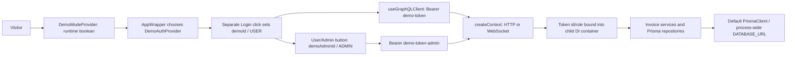

# Slice 4A — Demo Mode regression and contract tests

Date: 2026-10-17 (America/Halifax, client date).

## Baseline and scope

Branch: `portfolio-stabilization`. HEAD before changes:
`24b41b6a2d6d3e5c8892bc8ca420869be6862c28`. Initial working tree clean.
Reviewed repository archaeology, runtime verification, the stabilization plan,
Slice 1, Slice 2A/2B and adversarial review, and Slice 3A/3B reports. Those historical
documents are context; findings below reflect this branch's actual code and runs.
The current request supersedes the old plan's per-session alternatives: Portfolio
v1 will use one shared isolated USER identity and canonical reset on entry.

Only three files are added:

- `invoice-backend/tests/integration/demoMode.test.ts`: 27 tests.
- `invoice-frontend/tests/unit/demoMode.test.tsx`: 6 tests.
- This report.

**Production Demo Mode behavior is unchanged.** No production backend/frontend,
seed, schema, migration, tokens, authentication/Auth0, authorization, invoice-domain
rules, dependencies, lockfiles, existing assertions or shared test configuration
were modified. No reset API, per-session cloning, push, merge or deployment.

## Current architecture and frontend flow



Production paths (relative to repository root):

| Component | Current behavior |
| --- | --- |
| `invoice-frontend/src/index.tsx` | Redux -> DemoModeProvider -> AppWrapper. |
| `src/features/shared/components/DemoModeProvider.tsx` (frontend) | `useState(false)` on every mount. No localStorage/sessionStorage persistence and no initialization from `VITE_DEMO_MODE`. |
| `src/app/AppWrapper.tsx` (frontend) | Imports config eagerly; chooses DemoAuthProvider or Auth0ProviderWrapper using the runtime boolean. HashRouter/App sit inside the selected provider. |
| `src/features/auth/pages/Login.tsx` (frontend) | Demo button flips runtime state only; newly mounted demo provider is unauthenticated. A second Login click calls its local login function. |
| `src/features/auth/components/DemoAuthProvider.tsx` (frontend) | Login supplies `demoId`, numeric `Role.USER` (0). `toggleAdmin` changes to `demoAdminId`, numeric ADMIN (1). Its own token getter always returns `demo-token`. |
| `src/features/shared/components/buttons/DemoButton.tsx` and `Header.tsx` (frontend) | User/Admin toggle shown in Demo Mode on `/invoices`; calls `toggleAdmin` and refetches `ALL_INVOICES`. |
| `src/features/shared/hooks/useApolloClient.ts` (frontend) | Actual HTTP and WebSocket bearer tokens are selected from runtime state and numeric user role: `demo-token` or `demo-token-admin`. Skips Auth0 token retrieval for demo. Always chooses `wss://` for subscriptions. |
| `src/pages/WelcomePage.tsx` (frontend) | Redirects by demo/auth state; contains no independent demo initialization/reset operation. |

The older audits' localStorage-based provider and profile-menu toggle description
do **not** match this branch. The current header button is the escalation control.

## Backend context/token flow

`invoice-backend/src/server.ts` uses the production `src/GraphQL/createContext.ts`
for both Express requests and graphql-ws connections. Neither demo-token branch
checks `DEMO_MODE` or any other enable flag.

- HTTP: extracts `Bearer`; `NODE_ENV=test/CI` short-circuits to the fixed
  `auth0|12345` ADMIN. In production, `demo-token` maps to `demoId`/USER and
  `demo-token-admin` maps to `demoAdminId`/ADMIN without JWT verification.
- A child container binds that token identity and rebinds InvoiceService,
  UserService and InvoiceRevisionService. Real repositories resolve through the
  default Prisma client. HTTP then loads or creates the stored user and returns
  **that database user** as `context.user`.
- WebSocket: independently repeats both hardcoded demo-token branches. Returns
  the token user, without HTTP's DB-user provisioning step. It creates a child
  container but does not use HTTP's service-rebinding helper or include an
  invoiceRevisionService in the returned context. No WS revision execution is
  claimed by these tests.
- Non-demo credentials follow existing RS256/JWKS verification. Bare `demoId`
  and `demoAdminId` are not valid bearer credentials; both rejection tests pass.

**Unexpected role drift:** an existing `demoId` database row with ADMIN role causes
HTTP `context.user.role` to be ADMIN even when `demo-token` bound USER into the
services. The new red test records this inconsistency. It does not imply that
invoice services suddenly use ADMIN for that token; they retain the token-bound
USER. Slice 4B must keep the dedicated demo identity consistently USER across
context and services, including existing data.

## Environment/config and routing classification

| Variable/component | Classification | Verified current use |
| --- | --- | --- |
| `DATABASE_URL` / default `TYPES.PrismaClient` | ACTIVE | One lazily resolved singleton supplies DatabaseConnection and all invoice/user/revision repositories. Demo HTTP context resolves this binding in the test. |
| `DEMO_MODE` | ACTIVE, not an authentication gate | At config import, literal `true` replaces process-wide DATABASE_URL with DEMO_DATABASE_URL; also permits backend HTTP instead of local TLS. False does not reject demo tokens. |
| `DEMO_DATABASE_URL` | ACTIVE | `server.config.ts:16–19` reads it for the global override. Missing/empty value with DEMO_MODE=true overwrites DATABASE_URL with an empty string. Affects the whole process, including ordinary Auth0 requests. |
| `TYPES.PrismaClientDemo` | DEAD binding / obsolete routing | Registered alternate singleton factory, reading **DATABASE_URL_DEMO**, but no production consumer resolves it outside the unused factory. Registration does not instantiate another active client. |
| `DATABASE_URL_DEMO` | DEAD configuration path | Only read by the orphaned alternate Prisma binding. Different spelling from active DEMO_DATABASE_URL. |
| `TYPES.PrismaClientFactory` | DEAD binding / obsolete routing | Registered boolean-based client selector; no production injection or call site. |
| `bindPrismaClient` / per-request database switching | NOT PRESENT | No context helper/call remains. Demo requests do not select a database by identity. |
| Multiple Prisma clients | PARTIALLY WIRED historically | Two DI client bindings remain; only the default serves requests. The separate `/test-setup` endpoint creates a direct client for a whole-table wipe. |
| `DEMO_MODE_ENABLED`, `DEMO_USER_TOKEN`, `DEMO_ADMIN_TOKEN` | NOT PRESENT as production configuration | No current production readers. Tests use existing DEMO_MODE, not a proposed new flag/token scheme. |
| `VITE_DEMO_MODE` | PARTIALLY WIRED | Config skips Auth0 env checks when true; Vite disables local HTTPS. Runtime DemoModeProvider ignores it and still boots false. |
| `VITE_BACKEND_URL` | ACTIVE | Required even for demo, by config and Apollo hook. |
| `VITE_AUDIENCE`, `VITE_SCOPE`, `VITE_DOMAIN`, `VITE_CLIENT_ID`, `VITE_REDIRECT_URI` | ACTIVE for normal config | Eager validation when build-time demo flag is false; redirect URI has a browser-origin fallback. This blocks reaching the runtime demo toggle with missing Auth0 config. |
| `DOMAIN`, `AUDIENCE` | ACTIVE for Auth0 | Existing JWKS/JWT verification config. Hardcoded demo tokens need no valid Auth0 credentials or login. |
| `NODE_ENV`, `CERT_DIR`, `PORT` | ACTIVE | NODE_ENV also controls cached and dynamic test/CI ADMIN shortcuts; tests explicitly load production config to avoid them. |

Thus **per-request separate demo-database switching is dead**; the **process-wide
DEMO_MODE database override is active**. They must not be described as one working
isolation mechanism. Normal demo isolation currently comes from USER ownership
checks in the same selected database, not the orphaned client factory.

Deployment inspection found `.github/workflows/backend-deployment.yaml` deploying
the backend to Fly.io and `frontend-deploy.yaml` building GitHub Pages with Auth0
values; backend `fly.toml` has no explicit demo gate. Normal `docker-compose.yml`
sets DEMO_MODE=false/VITE_DEMO_MODE=false, which still leaves hardcoded tokens
usable. No `render.yaml`, `railway.toml`, `Procfile` or `pipeline.yml` exists here.
Live hosting settings/secrets were not inspected.

`docker-compose.demo.yml` selects a separate db-demo container but is **PARTIALLY
WIRED**: it sets DEMO_MODE=true and DATABASE_URL without explicitly supplying
DEMO_DATABASE_URL; dotenv may fill the latter only if an environment file exists.
It launches NODE_ENV=test, masking real demo authentication with the ADMIN test
shortcut. `start:test` also overrides DATABASE_URL with db-dev. Frontend config
references backend-test while `npm run demo` overrides the URL with localhost.
`setup.sh demo` delegates startup/migrations to Compose and runs the manual Prisma
seed afterward. No Docker/hosting changes or full Docker runtime verification.

## Seed ownership and reset reality

The real `npx --no-install prisma db seed` executes unchanged `prisma/seed.mjs`.
Fresh migration + seed succeeds, yielding:

- One user: `user1`, USER; **no demoId** until HTTP context auto-provisions it.
- Seven invoices: `AA1449`, `FV2353`, `RG0314`, `RT2080`, `RT3080`, `TY9141`, `XM9141`.
  **All belong to user1.** Meaningful clients, positive totals and all three statuses.
- Eleven revisions: five on RT3080, one on each other invoice, attributed to user1.
- Final RT3080 is paid, total **2101.80**, description `Website re-brand + logo`;
  latest revision matches that total/status. The older plan's 1800.90 is the
  initial invoice-array value, not the live invoice after rich-history seeding.
- First `demo-token` GraphQL list auto-creates demoId/USER and returns **[]**.

No reset GraphQL field, demo-reset service, entry endpoint, Reset Demo UI action or
scheduled reset exists. Shared demo-owned edits remain visible to a new independent
request context; that passing test intentionally establishes the chosen shared
identity model. Request contexts are created for every operation and cannot stand
in for a new visitor/session-entry boundary.

Manual seed execution is **not a complete reset**: existing invoice IDs are skipped;
the special final step always deletes/rebuilds RT3080 history and replaces its
items/status/description/total. It does not restore all its other fields or the
other six invoices, remove visitor-created demo invoices or transfer ownership.
This description is from seed control-flow inspection. `/test-setup` is a whole
invoice-table wipe in development/test/CI (403 in production), with no reseeding
or demo-only scope. Neither mechanism satisfies canonical reset.

## Tests added, passing boundaries and limitations

Backend harness: three generated `demo_contract_<uuid>` schemas in an explicitly
supplied disposable PostgreSQL database. Committed migrations and real package
seed command receive the same schema URL. Each scenario recreates fixtures;
cleanup drops only generated schemas even on red assertions and restores env.
No fallback developer DB. Production modules are loaded after setting both
NODE_ENV checks to production. Test-only DI substitution supplies the isolated
primary Prisma instance; token/context/roles/services/repositories are not mocked.
Enabled configuration supplies the isolated URL to DEMO_DATABASE_URL too, safely
exercising the existing global config path without changing its behavior.

Apollo executeOperation validates/executes real schema/resolvers with context
constructed from realistic HTTP request headers. WS tests pass connectionParams
to the real context path. No HTTP listener, actual WS handshake, real Auth0
tenant or hosted deployment is exercised. Auth0 URL/audience are inert local test
values; hardcoded demo authentication and invalid bare IDs never need a JWKS call.

Fixtures include demoId, normal USER A and USER B, and a normal ADMIN; three
invoices have complete items/addresses and two revisions each. Eight demo-specific
foreign-operation denials prove the existing normal USER boundary, without
duplicating the 45-case authorization matrix. Denials assert null protected data,
NOT_FOUND and unchanged persisted invoice/items/addresses/history for all owners.
These are invoice/revision isolation claims; the adversarial report's existing
legacy user-directory endpoint finding is not repaired or reclassified here.

**16 passing backend tests:** anonymous demo USER provisioning, WS USER identity,
two bare-ID credential rejections, same-database list isolation, own read/edit/
payment/history/delete lifecycle, eight foreign invoice/revision denials, shared
edits between contexts, and meaningful actual seed/history preparation.

Frontend uses existing Vitest/jsdom without shared harness/tool repairs. Actual
demo providers/state/config remain real. AppWrapper's Auth0 wrapper and invoice
App are replaced with marker components so provider selection can be observed
without Auth0 initialization/network or unrelated invoice rendering.
**Two passing frontend tests:** build-time demo config skips Auth0 requirements;
explicit local demo login produces demoId/USER without an Auth0 provider.

## Exact intentionally failing tests

All are ordinary failing assertions, not `.fails`, skips or altered old assertions.
Multiple soft assertion diagnostics can belong to one test; counts below are
test cases, not individual assertion messages.

Backend file: `invoice-backend/tests/integration/demoMode.test.ts` — **11 failures**.

| Exact suite > test name | Actual failure |
| --- | --- |
| `production demo disabled > rejects demo-token over HTTP` | Authenticates demoId/USER despite DEMO_MODE=false. |
| `production demo disabled > rejects demo-token-admin over HTTP` | Authenticates/provisions demoAdminId/ADMIN. |
| `production demo disabled > rejects demo-token over WebSocket` | Authenticates demoId/USER. |
| `production demo disabled > rejects demo-token-admin over WebSocket` | Authenticates demoAdminId/ADMIN. |
| `portfolio demo enabled > keeps demoId a USER when an existing database row has ADMIN role` | Returned HTTP context user has stored ADMIN role. |
| `portfolio demo enabled > rejects anonymous Demo Admin escalation over HTTP` | Returns ADMIN and creates demoAdminId DB row. |
| `portfolio demo enabled > rejects anonymous Demo Admin escalation over WebSocket` | Returns ADMIN. |
| `portfolio demo enabled > does not expose real-user invoices through the historical admin token` | Returns DM1001, USER A's AA1001 and USER B's BB1001, without errors. |
| `canonical demo seed > prepares the dedicated demo USER before any visitor request` | demoId row is absent. |
| `canonical demo seed > assigns all seven canonical sample invoices and their history to demoId` | Both invoice and revision owners are user1. |
| `canonical demo seed > shows the canonical invoices immediately on first anonymous demo entry` | Real demo context/GraphQL list returns []. |

Frontend file: `invoice-frontend/tests/unit/demoMode.test.tsx`, suite
`demo initialization contract` — **4 failures**:

| Exact test name within that suite | Actual failure |
| --- | --- |
| `allows runtime demo entry without requiring Auth0 config at module load` | Eager config import throws `VITE_AUDIENCE is required`. |
| `selects the demo provider on a build-time demo boot` | Runtime provider boots false and AppWrapper selects the Auth0 marker. |
| `authenticates the normal USER when runtime demo state is entered` | Mounted DemoAuthProvider remains anonymous until another login action. |
| `never grants ADMIN through the historical anonymous role toggle` | Toggle supplies demoAdminId, numeric role 1/ADMIN. |

## Required Slice 4B acceptance cases not yet executable

No production schema was added to compile a future reset test. Implement the
entry/reset boundary in 4B, then add these precise acceptance cases:

1. Fresh anonymous demo entry, without Auth0 env/credentials/login, restores and
   returns the canonical seven invoices owned by demoId/USER and canonical history
   (five RT3080 revisions; other initial history as defined by the shared dataset).
2. As demo USER, edit one canonical invoice and its items, mark a pending invoice
   paid, delete another, restore a revision, and create an extra invoice. Verify
   those changes are visible in the intentionally shared workspace.
3. Invoke the explicit Reset Demo backend action. Verify all canonical invoice
   fields/addresses/items/totals/statuses/history are restored, missing canonical
   invoices recreated, extra demo invoices removed and old visitor revisions gone.
   Compare semantic snapshots, ignoring generated row IDs/timestamps as appropriate.
4. Repeat reset and compare the same canonical state; no accumulated history,
   orphan demo items/addresses or duplicated sample records.
5. Mutate again and enter Demo Mode through the **new explicit entry boundary**
   from another visitor. Assert the same canonical restoration. Ordinary GraphQL
   queries/edits within a visit must not silently reset on every request.
6. For reset and entry, compare USER A/B invoices/items/addresses/revisions before
   and after byte-for-byte; retain real users and roles. Reject non-demo users,
   ordinary ADMIN and anonymous callers of the protected reset operation according
   to its final error contract; no caller-controlled owner/target scope.
7. Remove the public ADMIN toggle and both HTTP/WS admin-token acceptance branches;
   enforce demo enable/disable in both transports. Preserve normal Auth0 behavior
   and existing authorization/invariant assertions.
8. Verify one-click frontend entry with canonical invoices, Reset Demo refetch,
   and consistent USER identity even if old stored demo data has an ADMIN role.

Keep existing canonical IDs' global primary-key constraint in view: if user1 owns
those rows in an existing environment, 4B must handle canonical ownership/setup
explicitly and avoid overwriting real-user records. No per-session cloning design
or production-data migration is performed in this slice.

## Verification environment, commands and results

Installed Node 24.15.0, PostgreSQL 16.13 and existing package dependencies; no
installation/version changes. New cluster exclusively on 127.0.0.1:55437:

```bash
mkdir -p /tmp/portfolio-slice4a
/usr/lib/postgresql/16/bin/initdb -D /tmp/portfolio-slice4a/pgdata -U postgres --auth=trust > /tmp/portfolio-slice4a/initdb.log
/usr/lib/postgresql/16/bin/pg_ctl -D /tmp/portfolio-slice4a/pgdata -l /tmp/portfolio-slice4a/postgres.log -o '-p 55437 -k /tmp/portfolio-slice4a -h 127.0.0.1' start
/usr/lib/postgresql/16/bin/createdb -h 127.0.0.1 -p 55437 -U postgres demo_contract
```

Initial sandbox startup denied sockets; escalated startup/database/test runs
succeeded. No existing database or external authentication service was used.
Backend commands use:

```bash
cd invoice-backend
export PATH=/home/djblackett/.nvm/versions/node/v24.15.0/bin:$PATH
export DATABASE_URL=postgresql://postgres@127.0.0.1:55437/demo_contract NODE_ENV=test DEMO_MODE=false CERT_DIR=../certs/
```

The new harness itself switches to production before loading config/context;
the surrounding command env remains test for unchanged existing suites.

| Directory | Exact command | Exit | Result |
| --- | --- | ---: | --- |
| Backend | `npx --no-install tsc --noEmit` | 0 | Application typecheck passes; default config excludes tests. |
| Backend | `npx --no-install tsc --noEmit -p tsconfig.demo.tmp.json` | 0 | Application plus new Demo Mode integration test types pass. |
| Backend | `npx --no-install vitest run tests/unit --reporter=default` | 0 | 116/116 pass, 12 files. |
| Backend | `npx --no-install vitest run tests/integration/authorization.test.ts --reporter=default --no-file-parallelism --hookTimeout=60000` | 0 | 45/45 pass. |
| Backend | `npx --no-install vitest run tests/integration/invoiceInvariants.test.ts --reporter=default --no-file-parallelism --hookTimeout=60000` | 0 | 21/21 pass. |
| Backend | `npx --no-install vitest run tests/integration/demoMode.test.ts --reporter=default --no-file-parallelism --hookTimeout=60000` | 1 | 27 tests: 16 pass / 11 intentional failures. |
| Backend | `npx --no-install vitest run tests/integration --reporter=default --no-file-parallelism --hookTimeout=60000` | 1 | 107 tests: 96 pass / 11 intentional failures; 4 original files pass, only new demo file fails. All previous 80 tests remain green. |
| Frontend | `npx --no-install vitest run tests/unit/demoMode.test.tsx --reporter=default` | 1 | 6 tests: 2 pass / 4 intentional failures. |
| Frontend | `npx --no-install tsc -p tsconfig.app.json --noEmit` | 2 | Same 19 existing errors described by Slice 1, no errors in new file. No frontend typing repair. |
| Frontend | `npx --no-install vitest run tests --reporter=default` | 1 | 106 tests: 100 pass / 4 new intentional failures / 2 existing skips; all 20 original files pass. |

Temporary backend typecheck config (removed after verification):

```json
{"extends":"./tsconfig.json","include":["src/**/*.ts","tests/integration/demoMode.test.ts"],"exclude":["node_modules","dist","src/mocks"]}
```

Formatted only added test files using each package's installed CLI:
`node node_modules/prettier/bin/prettier.cjs --write <new test path>`.
During harness development, corrected frontend context identity after module-cache
reset and NodeNext/test-transport typing; final red cases are product contract
assertions, not setup/compiler failures. No general frontend tooling repair.

The two original new-invoice-form cases that failed in Slice 1 passed in this
execution. Their assertions and production frontend are unchanged; this run does
not establish that the older timing/tooling issues have been repaired.

New tests total **33: 18 passing, 15 intentionally failing** (backend 16/11;
frontend 2/4). Closed work: **116 unit + 45 authorization + 21 invariant tests
pass**, and all **80 pre-existing backend integration tests pass** together.

Raw local logs: `/tmp/portfolio-slice4a/{typecheck,demo-typecheck,unit,authorization,invariants,demo-focused,integration,frontend-demo,frontend-typecheck,frontend-suite}.log`.

Finalization commands from repository root:

```bash
/usr/lib/postgresql/16/bin/psql -h 127.0.0.1 -p 55437 -U postgres -d demo_contract -Atc "SELECT count(*) FROM pg_namespace WHERE nspname LIKE 'demo_contract_%' OR nspname LIKE 'authz_%' OR nspname LIKE 'invariants_%';"
/usr/lib/postgresql/16/bin/pg_ctl -D /tmp/portfolio-slice4a/pgdata stop -m fast
rm invoice-backend/tsconfig.demo.tmp.json
git diff --check
git add invoice-backend/tests/integration/demoMode.test.ts invoice-frontend/tests/unit/demoMode.test.tsx docs/audit/slice-4a-demo-mode-regression-tests.md
git diff --cached --check
git diff --cached --stat
git commit -m "test(demo): capture demo mode regressions"
git status --short
git rev-parse HEAD
```

Generated-schema query returned zero; temporary cluster stopped. Staged scope
contains only the three additions, whitespace checks pass, and the final local
commit hash/clean working-tree status are reported in the task response.
