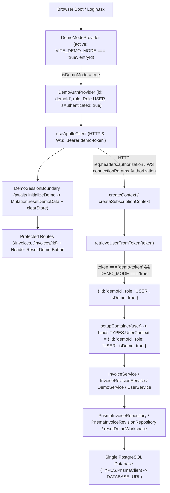

# Slice 4B Adversarial Demo Mode Review

**Date**: 2026-10-17  
**Branch**: `portfolio-stabilization`  
**Reviewed Commit Range**: `e8db75ae5eae9cddb85270ddba4b681a33321091..05fe4dff6232faeb8eb8f4fac84bb8132cb70bde` (`e8db75ae..05fe4dff`)  
**Reviewed HEAD**: `05fe4dff6232faeb8eb8f4fac84bb8132cb70bde` (`05fe4dff`)  
**Review Mode**: Read-only adversarial security review + disposable PostgreSQL 16 runtime probing

---

## 1. Executive Verdict

**Verdict: `PASS — Demo Mode stabilization can be closed`**

An adversarial security review of the Slice 4B Demo Mode stabilization (`e8db75ae..05fe4dff`)—combining full-path code analysis across the React frontend, Apollo HTTP/WebSocket client links, Express/graphql-ws context creation, Inversify DI bindings, GraphQL resolvers, domain services, and Prisma/PostgreSQL persistence with live adversarial runtime probing against a disposable PostgreSQL 16.13 cluster—found **zero privilege-escalation vectors, zero disabled-mode authentication bypasses, zero cross-user invoice/revision read or write leaks, and zero reset-induced real-user data loss or corruption paths**.

1. **No Anonymous or Demo Pathway Can Acquire `Role.ADMIN`**: Both HTTP and WebSocket authentication paths route through a single token gate ([`retrieveUserFromToken`](file:///home/djblackett/dev/invoice-web-app/invoice-backend/src/GraphQL/createContext.ts#L63-L93)) that rejects `demo-token-admin` and all `demo-*` prefix variants before reaching either JWT verification or the legacy `NODE_ENV=test/CI` shortcut. Even if the persisted `demoId` row in PostgreSQL is manually tampered with to hold `role = "ADMIN"`, both the child DI container binding (`TYPES.UserContext`) and the returned HTTP/WebSocket `context.user` object force `role: "USER"`, and `resetDemoData` repairs the stored database role back to `"USER"`.
2. **Demo-Disabled Gate Holds Over Both HTTP and WebSocket**: When `process.env.DEMO_MODE` is anything other than the exact string `"true"` (`"false"`, `""`, `"1"`, `"TRUE"`, `"yes"`, or unset), `retrieveUserFromToken` returns `null` for `demo-token` across both HTTP and WebSocket transports.
3. **Real-User Invoice & Revision Isolation Holds Under Direct & Mixed-Object Attacks**: As `demoId / USER`, all single-record and list operations on real users' invoices and revisions (`allInvoices`, `getInvoiceById`, `editInvoice`, `removeInvoice`, `markAsPaid`, `invoiceRevisions`, `invoiceRevision`, `invoiceRevisionDiff`, `restoreInvoiceRevision`), as well as mixed-object attacks (demo invoice + foreign revision, foreign invoice + demo revision, cross-invoice diff, and foreign `Item.id` injection into a demo invoice edit), fail closed with `NOT_FOUND` (or transactional `P2002` rollback on foreign item ID creation) with zero data leakage or mutation.
4. **Reset Authorization Is Strictly Bound to Active Server-Issued Demo Context**: `Mutation.resetDemoData` is triple-gated by `process.env.DEMO_MODE === "true"`, `user.isDemo === true`, `user.id === "demoId"`, and `user.role === "USER"` inside [`DemoService.reset`](file:///home/djblackett/dev/invoice-web-app/invoice-backend/src/services/demo.service.ts#L15-L28). Because `extractUserFromPayload` never copies `isDemo` from JWT claims, even a cryptographically valid RS256 Auth0 JWT with `sub: "demoId"` and a custom `isDemo: true` claim is rejected with `FORBIDDEN`.
5. **Reset Atomicity, Concurrency Serialization, and Collision Refusal Hold**: [`resetDemoWorkspace`](file:///home/djblackett/dev/invoice-web-app/invoice-backend/prisma/demoWorkspace.cjs#L78-L168) executes inside a single interactive Prisma transaction guarded by `SELECT pg_advisory_xact_lock(8372401)`. If any of the 7 canonical IDs (`AA1449`, `FV2353`, `RG0314`, `RT2080`, `RT3080`, `TY9141`, `XM9141`) is owned by a non-demo user, or if a mid-transaction item or revision ID collision occurs, the entire transaction rolls back cleanly with zero changes to real-user or existing demo records.
6. **Obsolete Multi-Database Routing Is Completely Removed from Runtime Code**: `DEMO_DATABASE_URL`, `DATABASE_URL_DEMO`, `TYPES.PrismaClientDemo`, and `TYPES.PrismaClientFactory` have been removed from all production code paths.

---

## 2. Reviewed Commit Range

- **Base Commit (Slice 4A)**: `e8db75ae5eae9cddb85270ddba4b681a33321091` (`test(demo): capture demo mode regressions`)
- **Target Commit (Slice 4B)**: `05fe4dff6232faeb8eb8f4fac84bb8132cb70bde` (`fix(demo): stabilize public demo mode`)

| File in `e8db75ae..05fe4dff` | Summary of Changes |
|---|---|
| [`invoice-backend/prisma/demoInvoices.json`](file:///home/djblackett/dev/invoice-web-app/invoice-backend/prisma/demoInvoices.json) | Canonical 7-invoice dataset (`AA1449`, `FV2353`, `RG0314`, `RT2080`, `RT3080`, `TY9141`, `XM9141`) decoupled from legacy `user1` ownership. |
| [`invoice-backend/prisma/demoWorkspace.cjs`](file:///home/djblackett/dev/invoice-web-app/invoice-backend/prisma/demoWorkspace.cjs) | Defines `DEMO_ID` (`"demoId"`), `DEMO_USER` (`role: "USER"`), `canonicalDemoRecords()`, and transactional `resetDemoWorkspace(prisma)` with PostgreSQL advisory locking (`pg_advisory_xact_lock(8372401)`), canonical-ID ownership conflict check, role repair upsert, scoped demo invoice/address deletion, and deterministic item/revision recreation. |
| [`invoice-backend/prisma/seed.mjs`](file:///home/djblackett/dev/invoice-web-app/invoice-backend/prisma/seed.mjs) | Replaces 600+ lines of partial/skip-existing `user1` seed logic with a direct call to `workspace.resetDemoWorkspace(prisma)`. |
| [`invoice-backend/src/GraphQL/createContext.ts`](file:///home/djblackett/dev/invoice-web-app/invoice-backend/src/GraphQL/createContext.ts) | Centralizes demo token handling in `retrieveUserFromToken`; gates `demo-token` on `process.env.DEMO_MODE === "true"`; rejects all other `demo-*` tokens prior to `NODE_ENV=test/CI` fallback; forces `{ ...dbUser, role: "USER", isDemo: true }` on HTTP context; wires `setupContainer` + `getServices` (including `DemoService` and `InvoiceRevisionService`) into WebSocket `createSubscriptionContext`. |
| [`invoice-backend/src/services/demo.service.ts`](file:///home/djblackett/dev/invoice-web-app/invoice-backend/src/services/demo.service.ts) | Request-scoped `DemoService.reset()` enforcing `DEMO_MODE === "true"`, `user?.isDemo === true`, `user.id === "demoId"`, and `user.role === "USER"`. |
| [`invoice-backend/src/resolvers/demoResolvers.ts`](file:///home/djblackett/dev/invoice-web-app/invoice-backend/src/resolvers/demoResolvers.ts), [`src/resolvers/index.ts`](file:///home/djblackett/dev/invoice-web-app/invoice-backend/src/resolvers/index.ts), [`src/GraphQL/typeDefs.ts`](file:///home/djblackett/dev/invoice-web-app/invoice-backend/src/GraphQL/typeDefs.ts) | Exposes `Mutation.resetDemoData: Boolean!` and maps `ForbiddenException` to GraphQL `FORBIDDEN`. |
| [`invoice-backend/src/config/inversify.config.ts`](file:///home/djblackett/dev/invoice-web-app/invoice-backend/src/config/inversify.config.ts), [`src/constants/identifiers.ts`](file:///home/djblackett/dev/invoice-web-app/invoice-backend/src/constants/identifiers.ts), [`src/constants/types.ts`](file:///home/djblackett/dev/invoice-web-app/invoice-backend/src/constants/types.ts) | Binds `DemoService`; adds `isDemo?: boolean` to `UserIdAndRole`; removes dead `PrismaClientDemo` and `PrismaClientFactory` bindings and symbols. |
| [`invoice-backend/src/config/server.config.ts`](file:///home/djblackett/dev/invoice-web-app/invoice-backend/src/config/server.config.ts) | Removes process-global `DEMO_DATABASE_URL` overwrite of `process.env.DATABASE_URL` and stops logging raw `DATABASE_URL` credentials. |
| [`invoice-frontend/src/config/config.ts`](file:///home/djblackett/dev/invoice-web-app/invoice-frontend/src/config/config.ts), [`src/app/AppWrapper.tsx`](file:///home/djblackett/dev/invoice-web-app/invoice-frontend/src/app/AppWrapper.tsx), [`src/features/auth/components/Auth0ProviderWrapper.tsx`](file:///home/djblackett/dev/invoice-web-app/invoice-frontend/src/features/auth/components/Auth0ProviderWrapper.tsx), [`src/features/auth/hooks/useAuth.ts`](file:///home/djblackett/dev/invoice-web-app/invoice-frontend/src/features/auth/hooks/useAuth.ts) | Adds `hasAuth0Config` and `canLogin`; mounts `Auth0ProviderWrapper` only when Auth0 env vars are present and `isDemoMode` is false; avoids throwing on missing Auth0 env vars at module import. |
| [`invoice-frontend/src/features/shared/components/DemoModeProvider.tsx`](file:///home/djblackett/dev/invoice-web-app/invoice-frontend/src/features/shared/components/DemoModeProvider.tsx), [`src/features/auth/components/DemoSessionBoundary.tsx`](file:///home/djblackett/dev/invoice-web-app/invoice-frontend/src/features/auth/components/DemoSessionBoundary.tsx), [`src/app/App.tsx`](file:///home/djblackett/dev/invoice-web-app/invoice-frontend/src/app/App.tsx) | Initializes `isDemoMode` from `VITE_DEMO_MODE === "true"`; tracks `demoEntryId` on false-to-true transitions; deduplicates `resetDemoData` promise per entry generation; blocks invoice route rendering until reset succeeds. |
| [`invoice-frontend/src/features/auth/components/DemoAuthProvider.tsx`](file:///home/djblackett/dev/invoice-web-app/invoice-frontend/src/features/auth/components/DemoAuthProvider.tsx), [`src/features/shared/hooks/useApolloClient.ts`](file:///home/djblackett/dev/invoice-web-app/invoice-frontend/src/features/shared/hooks/useApolloClient.ts) | Authenticates immediately as `{ id: "demoId", role: Role.USER }`; removes `demoAdmin` object and `-admin` token branch; makes `toggleAdmin` a permanent no-op; derives `ws://` vs `wss://` from `VITE_BACKEND_URL`. |
| [`invoice-frontend/src/features/auth/pages/Login.tsx`](file:///home/djblackett/dev/invoice-web-app/invoice-frontend/src/features/auth/pages/Login.tsx), [`src/features/shared/components/buttons/DemoButton.tsx`](file:///home/djblackett/dev/invoice-web-app/invoice-frontend/src/features/shared/components/buttons/DemoButton.tsx), [`src/features/shared/components/Header.tsx`](file:///home/djblackett/dev/invoice-web-app/invoice-frontend/src/features/shared/components/Header.tsx) | Renders `"Enter Demo Mode"` only when `VITE_DEMO_MODE === "true"`; replaces header Admin/User toggle with `"Reset Demo"` button; exits Demo Mode on logout. |
| [`invoice-backend/tests/integration/demoMode.test.ts`](file:///home/djblackett/dev/invoice-web-app/invoice-backend/tests/integration/demoMode.test.ts), [`invoice-frontend/tests/unit/demoSession.test.tsx`](file:///home/djblackett/dev/invoice-web-app/invoice-frontend/tests/unit/demoSession.test.tsx) | Adds 12 backend integration tests (total 39) and 7 frontend session/reset unit tests. |
| [`docker-compose.demo.yml`](file:///home/djblackett/dev/invoice-web-app/docker-compose.demo.yml), [`invoice-backend/.env.example`](file:///home/djblackett/dev/invoice-web-app/invoice-backend/.env.example), [`invoice-frontend/.env.example`](file:///home/djblackett/dev/invoice-web-app/invoice-frontend/.env.example), [`README.md`](file:///home/djblackett/dev/invoice-web-app/README.md) | Updates demo configuration to `NODE_ENV=production`, `DEMO_MODE=true`, `VITE_DEMO_MODE=true`, and single `DATABASE_URL`. |

---

## 3. Final Demo Architecture

### 3.1 End-to-End Flow



### 3.2 Sources of Truth Audit

Every point in the stack that can influence demo enablement, token acceptance, user ID, role, database connection, or reset behavior was inspected for split-brain or conflicting sources of truth:

| Security Dimension | Source(s) of Truth | Consistency & Precedence Analysis |
|---|---|---|
| **Demo Enabled / Disabled** | Backend: `process.env["DEMO_MODE"] === "true"` in [`createContext.ts:69`](file:///home/djblackett/dev/invoice-web-app/invoice-backend/src/GraphQL/createContext.ts#L69), [`demo.service.ts:17`](file:///home/djblackett/dev/invoice-web-app/invoice-backend/src/services/demo.service.ts#L17), and [`server.ts:27`](file:///home/djblackett/dev/invoice-web-app/invoice-backend/src/server.ts#L27).<br>Frontend: `import.meta.env.VITE_DEMO_MODE === "true"` in [`DemoModeProvider.tsx:38`](file:///home/djblackett/dev/invoice-web-app/invoice-frontend/src/features/shared/components/DemoModeProvider.tsx#L38) and [`Login.tsx:75`](file:///home/djblackett/dev/invoice-web-app/invoice-frontend/src/features/auth/pages/Login.tsx#L75). | **No backend split-brain.** Both `retrieveUserFromToken` and `DemoService.reset` evaluate `process.env["DEMO_MODE"] === "true"` dynamically per request. Client-side `VITE_DEMO_MODE` controls only UI presentation and cannot enable backend demo access. |
| **Token Acceptance** | [`retrieveUserFromToken`](file:///home/djblackett/dev/invoice-web-app/invoice-backend/src/GraphQL/createContext.ts#L63-L93) called by both `getUserFromRequest` (HTTP) and `createSubscriptionContext` (WebSocket). | **Single source of truth.** Only exact `"demo-token"` when `DEMO_MODE === "true"` succeeds; any other `token.startsWith("demo-")` returns `null` immediately before `NODE_ENV=test/CI` or JWKS verification. |
| **Effective User ID & Marker** | `DEMO_ID = "demoId"` in [`demoWorkspace.cjs:4`](file:///home/djblackett/dev/invoice-web-app/invoice-backend/prisma/demoWorkspace.cjs#L4) + `isDemo: true` attached only in [`createContext.ts:70,161`](file:///home/djblackett/dev/invoice-web-app/invoice-backend/src/GraphQL/createContext.ts#L70). | **Single source of truth.** `extractUserFromPayload` (`lines 109–127`) constructs `{ id, role, username, name }` without `isDemo`, so JWT claims cannot spoof `isDemo: true`. |
| **Effective Role** | 1. Token identity (`DEMO_USER.role = "USER"`) bound to `TYPES.UserContext` in [`setupContainer`](file:///home/djblackett/dev/invoice-web-app/invoice-backend/src/GraphQL/createContext.ts#L188-L212).<br>2. Context user override `{ ...dbUser, role: "USER", isDemo: true }` in [`createContext.ts:161`](file:///home/djblackett/dev/invoice-web-app/invoice-backend/src/GraphQL/createContext.ts#L161).<br>3. DB upsert `update: { role: "USER" }` in [`demoWorkspace.cjs:100`](file:///home/djblackett/dev/invoice-web-app/invoice-backend/prisma/demoWorkspace.cjs#L100). | **Consistent across all three layers.** Even if `User.role` in PostgreSQL is mutated to `"ADMIN"` between resets, `TYPES.UserContext.role` and `context.user.role` are both forced to `"USER"`. |
| **Database Connection** | Single `TYPES.PrismaClient` singleton in [`inversify.config.ts:21-28`](file:///home/djblackett/dev/invoice-web-app/invoice-backend/src/config/inversify.config.ts#L21-L28) injected into `DatabaseConnection`. | **Single source of truth.** Note that [`app.ts:41`](file:///home/djblackett/dev/invoice-web-app/invoice-backend/src/app.ts#L41) (`/test-setup`, active only in `development`/`test`/`CI`) still instantiates a separate `PrismaClient({ datasourceUrl: DATABASE_URL })`, which is blocked with `403 Forbidden` in `production`. |
| **Reset Behavior** | [`resetDemoWorkspace`](file:///home/djblackett/dev/invoice-web-app/invoice-backend/prisma/demoWorkspace.cjs#L78-L168) called by both [`DemoService.reset`](file:///home/djblackett/dev/invoice-web-app/invoice-backend/src/services/demo.service.ts#L26) and [`prisma/seed.mjs:6`](file:///home/djblackett/dev/invoice-web-app/invoice-backend/prisma/seed.mjs#L6). | **Single source of truth.** Both CLI seeding and runtime `resetDemoData` execute the exact same CommonJS function and JSON template file. |

---

## 4. Disabled-Mode Bypass Attempts

With Demo Mode disabled, all known, historical, and malformed credential and transport pathways were tested against the compiled production server (`NODE_ENV=production`):

| Pathway / Credential Tested | Transport | `DEMO_MODE` Values Tested | Observed Result | Verdict |
|---|---|---|---|---|
| `Authorization: Bearer demo-token` | HTTP & WebSocket | `"false"`, `""`, `"1"`, `"TRUE"`, `"True"`, `"yes"`, `"enabled"`, `undefined` | `retrieveUserFromToken` returns `null`; `context.user` is `null`; `allInvoices` and `resetDemoData` fail with GraphQL errors and `data: null`. | **BLOCKED** |
| `Authorization: Bearer demo-token-admin` | HTTP & WebSocket | All disabled values (`"false"`, etc.) | Rejected at `if (token.startsWith("demo-")) return null`; `context.user` is `null`; no `demoAdminId` row created. | **BLOCKED** |
| `Authorization: Bearer demo-admin` / `Bearer demoId` / `Bearer demoAdminId` | HTTP & WebSocket | `"false"` | `demo-admin` caught by `startsWith("demo-")`; `demoId` and `demoAdminId` fail `jwt.decode` (`"Invalid token"`); `context.user` is `null`. | **BLOCKED** |
| Malformed header variations: `"Bearer  demo-token"` (double space), `"bearer demo-token"` (lowercase scheme), `"demo-token"` (no scheme), `""` (empty) | HTTP & WebSocket | `"false"` | Rejected by `startsWith("Bearer ")` or empty `token` check; `context.user` is `null`. | **BLOCKED** |
| Lowercase `connectionParams: { authorization: "Bearer demo-token" }` | WebSocket | `"false"` | Extracted by `connectionParams["authorization"]`, passed to `retrieveUserFromToken("demo-token")`, returns `null`. | **BLOCKED** |
| Query string & custom headers (`?token=demo-token&demo=true&isDemo=true`, `X-Demo-Mode: true`, `X-Demo-Token: demo-token`) | HTTP | `"false"` | Ignored by `getUserFromRequest` (reads only `req.headers.authorization`); `context.user` is `null`. | **BLOCKED** |
| `NODE_ENV=test` or `NODE_ENV=CI` with `Bearer demo-token` (when `DEMO_MODE=false`) or `Bearer demo-token-admin` | HTTP & WebSocket | `"false"` | Because lines 68–74 of `createContext.ts` precede line 77 (`if (NODE_ENV === "test" \|\| NODE_ENV === "CI")`), demo credentials **never** fall through to the test/CI `ADMIN` shortcut. | **BLOCKED** |

**HTTP vs. WebSocket Comparison (Demo Disabled)**: Both transports call `retrieveUserFromToken` and return `{ user: null, ... }` without provisioning any database user or resolving request-scoped services.

---

## 5. Privilege-Escalation Attempts

With `DEMO_MODE="true"`, the following privilege-escalation vectors were tested:

| Escalation Vector | Mechanism Attempted | Defense Triggered | Observed Result |
|---|---|---|---|
| **1. Historical `demo-token-admin` token** | Send `Authorization: Bearer demo-token-admin` over HTTP and WebSocket. | [`createContext.ts:74`](file:///home/djblackett/dev/invoice-web-app/invoice-backend/src/GraphQL/createContext.ts#L74): `if (token.startsWith("demo-")) return null;` | Returns `user: null`; `demoAdminId` is never created in PostgreSQL; all queries/mutations fail. |
| **2. Stale `demoId` DB row with `role = ADMIN`** | Update `User` row `id = "demoId"` in PostgreSQL to `role = "ADMIN"`, then execute HTTP `allInvoices`, `deleteAllInvoices`, `deleteUsers`, and WebSocket `Subscription.invoiceAdded`. | 1. `retrieveUserFromToken` returns `DEMO_USER` (`role: "USER"`), bound to `TYPES.UserContext` in `setupContainer`.<br>2. HTTP `createContext` (`line 161`) returns `{ ...dbUser, role: "USER", isDemo: true }`.<br>3. WS `createSubscriptionContext` returns `user` (`role: "USER"`). | `allInvoices` returns only the 7 `demoId` invoices (`UA1001` and `UB1001` excluded); `deleteAllInvoices`, `deleteUsers`, and `Subscription.invoiceAdded` are all rejected (`UNAUTHORIZED` / `FORBIDDEN`). |
| **3. Request payload role / owner injection** | Supply `createdById: "auth0\|adv-admin"` or `createdBy: { role: "ADMIN" }` in `addInvoice` / `editInvoice` service/GraphQL payloads. | `InvoiceService.addInvoice` (`lines 72–81`) overwrites `createdById` and `createdBy` from `this.userContext`. `InvoiceService.updateInvoice` (`lines 128–129`) deletes `createdBy` and `createdById`. | Persisted invoice ownership remains `demoId` with `role: "USER"`. |
| **4. Frontend `useAuth().toggleAdmin()` invocation** | Call `toggleAdmin()` on `DemoAuthProvider` context. | [`DemoAuthProvider.tsx:24`](file:///home/djblackett/dev/invoice-web-app/invoice-frontend/src/features/auth/components/DemoAuthProvider.tsx#L24): `const toggleAdmin = () => {};` and [`useApolloClient.ts:45-47, 89-91`](file:///home/djblackett/dev/invoice-web-app/invoice-frontend/src/features/shared/hooks/useApolloClient.ts#L45-L47) hardcodes `token = "demo-token"`. | Permanent no-op; `user` remains `{ id: "demoId", role: Role.USER }` and Apollo always sends `Bearer demo-token`. |
| **5. `localStorage` / `sessionStorage` state tampering** | Inject `isDemoMode`, `role: "ADMIN"`, or `demoAdminId` into browser storage. | Neither `DemoModeProvider`, `DemoAuthProvider`, nor `useApolloClient` reads auth or demo role state from `localStorage` or `sessionStorage`. | Completely ignored by frontend and backend. |
| **6. Non-string WebSocket `connectionParams.Authorization`** | Send `connectionParams: { Authorization: ["Bearer demo-token"] }` over `graphql-ws`. | `createSubscriptionContext` (`line 282`) throws `TypeError: authHeader?.startsWith is not a function` before `try`, causing `graphql-ws` to abort message handling. | Fails closed (`data: null`); tracked as a minor `LOW` robustness item (`DEMO-F02`). |

---

## 6. Real-User Isolation

Using a disposable PostgreSQL schema populated with `demoId` (7 canonical invoices + 11 revisions), `User A` (`UA1001` + 2 revisions), `User B` (`UB1001` + 2 revisions), and `Admin`, every invoice and revision operation was executed as `Bearer demo-token`:

| Operation / Attack Scenario | Target Arguments | Observed GraphQL Response | Database State After Probe |
|---|---|---|---|
| **List all invoices** (`Query.allInvoices`) | `{}` | Returns only the 7 `demoId` canonical invoices (`AA1449`, `FV2353`, `RG0314`, `RT2080`, `RT3080`, `TY9141`, `XM9141`). `UA1001` and `UB1001` are absent. | Unchanged |
| **Retrieve User A invoice** (`Query.getInvoiceById`) | `id: "UA1001"` | `data: { getInvoiceById: null }`, `errors[0].extensions.code: "NOT_FOUND"` (`"Invoice not found"`) | Unchanged |
| **Edit User A invoice** (`Mutation.editInvoice`) | `id: "UA1001", clientName: "Hacked"` | `data: { editInvoice: null }`, `errors[0].extensions.code: "NOT_FOUND"` (`"Invoice not found"`) | `UA1001` unchanged; no revision created |
| **Delete User A invoice** (`Mutation.removeInvoice`) | `id: "UA1001"` | `data: { removeInvoice: null }`, `errors[0].extensions.code: "NOT_FOUND"` (`"Invoice not found"`) | `UA1001` still in DB |
| **Mark User A invoice paid** (`Mutation.markAsPaid`) | `id: "UA1001"` | `data: { markAsPaid: null }`, `errors[0].extensions.code: "NOT_FOUND"` (`"Invoice not found"`) | `UA1001.status === "pending"` |
| **List User A revisions** (`Query.invoiceRevisions`) | `invoiceId: "UA1001"` | `data: null`, `errors[0].extensions.code: "NOT_FOUND"` (`"Invoice not found"`) | Unchanged |
| **Get User A revision by ID** (`Query.invoiceRevision`) | `id: "UA1001-rev-1"` | `data: { invoiceRevision: null }`, `errors[0].extensions.code: "NOT_FOUND"` (`"Revision not found"`) | Unchanged |
| **Diff User A revisions** (`Query.invoiceRevisionDiff`) | `fromRevisionId: "UA1001-rev-1", toRevisionId: "UA1001-rev-2"` | `data: null`, `errors[0].extensions.code: "NOT_FOUND"` (`"Revision not found"`) | Unchanged |
| **Restore User A revision** (`Mutation.restoreInvoiceRevision`) | `invoiceId: "UA1001", revisionId: "UA1001-rev-1"` | `data: { restoreInvoiceRevision: null }`, `errors[0].extensions.code: "NOT_FOUND"` (`"Invoice not found"`) | `UA1001` unchanged |
| **Mixed restore: Demo invoice + User A revision** | `invoiceId: "RT3080", revisionId: "UA1001-rev-1"` | `getRevision("UA1001-rev-1")` checks parent `"UA1001"` first and throws `NOT_FOUND` (`"Revision not found"`) before comparing `invoiceId`s. | Both `RT3080` and `UA1001` unchanged |
| **Mixed restore: User A invoice + Demo revision** | `invoiceId: "UA1001", revisionId: "demo-RT3080-revision-1"` | `getAuthorizedInvoice("UA1001")` immediately throws `NOT_FOUND` (`"Invoice not found"`). | Both `UA1001` and `RT3080` unchanged |
| **Mixed diff: Demo `fromRevisionId` + User A `toRevisionId`** | `fromRevisionId: "demo-RT3080-revision-1", toRevisionId: "UA1001-rev-1"` | `getDiff` authorizes `toRevisionId` first -> throws `NOT_FOUND` (`"Revision not found"`). | Unchanged |
| **Mixed diff: User A `fromRevisionId` + Demo `toRevisionId`** | `fromRevisionId: "UA1001-rev-1", toRevisionId: "demo-RT3080-revision-1"` | `getDiff` authorizes `toRevisionId` (succeeds), then authorizes `fromRevisionId` -> throws `NOT_FOUND` (`"Revision not found"`). | Unchanged |
| **Foreign Item ID injected into Demo invoice edit** | `editInvoice(id: "XM9141", items: [{ id: "UA1001-item-1", name: "Stolen", ... }])` | `PrismaInvoiceRepository.update` scopes `existingIds` to `where: { invoiceId: "XM9141" }`, so `"UA1001-item-1"` is not updated; `prisma.item.create` hits `P2002` inside `$transaction` and rolls back. | Both `"UA1001-item-1"` (on `UA1001`) and `XM9141` remain completely untouched |

> [!NOTE]
> **Carry-Over Observation on Legacy `User` Endpoints (`AUTHZ-F01` / `DEMO-F01`)**: As documented in Slice 2B (`AUTHZ-F01`), Slice 4A, and Slice 4B, the legacy user-directory endpoints in [`userResolvers.ts`](file:///home/djblackett/dev/invoice-web-app/invoice-backend/src/resolvers/userResolvers.ts) (`Query.allUsers`, `Query.getUserById`, `Mutation.createUser`) were not modified in Slice 4B. Because Demo Mode authenticates as an ordinary `USER` in the shared database, a direct GraphQL query with `Bearer demo-token` can still call `Query.allUsers { id username }` or `Mutation.createUser`. This exposes no invoice or revision data and is tracked as carry-over finding `DEMO-F01` (`MEDIUM`) for retirement when legacy user endpoints are cleaned up.

---

## 7. Reset Authorization

`Mutation.resetDemoData` is protected at two independent layers:
1. **Resolver Check ([`demoResolvers.ts:13-16`](file:///home/djblackett/dev/invoice-web-app/invoice-backend/src/resolvers/demoResolvers.ts#L13-L16))**: Rejects requests where `!context.demoService` (which occurs whenever `context.user` is `null`, i.e., unauthenticated, disabled demo mode, or invalid token) with `FORBIDDEN` (`"Demo authentication required"`).
2. **Service Check ([`demo.service.ts:16-25`](file:///home/djblackett/dev/invoice-web-app/invoice-backend/src/services/demo.service.ts#L16-L25))**:
   ```ts
   if (
     process.env["DEMO_MODE"] !== "true" ||
     this.user?.isDemo !== true ||
     this.user.id !== DEMO_ID ||
     this.user.role !== "USER"
   ) {
     throw new ForbiddenException(
       "Only the authenticated demo user can reset demo data",
     );
   }
   ```

| Caller Identity Tested | Token / Credential Used | Observed Result | Database Impact |
|---|---|---|---|
| **1. Active Demo identity (`demoId / USER`)** | `Bearer demo-token` (HTTP & WebSocket, `DEMO_MODE="true"`) | **ALLOWED**: Returns `{ data: { resetDemoData: true } }`. | Restores only `demoId` canonical rows; real users untouched. |
| **2. Ordinary real `USER` (`User A`, `User B`)** | Valid RS256 Auth0 JWT for `User A` / `User B` | **DENIED**: `FORBIDDEN` (`"Only the authenticated demo user can reset demo data"`). | Zero rows changed. |
| **3. Real `ADMIN` (`Admin`)** | Valid RS256 Auth0 JWT with `invoice-web-app/roles: ["Admin"]` | **DENIED**: `FORBIDDEN` (`"Only the authenticated demo user can reset demo data"`). | Zero rows changed. |
| **4. Forged/Signed Auth0 JWT with `sub: "demoId"` and claim `isDemo: true`** | Valid RS256 JWT signed by JWKS key with `{ sub: "demoId", isDemo: true }` | **DENIED**: `extractUserFromPayload` ignores JWT `isDemo` claim (`this.user.isDemo` is `undefined`) -> `FORBIDDEN`. | Zero rows changed. |
| **5. Demo token while `DEMO_MODE="false"`** | `Bearer demo-token` (`DEMO_MODE="false"`) | **DENIED**: `retrieveUserFromToken` returns `null` -> `context.demoService` is undefined -> `FORBIDDEN` (`"Demo authentication required"`). | Zero rows changed. |
| **6. Unauthenticated caller** | Missing / empty `Authorization` header | **DENIED**: `FORBIDDEN` (`"Demo authentication required"`). | Zero rows changed. |
| **7. Historical `demo-token-admin`** | `Bearer demo-token-admin` (`DEMO_MODE="true"`) | **DENIED**: `retrieveUserFromToken` returns `null` -> `FORBIDDEN` (`"Demo authentication required"`). | Zero rows changed. |

---

## 8. Reset Atomicity and Collision Safety

### 8.1 Canonical-ID Collision Safety (Phase 6)

Inside [`resetDemoWorkspace`](file:///home/djblackett/dev/invoice-web-app/invoice-backend/prisma/demoWorkspace.cjs#L85-L95), before any `upsert`, `deleteMany`, or `create` statement executes:

```js
const conflict = await tx.invoice.findFirst({
  where: {
    id: { in: records.map((record) => record.id) },
    createdById: { not: DEMO_ID },
  },
  select: { id: true },
});
if (conflict)
  throw new Error(
    "Canonical demo invoice ID is owned by another user; reset refused",
  );
```

- **Verified Behavior**: When `RT3080` (or any of the 7 canonical IDs) is owned by `User A` (`createdById: "auth0|..."`), calling `resetDemoData` fails with GraphQL `INTERNAL_SERVER_ERROR` (`"Demo data could not be reset"`).
- **Zero Side Effects**:
  - `User A`'s `RT3080` invoice, items, addresses, and revisions remain 100% untouched.
  - None of the remaining 6 `demoId` invoices or their revisions are deleted or modified.
  - Ownership of `RT3080` is never transferred to `demoId`.
- **Portfolio v1 Acceptability**: **Acceptable and safe.** Refusing to overwrite or steal a canonical ID owned by a non-demo user is the only safe fail-closed behavior in a single-database architecture. (See `DEMO-F03` under `LOW` for a defensive note on preventing users from claiming unallocated canonical IDs via `addInvoice`).

### 8.2 Reset Atomicity and Concurrency (Phase 7)

Three mid-transaction and concurrency fault scenarios were verified against live PostgreSQL 16:

1. **Mid-Transaction Item-ID Collision (`demo-RT3080-item-1` owned by `User A`)**:
   - After `tx.user.upsert` (changing `demoId` from `ADMIN` to `USER`), `tx.invoice.deleteMany({ where: { createdById: "demoId" } })`, `tx.clientAddress.deleteMany`, `tx.senderAddress.deleteMany`, and recreating the first 4 canonical invoices (`AA1449`, `FV2353`, `RG0314`, `RT2080`), inserting `RT3080` collides on `Item.id = "demo-RT3080-item-1"` (`P2002`).
   - **Result**: PostgreSQL rolls back the entire interactive transaction. All pre-existing `demoId` invoices, addresses, revisions, and even the pre-reset `demoId` role (`ADMIN`) are restored byte-for-byte, and `User A`'s item is untouched.
2. **Late-Transaction Revision-ID Collision (`demo-XM9141-revision-1` owned by `User A` on the 7th/final canonical invoice)**:
   - Tested in our adversarial probe: after deleting all existing demo invoices and recreating all 7 canonical invoices and 10 of the 11 canonical revisions, the very last `tx.invoiceRevision.createMany` statement for `XM9141` collides on `InvoiceRevision.id = "demo-XM9141-revision-1"`.
   - **Result**: Complete transactional rollback; zero partial demo rows or orphaned addresses remain, and `User A`'s revision is untouched.
3. **5-Way Concurrent Reset Burst (`Promise.all` of 5 simultaneous `resetDemoData` requests)**:
   - Tested in our adversarial probe: 5 concurrent HTTP `resetDemoData` mutations were fired in parallel against the live server.
   - **Result**: `await tx.$executeRaw\`SELECT pg_advisory_xact_lock(8372401)\`` serialized all 5 transactions cleanly. All 5 returned `{ data: { resetDemoData: true } }` with zero `P2002` deadlocks or unique-constraint failures, leaving exactly 7 demo invoices and 11 demo revisions in PostgreSQL.

---

## 9. Reset-on-Entry Behavior

Inspection of [`DemoModeProvider.tsx`](file:///home/djblackett/dev/invoice-web-app/invoice-frontend/src/features/shared/components/DemoModeProvider.tsx), [`DemoSessionBoundary.tsx`](file:///home/djblackett/dev/invoice-web-app/invoice-frontend/src/features/auth/components/DemoSessionBoundary.tsx), [`AppWrapper.tsx`](file:///home/djblackett/dev/invoice-web-app/invoice-frontend/src/app/AppWrapper.tsx), and [`App.tsx`](file:///home/djblackett/dev/invoice-web-app/invoice-frontend/src/app/App.tsx) confirms how reset-on-entry behaves across lifecycle events:

| Lifecycle / UI Event | Triggers `resetDemoData`? | Mechanism |
|---|---|---|
| **Initial Demo Boot (`VITE_DEMO_MODE="true"`)** | **Yes (Exactly once)** | `state` initializes to `{ active: true, entryId: 0 }`; `DemoSessionBoundary` calls `initializeDemo`, which caches `{ id: 0, promise }` in `initialization.current`. |
| **Deliberate Entry from `Login.tsx` (`false -> true`)** | **Yes (Exactly once)** | `setIsDemoMode(true)` increments `entryId` (`previous.entryId + (!previous.active && active ? 1 : 0)`), causing `initializeDemo` to create a new promise for the new `entryId`. |
| **Logout then Re-Entry (`true -> false -> true`)** | **Yes (Exactly once on re-entry)** | `Header.tsx` calls `setIsDemoMode(false)` on logout; clicking `"Enter Demo Mode"` transitions `false -> true`, incrementing `entryId`. |
| **React `<StrictMode>` Double Effect Invocation** | **No (Deduplicated)** | Both effect runs share `state.entryId`; the second call sees `initialization.current?.id === state.entryId` and reuses the in-flight promise. |
| **Component Remount / `DemoSessionBoundary` Unmount & Remount** | **No (Deduplicated)** | `initialization` `useRef` lives in `DemoModeProvider` above `AppWrapper` and `App`, so remounting `App` or `DemoSessionBoundary` reuses the resolved promise for `state.entryId`. |
| **Route Changes (`/invoices` -> `/invoices/RT3080` -> `/invoices`)** | **No** | `DemoModeProvider` and `DemoSessionBoundary` wrap the router outlet (`{element}`) in `App.tsx`; route changes do not change `demoEntryId`. |
| **Theme Toggle (Light <-> Dark)** | **No** | `theme` state in `App.tsx` updates `ThemeProvider` without changing `demoEntryId` or `client`. |
| **Calling `setIsDemoMode(true)` When Already Active (`true -> true`)** | **No** | `!previous.active && active` is `false`, so `entryId` is unchanged. |
| **Full Browser Page Refresh (`F5` / `window.location.reload()`)** | **Yes (New JS runtime boot)** | Because `DemoModeProvider` stores state only in React memory (not `localStorage`/`sessionStorage`), a full page reload creates a fresh React tree with `entryId: 0` and triggers a fresh demo entry reset. Documented in Slice 4B ("browser reload is a new boot/entry"). |

---

## 10. HTTP / WebSocket Parity

Both HTTP (`expressMiddleware` in [`server.ts:105-108`](file:///home/djblackett/dev/invoice-web-app/invoice-backend/src/server.ts#L105-L108)) and WebSocket (`useServer` in [`server.ts:60-72`](file:///home/djblackett/dev/invoice-web-app/invoice-backend/src/server.ts#L60-L72)) invoke [`createContext`](file:///home/djblackett/dev/invoice-web-app/invoice-backend/src/GraphQL/createContext.ts#L129-L170):

| Check | HTTP Path (`getUserFromRequest` -> `createContext`) | WebSocket Path (`createSubscriptionContext`) | Parity Verdict |
|---|---|---|---|
| **Token Dispatcher** | Calls `retrieveUserFromToken(token, options)` (`line 185`). | Calls `retrieveUserFromToken(token, options)` (`line 286`). | **Identical** |
| **Demo Disabled (`DEMO_MODE !== "true"`)** | Rejects `demo-token` and `demo-token-admin` (`user: null`). | Rejects `demo-token` and `demo-token-admin` (`user: null`). | **Identical** |
| **Demo Enabled (`DEMO_MODE === "true"`)** | Accepts `demo-token` as `{ id: "demoId", role: "USER", isDemo: true }`; rejects `demo-token-admin`. | Accepts `demo-token` as `{ id: "demoId", role: "USER", isDemo: true }`; rejects `demo-token-admin`. | **Identical** |
| **Stale `ADMIN` Role in DB** | `TYPES.UserContext` bound to `DEMO_USER` (`role: "USER"`); `context.user` overridden with `{ ...dbUser, role: "USER", isDemo: true }`. | `TYPES.UserContext` and `context.user` both use `DEMO_USER` (`role: "USER", isDemo: true`). | **Identical effective identity (`demoId / USER / isDemo: true`)** |
| **DI Child Container & Services** | Calls `setupContainer(user)` and `getServices(childContainer)` (`invoiceService`, `userService`, `invoiceRevisionService`, `pubsub`, `demoService`). | Calls the exact same `setupContainer(user)` and `getServices(childContainer)`. | **Identical** |
| **DB User Auto-Provisioning on First Request** | Calls `getOrCreateDbUser(user, services.userService)` on every HTTP request (`line 156`). | Does not call `getOrCreateDbUser` during WS handshake, but `seed.mjs` and `resetDemoData` upsert `demoId` in PostgreSQL. | **Harmless difference** (see `DEMO-F02` for non-string `connectionParams` edge case). |

---

## 11. Historical Database-Routing Cleanup

A full-repository search was conducted for all remnants of historical multi-database routing (`DEMO_DATABASE_URL`, `DATABASE_URL_DEMO`, `PrismaClientDemo`, `PrismaClientFactory`, `bindPrismaClient`, `DEMO_USER_TOKEN`, `DEMO_ADMIN_TOKEN`):

| Symbol / Reference | Location | Classification | Rationale |
|---|---|---|---|
| `TYPES.PrismaClient` & `DatabaseConnection` | [`invoice-backend/src/config/inversify.config.ts:21-30`](file:///home/djblackett/dev/invoice-web-app/invoice-backend/src/config/inversify.config.ts#L21-L30), [`src/database/prisma.database.connection.ts`](file:///home/djblackett/dev/invoice-web-app/invoice-backend/src/database/prisma.database.connection.ts) | **REQUIRED** | Sole active Prisma client binding used by all repositories and `DemoService`. |
| `DEMO_DATABASE_URL` & `DATABASE_URL_DEMO` in `demoMode.test.ts` | [`invoice-backend/tests/integration/demoMode.test.ts:153-154`](file:///home/djblackett/dev/invoice-web-app/invoice-backend/tests/integration/demoMode.test.ts#L153-L154) | **HARMLESS LEGACY** | Unmodified Slice 4A test harness lines (`vi.stubEnv`); preserved to keep Slice 4A test setup unchanged. Ignored by production code. |
| `DATABASE_URL_DEMO` in `invoice-backend/no-git.env` | [`invoice-backend/no-git.env:8-9`](file:///home/djblackett/dev/invoice-web-app/invoice-backend/no-git.env#L8-L9) | **HARMLESS LEGACY** | Historical untracked/unused sample env file; never loaded by `dotenv/config` or referenced by any code. |
| Commented `# DEMO_DATABASE_URL` / `# DATABASE_URL_DEMO` and `DEMO_USER_TOKEN` / `DEMO_ADMIN_TOKEN` in local `.env` | `invoice-backend/.env:18-19, 32-33` | **HARMLESS LEGACY** | Untracked local developer `.env` file; never read by any production code (`createContext.ts` checks literal `"demo-token"` and `process.env.DEMO_MODE`). |
| `PrismaClientDemo`, `PrismaClientFactory`, `bindPrismaClient` | *Removed from `src/`* | **NONE REMAINING** | Completely removed from `inversify.config.ts`, `identifiers.ts`, and `types.ts` in Slice 4B (`05fe4dff`). |

**Confirmation**: The running application has **no code path** capable of switching databases per request or overwriting `DATABASE_URL` via `DEMO_MODE`. Confirmed at runtime by setting `DEMO_DATABASE_URL` and `DATABASE_URL_DEMO` to `"postgresql://postgres@127.0.0.1:1/unreachable"` while executing the full adversarial probe suite against a live `DEMO_MODE=true` production server.

---

## 12. Frontend Configuration

| Component / Flag | File | Security & Functional Verification |
|---|---|---|
| `VITE_DEMO_MODE` & `hasAuth0Config` | [`invoice-frontend/src/config/config.ts:10-24`](file:///home/djblackett/dev/invoice-web-app/invoice-frontend/src/config/config.ts#L10-L24) | `checkEnvs()` requires only `VITE_BACKEND_URL`. Missing Auth0 variables no longer crash module load, allowing demo-only deployments without dummy Auth0 credentials. |
| Provider Selection | [`invoice-frontend/src/app/AppWrapper.tsx:16-46`](file:///home/djblackett/dev/invoice-web-app/invoice-frontend/src/app/AppWrapper.tsx#L16-L46) | When `isDemoMode` is `true`, mounts `<DemoAuthProvider>`. When `isDemoMode` is `false` and `hasAuth0Config` is `true`, mounts `<Auth0ProviderWrapper>`. When both are `false`, renders `<App />` with default unauthenticated `AuthContext` (`canLogin: false`). |
| Entry Controls | [`invoice-frontend/src/features/auth/pages/Login.tsx:65-98`](file:///home/djblackett/dev/invoice-web-app/invoice-frontend/src/features/auth/pages/Login.tsx#L65-L98) | `"Enter Demo Mode"` button (`data-testid="demo-login-button"`) is rendered **only** when `import.meta.env.VITE_DEMO_MODE === "true"`. When `canLogin === false`, the normal `"Login"` button is disabled and displays `"Account sign-in is not configured for this deployment."` |
| `DemoAuthProvider` | [`invoice-frontend/src/features/auth/components/DemoAuthProvider.tsx:6-44`](file:///home/djblackett/dev/invoice-web-app/invoice-frontend/src/features/auth/components/DemoAuthProvider.tsx#L6-L44) | Hardcodes `demoUser = { id: "demoId", name: "Demo User", email: "demo-user@example.com", role: Role.USER }`, `isAuthenticated = true`, `toggleAdmin = () => {}`, and `getAccessTokenSilently = () => Promise.resolve("demo-token")`. |
| Header Reset Button | [`invoice-frontend/src/features/shared/components/buttons/DemoButton.tsx:34-59`](file:///home/djblackett/dev/invoice-web-app/invoice-frontend/src/features/shared/components/buttons/DemoButton.tsx#L34-L59) | Replaces the old role-escalation button with `"Reset Demo"`, executing `RESET_DEMO_DATA`, `apolloClient.clearStore()`, and `apolloClient.refetchQueries({ include: [ALL_INVOICES] })`. |

---

## 13. Regression-Suite Results

All required suites were executed against a fresh disposable PostgreSQL 16.13 instance (`127.0.0.1:55439/demo_adv_review`) using Node `v24.15.0` without modifying any test or source files:

| Suite | Command | Expected Minimum | Observed Result | Exit Code |
|---|---|---:|---:|---:|
| **Backend Unit Tests** | `npx --no-install vitest run tests/unit --reporter=default` | `116/116` | **`116/116` passed (12 files)** | `0` |
| **Authorization Tests** | `npx --no-install vitest run tests/integration/authorization.test.ts --reporter=default --no-file-parallelism --hookTimeout=60000` | `45/45` | **`45/45` passed (1 file)** | `0` |
| **Invoice Invariants Tests** | `npx --no-install vitest run tests/integration/invoiceInvariants.test.ts --reporter=default --no-file-parallelism --hookTimeout=60000` | `21/21` | **`21/21` passed (1 file)** | `0` |
| **Backend Demo Mode Tests** | `npx --no-install vitest run tests/integration/demoMode.test.ts --reporter=default --no-file-parallelism --hookTimeout=60000` | `39/39` | **`39/39` passed (1 file)** | `0` |
| **Full Backend Integration** | `npx --no-install vitest run tests/integration --reporter=default --no-file-parallelism --hookTimeout=60000` | `119/119` | **`119/119` passed (5 files)** | `0` |
| **Frontend Serial Suite** | `npx --no-install vitest run tests --reporter=default --no-file-parallelism` | `111 pass, 2 skips` | **`111 passed, 2 skipped` (22 files)** | `0` |

**Deviations**: **None.** Every suite matched expected counts on the first run.

---

## 14. Test Adequacy

### 14.1 Assessment of Existing Demo Mode Regression Suite

The 39 backend integration tests in [`invoice-backend/tests/integration/demoMode.test.ts`](file:///home/djblackett/dev/invoice-web-app/invoice-backend/tests/integration/demoMode.test.ts) and 13 frontend unit tests in [`demoMode.test.tsx`](file:///home/djblackett/dev/invoice-web-app/invoice-frontend/tests/unit/demoMode.test.tsx) (`6`) + [`demoSession.test.tsx`](file:///home/djblackett/dev/invoice-web-app/invoice-frontend/tests/unit/demoSession.test.tsx) (`7`) provide comprehensive coverage of:
- HTTP & WebSocket token rejection when `DEMO_MODE=false` (`demo-token` and `demo-token-admin`);
- `demo-token-admin` and bare `demoId`/`demoAdminId` rejection when `DEMO_MODE=true`;
- Stale `Role.ADMIN` database row override for `demoId` across HTTP and WebSocket while preserving stored `Role.ADMIN` for real Auth0 users;
- Full 8-operation cross-user isolation denials against `User A` data;
- Canonical seed verification (`7` invoices, `11` revisions, `RT3080` 5-revision chain);
- Full mutation + `resetDemoData` restoration, idempotence, role repair, canonical-ID conflict refusal (`RT3080` owned by `User A`), mid-transaction rollback (`demo-RT3080-item-1` collision), and Auth0/unauthenticated reset denial (including a signed RS256 JWT with `sub: "demoId"`).

### 14.2 High-Value Additional Tests Worth Adding Later

Only **3 high-value adversarial cases** are worth adding in a future test pass:

1. **Forged JWT with Custom `isDemo: true` Claim Attempting `resetDemoData`**:
   - In `demoMode.test.ts`, extend the signed-JWT reset denial test (`authToken(demo)`) to include `"isDemo": true` in the signed JWT payload, explicitly regression-testing that `extractUserFromPayload` never copies `isDemo` from token claims.
2. **WebSocket `Subscription.invoiceAdded` Denial for `demo-token` (Including with Stale `ADMIN` DB Row)**:
   - Verify that subscribing to `invoiceAdded` with `Bearer demo-token` over the WebSocket context is rejected with `FORBIDDEN`, ensuring Demo Mode visitors cannot eavesdrop on real users' newly created invoices in a shared database.
3. **Concurrent `resetDemoData` Serialization Test**:
   - Execute `await Promise.all([h.execute(reset), h.execute(reset), h.execute(reset)])` to regression-test that `pg_advisory_xact_lock(8372401)` prevents `P2002` race conditions when two visitors enter or reset Demo Mode simultaneously.

---

## 15. Findings by Severity

### CRITICAL

*None.* Zero privilege-escalation or cross-user invoice/revision read or write vulnerabilities exist.

### HIGH

*None.* Zero disabled-mode bypasses or reset scope violations exist.

### MEDIUM

#### `DEMO-F01` (Carry-Over from `AUTHZ-F01`) — Pre-Existing Unguarded `User` GraphQL Endpoints (`allUsers`, `getUserById`, `createUser`) Are Reachable by Demo `USER`
- **Locations**:
  - [`invoice-backend/src/resolvers/userResolvers.ts:9-77`](file:///home/djblackett/dev/invoice-web-app/invoice-backend/src/resolvers/userResolvers.ts#L9-L77)
  - [`invoice-backend/src/services/user.service.ts:28-52, 67-112`](file:///home/djblackett/dev/invoice-web-app/invoice-backend/src/services/user.service.ts#L28-L52)
- **Observation**:
  - As previously identified in Slice 2B (`AUTHZ-F01`) and noted as out of scope in Slice 4A/4B, `Query.allUsers` checks only `if (!this.userContext?.id)` (not `role === "ADMIN"`), and `Query.getUserById` and `Mutation.createUser` do not check caller role or demo status. Because Demo Mode authenticates as `demoId` (`role: "USER"`) in the shared application database, an anonymous caller using `Bearer demo-token` can query `allUsers { id username }` to list existing user IDs/emails or call `createUser` to insert `User` rows (with `role: "USER"`) that `resetDemoData` does not delete.
  - This does **not** expose or mutate any invoice or revision data, cannot grant `ADMIN`, and is already scheduled for retirement in the Portfolio Stabilization Plan (Section 7.1).

### LOW

#### `DEMO-F02` — Non-String `connectionParams.Authorization` in `createSubscriptionContext` Throws Uncaught `TypeError` Outside `try/catch`
- **Location**: [`invoice-backend/src/GraphQL/createContext.ts:279-298`](file:///home/djblackett/dev/invoice-web-app/invoice-backend/src/GraphQL/createContext.ts#L279-L298)
- **Observation**:
  - In `createSubscriptionContext`, `const authHeader = (connection.connectionParams?.["Authorization"] || connection.connectionParams?.["authorization"]) as string | undefined; if (!authHeader?.startsWith("Bearer "))` executes before the `try` block. If a WebSocket client sends a non-string value (e.g., `{ Authorization: ["Bearer demo-token"] }` or `{ Authorization: 123 }`), `authHeader?.startsWith` throws `TypeError: authHeader?.startsWith is not a function`.
  - **Impact**: Fails closed (`graphql-ws` aborts the operation with `Internal error occurred during message handling` and never authenticates the caller), but checking `typeof authHeader !== "string" || !authHeader.startsWith("Bearer ")` avoids an unhandled exception log.

#### `DEMO-F03` — Real User Can Claim an Unallocated Canonical Demo ID (`AA1449`, `RT3080`, etc.) if Deleted During a Demo Session
- **Locations**:
  - [`invoice-backend/prisma/demoWorkspace.cjs:85-95`](file:///home/djblackett/dev/invoice-web-app/invoice-backend/prisma/demoWorkspace.cjs#L85-L95)
  - [`invoice-backend/src/services/invoice.service.ts:66-86`](file:///home/djblackett/dev/invoice-web-app/invoice-backend/src/services/invoice.service.ts#L66-L86)
- **Observation**:
  - If a Demo visitor deletes one of the 7 canonical demo invoices (e.g., `TY9141`) and, before the next demo reset, an authenticated real user calls `addInvoice(id: "TY9141", ...)`, `TY9141` becomes owned by that real user. Subsequent `resetDemoData` calls will safely refuse to reset (`"Canonical demo invoice ID is owned by another user; reset refused"`), protecting the real user's invoice at the cost of blocking demo reset until an operator resolves the ID collision. Reserving the 7 canonical IDs in `addInvoice` for `demoId` only would prevent accidental or deliberate collision in shared deployments.

#### `DEMO-F04` — `docker-compose.demo.yml` Runs `npm start` (`node dist/src/index.js`) Without Running `npm run build` First
- **Location**: [`docker-compose.demo.yml:35-38`](file:///home/djblackett/dev/invoice-web-app/docker-compose.demo.yml#L35-L38)
- **Observation**:
  - `backend-demo` mounts `./invoice-backend:/usr/src/app/` using `dev.Dockerfile` and executes `npx prisma@6.2.1 generate && npx prisma@6.2.1 migrate deploy && npx prisma@6.2.1 db seed && npm start`. Because `npm start` executes `dist/src/index.js`, starting `docker-compose.demo.yml` in a clean clone where `npm run build` has not yet been run on the host will fail to find `dist/src/index.js` unless `npm run build && npm start` is used (scheduled for the Docker/setup cleanup slice).

### NOT A DEFECT

- **Shared Demo Workspace Interference Across Concurrent Visitors**: Concurrent demo visitors intentionally share the `demoId` workspace in Portfolio v1; one visitor's deliberate entry or manual click on **Reset Demo** resets the workspace for other active demo visitors while serializing cleanly via `pg_advisory_xact_lock(8372401)`.
- **Browser Page Reload Triggering a Fresh Demo Entry Reset**: `DemoModeProvider` stores `demoEntryId` in React memory rather than `localStorage` or `sessionStorage`, so a full browser reload starts a fresh entry generation (`entryId: 0`) and restores canonical demo data, while in-app route navigation, theme toggles, and component remounts preserve visitor edits without resetting.
- **Retained No-Op `toggleAdmin` on `AuthContext`**: `DemoAuthProvider.tsx` and `Auth0ProviderWrapper.tsx` retain `toggleAdmin: () => {}` as an inert no-op solely to satisfy the existing `IAuthContext` interface and the unmodified Slice 4A regression probe (`demoMode.test.tsx:118`).

---

## 16. Demo Mode Release Verdict

**`PASS — Demo Mode stabilization can be closed`**

All security objectives for Portfolio v1 Demo Mode are met and verified against both static analysis and live adversarial PostgreSQL/HTTP/WebSocket probing. Demo Mode stabilization (Slice 4A / Slice 4B) can now be closed.

