# Slice 4B — public Demo Mode stabilization

Date: 2026-10-17 (America/Halifax, client date).

## Baseline and scope

Branch `portfolio-stabilization`, clean before changes. Starting HEAD:
`e8db75ae5eae9cddb85270ddba4b681a33321091`.
The requested archaeology/runtime/plan and Slice 1–4A reports, including the
authorization adversarial review, supply the baseline. Relevant current paths
were verified directly; no broad re-audit or authentication migration.

All **33 original Slice 4A cases now pass**, with their assertions unchanged.
Original backend describe blocks were compared byte-for-byte with starting HEAD;
the frontend 4A test file is entirely unchanged. Authorization, invoice-invariant
and existing unit test files/assertions are untouched. No dependencies, lockfiles,
Prisma schema/migrations or production data were changed. No push/merge/deploy.

## Production files changed

Paths are relative to repository root. New files are marked **new**.

| Paths | Purpose |
| --- | --- |
| `invoice-backend/prisma/demoInvoices.json` **new** | The seven existing sample templates, with old user1 ownership removed. |
| `invoice-backend/prisma/demoWorkspace.cjs` **new** | Shared canonical identity, snapshots and transactional reset, usable from both plain Node seed and compiled backend. |
| `invoice-backend/prisma/seed.mjs` | Calls shared reset using configured DATABASE_URL, with guaranteed disconnect; removes divergent partial-reset seed implementation and localhost fallback. |
| `invoice-backend/src/services/demo.service.ts` **new** | Request-scoped demo reset authorization and delegation. |
| `invoice-backend/src/resolvers/demoResolvers.ts` **new**, `src/resolvers/index.ts`, `src/GraphQL/typeDefs.ts` | Boolean `resetDemoData` mutation and existing-convention error mapping. |
| `invoice-backend/src/GraphQL/createContext.ts` | Unified demo token gate for both transports, USER identity marker/role enforcement, WS request services. |
| `invoice-backend/src/config/inversify.config.ts`, `src/constants/identifiers.ts`, `src/constants/types.ts` | DemoService binding/context type; remove dead alternate Prisma client/factory identifiers/bindings. |
| `invoice-backend/src/config/server.config.ts` | Remove process-wide demo DB URL overwrite. |
| `invoice-frontend/src/config/config.ts`, `src/app/AppWrapper.tsx` | Auth0 configuration detection and independent demo/anonymous boot. |
| `invoice-frontend/src/features/shared/components/DemoModeProvider.tsx` | Initialize from VITE_DEMO_MODE; explicit entry generation and one reset promise per entry. |
| `invoice-frontend/src/features/auth/components/DemoAuthProvider.tsx` | Immediately authenticated demoId/USER, no admin object or switching. |
| `invoice-frontend/src/features/auth/components/Auth0ProviderWrapper.tsx`, `src/features/auth/hooks/useAuth.ts` | Signal whether real sign-in is available; keep normal Auth0 composition. |
| `invoice-frontend/src/features/auth/components/DemoSessionBoundary.tsx` **new**, `src/app/App.tsx` | Await canonical reset before rendering invoice UI; explicit retry on failure. |
| `invoice-frontend/src/features/auth/graphql/demo.mutations.ts` **new** | Shared reset mutation document for entry and manual reset. |
| `invoice-frontend/src/features/auth/pages/Login.tsx` | Enabled-only, one-action demo entry; disable unavailable real sign-in. |
| `invoice-frontend/src/features/shared/components/buttons/DemoButton.tsx`, `src/features/shared/components/Header.tsx` | Replace User/Admin toggle with Reset Demo and feedback; logout exits demo state. |
| `invoice-frontend/src/features/shared/hooks/useApolloClient.ts` | Only USER demo token over HTTP/WS; derive ws/wss from backend URL. |
| Backend/frontend `.env.example`, `docker-compose.demo.yml`, `README.md` | Document/configure explicit flags, single URL, production-mode local demo startup and automatic migration/seed. |

Other changed files: expanded backend demo test, new frontend demo-session test,
and this report. Generic DatabaseConnection, invoice/revision authorization,
invoice calculations/status rules and normal database role lookup remain intact.

## Final architecture and gating

```mermaid
flowchart LR
  V[Visitor / deliberate demo entry] --> P[DemoModeProvider entry generation]
  P --> A[DemoAuthProvider: demoId / USER]
  A --> B[DemoSessionBoundary awaits resetDemoData]
  B --> T[Bearer demo-token]
  T --> C[Shared HTTP / WebSocket token dispatch]
  C --> G[DEMO_MODE must equal true]
  G --> U[demoId / USER / isDemo=true]
  U --> S[DemoService reset or ordinary invoice services]
  S --> D[One Prisma client / DATABASE_URL]
  D --> I[Canonical demo-owned invoices and history]
```



**DEMO_MODE is the single backend enable flag**, literal string `true`; missing,
false and other values disable demo authentication. The normal token retains its
existing spelling. Retired/unknown `demo-` credentials are rejected outright.
These checks run before the existing test/CI shortcut, so even that harness path
cannot turn a demo credential into ADMIN. HTTP and WebSocket call the same token
dispatcher, eliminating independently interpreted flags and duplicated branches.

With demo disabled, tokens produce unauthenticated context over both transports;
protected GraphQL operations return errors and no invoices. This preserves the
application's existing GraphQL error style rather than introducing an HTTP-401
authentication redesign. With demo enabled, only normal demo authentication
produces `demoId`, USER and internal `isDemo: true`.

The explicit marker is created by the server's demo-token path, not copied from
JWT claims or accepted as a reset argument. A genuine locally signed Auth0-style
JWT with subject demoId still cannot reset. Normal USER/ADMIN accounts cannot
reset, nor can anonymous callers. DemoService rechecks enable flag, marker,
identity and role independently of its resolver.

HTTP still provisions/loads the database user, but overrides the **effective demo
role only** to USER and preserves the explicit marker. Services were already
bound to the USER token identity. WS returns the same demo identity and now uses
the shared request-service setup, including DemoService and revision service.
Normal Auth0 database-role behavior is unchanged, explicitly tested with a stored
ADMIN row. Existing non-demo test/CI authentication remains for unchanged old
integration harnesses; the local demo Compose stack now uses production mode.

## Demo Admin and obsolete routing removed

| Removed component | Previous role | Replacement |
| --- | --- | --- |
| Both backend admin-token authentication branches | Anonymous demoAdminId/ADMIN over HTTP/WS | Shared normal-demo gate; historical token rejected. |
| Frontend demoAdmin object, role switching and `-admin` token suffixes | Anonymous User/Admin escalation | Single immutable USER identity and Reset Demo action. |
| PrismaClientDemo binding / identifier | Unconsumed alternate client reading DATABASE_URL_DEMO | Default PrismaClient only. |
| PrismaClientFactory binding / identifier | Unconsumed per-request client selection factory | No identity-dependent database selection. |
| DEMO_DATABASE_URL process-global override | Replaced DATABASE_URL for all callers, sometimes with empty string | Use configured application DATABASE_URL unchanged. |
| DEMO_DATABASE_URL environment example | Obsolete database routing setting | Explicit DEMO_MODE flag and one application URL. |
| Old seed's skip-existing/partial first-invoice reset | Noncanonical user1 seed and partial history rewrite | Shared complete transactional demo reset. |

No production src references to the retired admin identity/token or alternate
database plumbing remain. Historical audit/test references remain intentionally.
`bindPrismaClient` was already absent. DatabaseConnection and the normal Prisma
binding are retained. The local demo Compose database is simply that local
deployment's DATABASE_URL, not a second client stack or per-request route.

The `toggleAdmin` member remains as a **permanent no-op** in the existing shared
AuthContext interface to preserve the unchanged Slice 4A negative probe. There
is no production UI caller, alternate identity, mutation or token change behind
it. This compatibility member cannot grant ADMIN.

## Canonical data and reset implementation

The shared CommonJS module requires no new runtime dependency and is emitted with
its JSON templates into `dist/prisma` by the existing build. Seed and server call
the same function; the backend owns only one application Prisma client.

Seven canonical invoices are retained: `AA1449`, `FV2353`, `RG0314`, `RT2080`,
`RT3080`, `TY9141`, `XM9141`. All belong to demoId. History contains eleven rows:
five progressive snapshots on RT3080 and one create snapshot on each other
invoice. RT3080's final rich-history state remains paid, total 2101.80. Canonical
item/revision IDs and revision timestamps are deterministic; snapshots and live
state agree. No existing domain rules or historical snapshot calculations changed.

Reset uses one interactive Prisma transaction:

1. Acquire a transaction-scoped PostgreSQL advisory lock to serialize resets.
2. Refuse if a canonical invoice ID belongs to anyone other than demoId.
3. Upsert demoId and force its persisted role to USER.
4. Capture address IDs from demo-owned invoices; delete only demo-owned invoice
   parents (items/history cascade). Delete those captured addresses only when no
   invoice references them. There is no global orphan-address sweep.
5. Recreate the seven invoices, addresses, items and canonical history under demoId.

Extra current demo invoices and visitor revisions disappear; deleted canonical
invoices reappear. Repeated reset/reseed does not duplicate canonical data or
accumulate addresses attached to the replaced invoices. Normal users, invoices,
items, addresses and revisions are unchanged. Both canonical-ID conflict and
forced later item-ID collision tests verify preservation; the latter proves
rollback after the transaction has already begun deleting/recreating demo rows.
Previously detached addresses with no ownership information are not swept.

Existing environments whose old samples still belong to user1 require an explicit
operator-reviewed data reconciliation before reseeding. Reset deliberately fails
closed on those global IDs; it never guesses that another user's invoices may be
transferred or deleted. No existing developer/hosted data was migrated here.

## Entry, manual reset and Auth0 independence

Frontend `VITE_DEMO_MODE=true` explicitly selects demo boot. Missing/false hides
the demo-entry control. The backend independently enforces DEMO_MODE, so a client
flag cannot enable server access. Example files default both flags to false; local
demo Compose explicitly enables them. An enabled build is demo-first; after logout
the visitor can explicitly enter again.

DemoAuthProvider supplies an authenticated USER immediately. Within App's Apollo
provider, DemoSessionBoundary invokes resetDemoData and awaits completion before
rendering invoice routes. DemoModeProvider, above App/Auth provider swaps, retains
one initialization promise per entry generation. StrictMode effect replay,
rerenders, ordinary navigation and incidental App/boundary remounts reuse it.
Only a deliberate inactive-to-active transition creates a new generation;
browser reload is a new boot/entry. Failure shows an explicit Retry Demo control
and does not display stale invoices. Retry may perform another reset deliberately.

The header's former role button now says **Reset Demo**. It awaits the same server
mutation, clears Apollo's cache, refetches the invoice query and reports success
or failure through existing toasts. It leaves the visitor in demo. The control
retains the old list-page placement; header/navigation was not redesigned.

Auth0 is mounted only when its configuration exists and normal mode is selected.
Missing Auth0 values no longer throw at config import. An unconfigured normal
sign-in screen clearly disables account login; it cannot offer demo when the
deployment flag is off. No external OAuth redirect or credentials are involved
in demo entry/reset. Normal configured Auth0 sign-in/token verification is retained.

## Tests and before/after results

| Check | Slice 4A before | Slice 4B after |
| --- | --- | --- |
| Original backend demo contracts | 16 pass / 11 fail | **27/27 pass**, separately run before adding cases. |
| Original frontend demo contracts | 2 pass / 4 fail | **6/6 pass**, unchanged file. |
| Total original contracts | 18 pass / 15 fail | **33/33 pass**. |
| Expanded backend demo suite | Not present | **39/39 pass**. |
| New frontend entry/reset tests | Not present | **7/7 pass**. |
| Backend units | 116/116 | **116/116 pass**. |
| Authorization | 45/45 | **45/45 pass**. |
| Invoice invariants | 21/21 | **21/21 pass**. |
| Full backend integration | 96 pass / 11 demo failures | **119/119 pass**, 5 files. |
| Full frontend, serial | 100 pass / 4 demo failures / 2 skips (4A default run) | **111 pass / 2 existing skips**, 22 files. |

Twelve backend cases added in `tests/integration/demoMode.test.ts`: complete
mutate/reset restoration, idempotence/stored role repair, four normal Auth0 identity
denials (including ADMIN and signed demoId without demo authentication), anonymous
denial, protected canonical-ID conflict, mid-reset rollback, two reseeds, explicit
entry/reset over either transport with shared ordinary edits, and preserved
normal-Auth0 role behavior with demo role enforcement. Normal token cases use
real local RSA/JWKS verification, not a mocked role/verification function.

Seven frontend cases in `tests/unit/demoSession.test.tsx`: reset before display,
StrictMode/rerender/remount deduplication, deliberate re-entry, entry failure/retry,
no reset in normal mode, disabled entry controls, manual reset/refresh/feedback,
and manual failure/retry. UI tests mock the Apollo boundary and toast effects;
they leave actual demo state/session-boundary/control code real.

## Verification commands and runtime evidence

Disposable PostgreSQL 16.13 cluster only; existing dependencies/Node 24.15.0.
No normal developer DB or external Auth0 tenant contacted.

```bash
mkdir -p /tmp/portfolio-slice4b
/usr/lib/postgresql/16/bin/initdb -D /tmp/portfolio-slice4b/pgdata -U postgres --auth=trust > /tmp/portfolio-slice4b/initdb.log
/usr/lib/postgresql/16/bin/pg_ctl -D /tmp/portfolio-slice4b/pgdata -l /tmp/portfolio-slice4b/postgres.log -o '-p 55438 -k /tmp/portfolio-slice4b -h 127.0.0.1' start
/usr/lib/postgresql/16/bin/createdb -h 127.0.0.1 -p 55438 -U postgres demo_stabilization
```

Backend commands use:

```bash
cd invoice-backend
export PATH=/home/djblackett/.nvm/versions/node/v24.15.0/bin:$PATH
export DATABASE_URL=postgresql://postgres@127.0.0.1:55438/demo_stabilization NODE_ENV=test DEMO_MODE=false CERT_DIR=../certs/
```

The demo harness itself loads production config/context with explicit per-suite
flags and generated schemas. Tests use committed migrations and clean their
generated schemas on assertion failure too. Required checks:

| Directory | Exact command | Exit / result |
| --- | --- | --- |
| Backend | `npx --no-install tsc --noEmit` | 0; pass. |
| Backend | `npx --no-install tsc --noEmit -p tsconfig.demo.tmp.json` | 0; source plus expanded demo test types pass. |
| Backend | `npm run build` | 0; compiled canonical module/JSON present. |
| Backend | `npx --no-install vitest run tests/unit --reporter=default` | 0; 116/116. |
| Backend | `npx --no-install vitest run tests/integration/authorization.test.ts --reporter=default --no-file-parallelism --hookTimeout=60000` | 0; 45/45. |
| Backend | `npx --no-install vitest run tests/integration/invoiceInvariants.test.ts --reporter=default --no-file-parallelism --hookTimeout=60000` | 0; 21/21. |
| Backend | `npx --no-install vitest run tests/integration/demoMode.test.ts --reporter=default --no-file-parallelism --hookTimeout=60000` | 0; original 27/27, then expanded 39/39. |
| Backend | `npx --no-install vitest run tests/integration --reporter=default --no-file-parallelism --hookTimeout=60000` | 0; 119/119. |
| Frontend | `npx --no-install vitest run tests/unit/demoMode.test.tsx --reporter=default` | 0; 6/6. |
| Frontend | `npx --no-install vitest run tests/unit/demoSession.test.tsx --reporter=default` | 0; 7/7. |
| Frontend | `npx --no-install vitest run tests --reporter=default` | 1; 110 pass, one known New Invoice title timeout, two existing skips. |
| Frontend | `npx --no-install vitest run tests/integration/newInvoiceForm.test.tsx --reporter=default` | 0; unchanged file 9/9 on focused retry. |
| Frontend | `npx --no-install vitest run tests --reporter=default --no-file-parallelism` | 0; 111 pass, two existing skips. |
| Frontend | `npx --no-install tsc -p tsconfig.app.json --noEmit` | 2; same 19 baseline diagnostics, exact diagnostic-line comparison against 4A log passes. **Zero new frontend errors.** |
| Frontend | `VITE_DEMO_MODE=true npm run build` | 0; existing chunk-size warning. |
| Root | `docker compose -f docker-compose.demo.yml config --quiet` | 0; existing obsolete-version warning. No Docker runtime/deployment. |
| Root | `git diff --check` | 0. |

The unchanged frontend timeout is `First integration test > should render New
Invoice title in the new invoice form`, in `tests/integration/newInvoiceForm.test.tsx`.
This is the same baseline failure recorded in Slice 1; no assertion/timeout/tooling
repair was introduced. The existing 19 type errors remain missing prop-types
declarations, form generic/indexing issues and unused old test variables.

Temporary backend typecheck config, removed after use:

```json
{"extends":"./tsconfig.json","include":["src/**/*.ts","tests/integration/demoMode.test.ts"],"exclude":["node_modules","dist","src/mocks"]}
```

Live compiled-server/Chromium verification uses the local temporary harness:

```bash
export PATH=/home/djblackett/.nvm/versions/node/v24.15.0/bin:$PATH
node /tmp/portfolio-slice4b/runtime.cjs
```

It provisions another generated schema containing canonical demo data, User A,
User B, ADMIN and private invoices/revisions, then starts compiled production-mode
servers on ephemeral loopback ports with demo disabled/enabled and a local JWKS
server. Both obsolete DB URL variables intentionally point to an unreachable
database: the enabled server still uses its configured DATABASE_URL.

Runtime harness exit **0**, twelve labelled checkpoints pass. HTTP/WS gating,
stale-role protection, private read/edit/history/restore denial, normal JWT
verification, canonical reset and real-user preservation pass over actual
transports. Real Chromium additionally verifies:

- Boot with empty Auth0 env values resets once, then displays seven canonical cards.
- Invoice navigation performs no reset.
- Reset Demo calls the live backend, restores the dataset and shows success feedback.
- Logout/re-entry restores canonical state exactly once; real-user records remain
  identical throughout and there are no browser page errors.

Screenshot: `/tmp/portfolio-slice4b/demo-browser.png`. The local runtime script and
server logs are temporary artifacts, not production/test API additions. Browser
verification used an already installed Chromium 1178 executable because the
package's default revision was absent, and a temporary Vite cache/config under
/tmp because a pre-existing dependency cache could not be rewritten. No browsers,
dependencies or shared tooling were installed/repaired. Initial runtime-harness
fixture/selector setup was corrected without changing production APIs (including
leaving the existing unwired `me` query untouched). A cold Vite transform initially
exceeded the smoke harness's selector timeout; the completed run passed without
an application change. General frontend test/tooling repairs remain deferred.

## Limits and finalization

This is intentionally **one shared demo workspace**. A deliberate entry/reset
can replace another concurrent visitor's demo edits. Resets serialize with one
another; ordinary visitor operations are not per-session isolated. No cloning,
tenant schema, second database stack or scale-oriented session framework.

The new scope does not alter legacy user-directory endpoints identified in the
authorization review, existing generic test/CI helpers, broader frontend tooling
or normal invoice-domain rules. Demo invoice/revision access uses the stabilized
normal USER authorization boundary.

Local raw logs/artifacts are under `/tmp/portfolio-slice4b/`: typechecks, builds,
unit/authorization/invariant/demo/integration runs, frontend parallel/serial/focused
runs, and runtime harness/server/browser evidence. Local socket/browser execution
used sandbox escalation. No dependency installation or external services.

Finalization commands:

```bash
/usr/lib/postgresql/16/bin/psql -h 127.0.0.1 -p 55438 -U postgres -d demo_stabilization -Atc "SELECT count(*) FROM pg_namespace WHERE nspname LIKE 'demo_contract_%' OR nspname LIKE 'demo_runtime_%' OR nspname LIKE 'authz_%' OR nspname LIKE 'invariants_%';"
/usr/lib/postgresql/16/bin/pg_ctl -D /tmp/portfolio-slice4b/pgdata stop -m fast
rm invoice-backend/tsconfig.demo.tmp.json
git diff --check
git diff --cached --check
git commit -m "fix(demo): stabilize public demo mode"
git status --short
git rev-parse HEAD
```

Generated-schema query returns zero; temporary servers/browser and cluster stopped.
Only the listed Demo implementation, configuration/documentation and tests are
included in the local commit. The commit hash and clean working-tree status are
reported in the task response.
