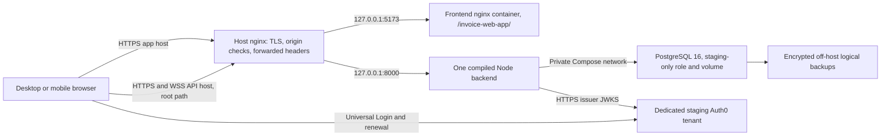

# Slice 6B-1 — hosted CI and staging deployment preflight

Assessment date: **2026-10-18, America/Halifax**. This is a documentation-only
preflight. Commands in the [staging runbook](../deployment/staging-runbook.md)
are instructions for a separately authorized Slice 6B-2, not actions performed here.

## 1. Executive assessment

**GO for reviewed staging preparation; NO-GO for deployment today.** The stabilized
application has substantial local evidence, but no GitHub-hosted run covers the
baseline, no live Auth0 browser flow is verified, and no staging infrastructure,
secrets, ingress or recovery process has been approved or exercised.

Recommend one isolated Linux VPS running the existing compiled backend, nginx
frontend and PostgreSQL 16 in Docker Compose, with host nginx terminating TLS on
separate app/API hostnames. Use a fresh staging database and dedicated Auth0
staging tenant/SPA/API. One backend replica matches the in-memory subscription
bus and avoids introducing distributed operations. This reuses Slice 6A's local
architecture while explicitly replacing its local credentials and adding ingress.

This recommendation is a proposal requiring approval. Existing Fly manifests and
the README's GitHub Pages link do not establish current hosting ownership or
deployment readiness. No hosting/Auth0 account or existing external database was
inspected, changed or assumed to be available.

## 2. Release baseline and inherited evidence

| Item | Observed state |
| --- | --- |
| Branch | `portfolio-stabilization` |
| Starting HEAD | `e5f90c30ec28e05cf90c5b371e5414efe0e92ac4` |
| Initial working tree | Clean, including untracked files |
| Toolchain | `.nvmrc`: 24.15.0; both packages require Node >=24 <25 |
| Actual local tools | Linux Node 24.15.0, npm 12.2.0, Corepack 0.34.6; default shell initially selected Windows npm and had no Node |
| Dependency installation | Separate backend/frontend `yarn.lock`; `packageManager: yarn@4.6.0`; `nodeLinker: node-modules`; `corepack yarn install --immutable`; no root package/lockfile and no npm install requirement |
| Database | Compose/CI `postgres:16`; local installed tools 16.13; actual future target version unknown |
| ORM | Prisma CLI and client pinned 6.2.1 |
| Runtime images | Backend Node 24.15.0 Bookworm slim, non-root compiled JS; frontend nginx stable Alpine; PostgreSQL persistent project volume |
| Local network | Frontend 127.0.0.1:5173, API 127.0.0.1:8000, DB not published; dependency health ordering |
| Startup | Backend entrypoint runs `migrate deploy`, then compiled server; never seeds; no Compose restart policy currently |
| Workflows | `ci-code-quality-tests.yaml` and `codeql.yml`; deployment workflows retired |

Read the requested [archaeology](repository-archaeology.md),
[stabilization plan](portfolio-stabilization-plan.md),
[Slice 1](slice-1-baseline-verification.md),
[Slice 2B adversarial review](slice-2b-adversarial-review.md),
[Slice 4B implementation](slice-4b-demo-mode-stabilization.md),
[Demo adversarial review](slice-4b-adversarial-demo-review.md),
[Slice 4C](slice-4c-user-api-security.md),
[Slice 5C](slice-5c-playwright-e2e-stabilization.md) and
[Slice 6A](slice-6a-release-infrastructure.md), plus the root README.
Older reports describe superseded behavior. In particular, the current migration
directory contains **two**, not eight, migrations; Demo reload uses sessionStorage
to preserve entry state after Slice 5C. The non-string WebSocket authorization
header guard still calls startsWith before its try/catch; this remains a small
input-validation follow-up, not a closed finding. Current source controls this assessment.

Inherited from Slice 6A, **not rerun here**:

| Gate | Last recorded local result |
| --- | --- |
| Backend lint, typecheck, build | Pass; ESLint 0 errors/0 warnings |
| Backend unit/integration | 116 / 158 passing |
| Frontend types/lint/tests/build | Pass; 115 passing, 2 existing skips |
| Browser | 17 Chromium cases plus optional Firefox smoke (18 total) |
| Fresh/repeated migrations, schema agreement | Pass on disposable databases |
| Container builds/startup, persistence, nginx, local HTTP/WS | Pass |
| Hosted CI / live Auth0 / public TLS | Unverified |

## 3. GitHub-hosted CI readiness

Inspected [quality workflow](../../.github/workflows/ci-code-quality-tests.yaml),
[CodeQL](../../.github/workflows/codeql.yml), package scripts and the
[E2E orchestrator](../../invoice-frontend/qa/scripts/run-e2e.mjs).

| Concern | Actual behavior and assessment |
| --- | --- |
| Triggers | Quality push: main, dev, portfolio-stabilization, feature/**, release/**, hotfix/**; all PRs; manual dispatch. CodeQL push: main/dev/portfolio-stabilization; all PRs; Saturday 00:16 UTC schedule; manual dispatch. Nothing deploys. |
| Jobs/dependencies | Four independent Ubuntu 24.04 quality jobs, no `needs`; frontend 15-minute timeout, backend/browser/containers 20 minutes; CodeQL 20 minutes. Failure in any job fails the gate. |
| Checkout/permissions | Checkout v6 with persisted credentials disabled; contents read. CodeQL alone adds security-events write. No deployment permissions/secrets. |
| Node/install/cache | setup-node v6 reads root .nvmrc; automatic package-manager cache disabled; explicit cache v5 uses ~/.yarn/berry/cache keyed by OS and relevant Yarn lockfiles; immutable Yarn installs. npm only launches scripts. Hosted Corepack/action availability remains to be proved. |
| Backend | PostgreSQL 16 service, invoice_ci database, ci-only disposable password, localhost:5432, pg_isready health; Prisma generate; check (types/lint/116 units/build); integration launcher applies migrations and runs serially with 60-second hooks. |
| Frontend | check (types/lint/115 tests plus 2 skips/build), E2E typecheck; public localhost API, Demo false; no Auth0 account needed. |
| Browser | Installs postgresql-16 and Playwright's matching Chromium with OS dependencies. Creates its own loopback cluster/ports and enabled/disabled bundles; seeds only its generated DB; compiled production backend. 17 serial Chromium desktop/mobile/disabled cases, zero retries. Firefox is optional locally and **not installed/enabled by CI**. |
| Containers | Builds both images, validates Compose, fresh DB startup/health within 180s, HTTP health/static page/GraphQL typename. Demo remains off. This job does not assert public TLS or WSS. |
| Cleanup | Native E2E finally stops children/cluster and removes generated DB/socket data; SIGINT/SIGTERM handled. Container `always()` tears down only invoice-ci including its disposable volume. Hard runner termination ultimately removes VM resources. |
| Artifacts | Browser always uploads logs, JSON/HTML results, failure traces/screenshots; 7 days. Other jobs retain ordinary GitHub logs only; container logs printed on failure. Dist directories, Docker images and CodeQL results are not downloadable release image artifacts; CodeQL uploads analysis through its action. Repository log-retention setting not inspected. |
| Concurrency | New quality run on same workflow/ref cancels previous; push and PR refs can run separately. CodeQL has no concurrency group. Cancelled/superseded runs do not count as clean evidence. |

All ordinary gates can provision their dependencies on a standard hosted runner.
No production database, Auth0 password, API key or deployment environment is
referenced. `tests/integration/utils.ts` contains a legacy client-credentials helper
using CLIENT_ID/CLIENT_SECRET, but repository search finds no importer; it is not
an active CI dependency. Integration tests use local signed JWT/JWKS or private
test shortcuts; browser tests use real Demo flows without external login.

**Hosted evidence, checked read-only on the assessment date:**

- GitHub connector baseline PR-run query returned an empty list; its documented
  scope is PR events/first page, so this alone was insufficient.
- GitHub REST `GET /repos/djblackett/invoice-web-app/actions/runs?head_sha=e5f90c30ec28e05cf90c5b371e5414efe0e92ac4&per_page=100`
  returned `total_count: 0`, across events. The connector branch search also
  returned no portfolio-stabilization branch.
- Recent-run REST inspection returned 118 runs total; the five sampled successful
  runs were dynamic dependency automation at `32a820c0132456726284b9c2b5571540d6884bbe`.
  [One sampled run](https://github.com/djblackett/invoice-web-app/actions/runs/26165468116)
  does **not** validate stabilization.
- Therefore neither the starting HEAD nor this new local documentation commit
  has a qualifying hosted run. Local workflow syntax passes actionlint 1.7.12;
  application commands were exercised in Slice 6A, not hosted and not rerun here.

First future action: after explicit push/PR authorization, push
`portfolio-stabilization`, open a PR to `main`, and collect all four quality jobs
plus CodeQL for the exact reviewed tip (and PR merge SHA where applicable).
Do not merge until all succeed. CodeQL entitlement/permissions, fork behavior,
cache, apt/browser provisioning and artifact upload need actual hosted evidence.
See runbook section 4 for exact commands and failure classification.

## 4. Recommended architecture, resources and current costs



Host nginx is the single trusted proxy. Frontend nginx only serves static assets.
Backend handles GraphQL HTTP and graphql-transport-ws at `/`, authorization,
transactional Demo reset and Prisma. PostgreSQL persists independently of app
containers. Auth0 handles normal user login. No Kubernetes, Redis or separate
Demo database is needed. In-memory PubSub means multiple backend replicas would
lose cross-replica subscription events; retain one for this release.

| Option | Cost evidence / estimate | Tradeoffs and fit |
| --- | --- | --- |
| **Recommended: dedicated DigitalOcean Basic VPS, self-hosted PG16** | Official regular 1 vCPU/2 GiB/50 GiB SSD/2,000 GiB transfer: USD 12/month. Weekly VM backup +20% = 2.40; daily +30% = 3.60. USD 14.40 weekly or 15.60 daily subtotal. Additional encrypted off-host dump storage, domain, tax, Auth0 and overages not quoted. | Reuses verified containers; full WS/proxy/migration control; simple image rollback. Operator must patch OS/Postgres, manage TLS and verify restores. Single host is a single failure domain; acceptable for isolated low-traffic staging. |
| Managed alternative: Render static frontend + paid Docker web service + paid Render Postgres | Static hosting has no compute fee within usage allowances; paid service/DB quote must be confirmed at selection. Current pricing page extraction did not expose numerical paid rates, so no exact managed total claimed. | Managed TLS, inbound WSS and independent DB lifecycle; less OS work. Extra service configuration, fixed frontend base path packaging, one-hop proxy verification, build/secrets/migration/backup adaptation still required. Use paid persistent DB; free DB expires after 30 days and has no backups, free backend sleeps after 15 minutes. |
| Historical Fly backend + GitHub Pages frontend | No active resource inventory or current cost quote verified. | Existing backend Fly manifest sleeps to zero and needs release review; root manifest references missing artifacts and is explicitly unsupported. Split hosting adds Auth0/CORS/routing work without reusable complete infrastructure. Not the first choice. |

Budget/resources are **estimates**, not load-test results: 2 GiB RAM and one shared
CPU are a starting runtime size; allow about 512–768 MiB backend, 256–512 MiB DB
and room for OS/proxies. Watch OOMs, CPU and disk. Build off-host to avoid compiler
memory pressure; a reviewed 4 GiB VPS is USD 24/month before add-ons if needed.
Keep storage usage below 80%, constrain/rotate logs and keep release archives off
the DB disk where possible. Region, available plan, budget and backup destination
remain operator decisions. HTTP/TLS/WSS on the proposed host are planned, not tested.

Official sources checked **2026-10-18**:
[DigitalOcean pricing](https://www.digitalocean.com/pricing/droplets),
[backup pricing](https://docs.digitalocean.com/products/backups/details/pricing/),
[Render pricing](https://render.com/pricing),
[compute specifications](https://render.com/docs/compute-plans),
[Render free limitations](https://render.com/docs/free),
[TLS](https://render.com/docs/tls),
[WebSockets](https://render.com/docs/websocket).
Requote before purchase; prices are USD, not CAD.

## 5. Environment inventory and isolation

Matrix notation: **R** required for a complete account-enabled release; **O** optional;
**D** only for Demo; **T** tooling only. **S** secret; **P** public/non-secret.
**Static** means verified by present source inspection; **6A** is inherited local
runtime/build evidence; **pending** means target value/live behavior unverified.
All staging values below are placeholders or proposed settings, not existing resources.

| Actual variable | Component / requirement / purpose | Development example | Staging requirement | Production requirement | Secret; timing; configuration; evidence |
| --- | --- | --- | --- | --- | --- |
| DATABASE_URL | Backend/Prisma R, single database | Local example in backend .env.example | Separate invoice_staging DB, invoice_staging role and generated password on private db:5432 | Independent production DB/role/password; never reuse staging | S; runtime; server secret env; Static/6A, target pending |
| NODE_ENV | Backend R, auth shortcuts/logging/limiter/transport | development only for source; test/CI only private harnesses | **production** | **production** | P; runtime; release manifest; Static/6A |
| PORT | Backend O, defaults 8000 | 8000 | 8000 inside container | Target internal port | P; runtime; manifest; Static/6A |
| CORS_ORIGIN | Backend R operationally, one exact browser origin | http://localhost:5173 | https://&lt;APP_HOST&gt;, no trailing slash/path/list | Exact production app origin | P; runtime; server env; Static/6A, public pending |
| DEMO_MODE | Backend D, accepts literal true only | false | Initially false; true only approved Demo stage | Explicitly approved true/false | P; runtime; server env; Static/6A |
| DOMAIN | Backend R for Auth0, issuer and JWKS prefix | Empty for isolated Demo | https://&lt;STAGING_AUTH0_HOST&gt;/ including final slash | Production tenant issuer; never staging issuer | P; runtime; server env; Static; live pending |
| AUDIENCE | Backend R for Auth0, JWT audience | Empty for isolated Demo | Exact dedicated staging custom API identifier | Separate production API identifier | P; runtime; server env; Static; live pending |
| CERT_DIR | Backend O, local certificate loading | Empty for HTTP; ../certs for source HTTPS | Empty; production always HTTP behind ingress | Empty behind ingress | P; runtime; server env; Static/6A |
| APOLLO_GRAPH_REF | Backend O, production landing-page graph ref | Unset | Unset unless real graph intentionally selected | Same policy | P; runtime; server env; Static only; not an API key |
| VITE_BACKEND_URL | Frontend R, HTTP root and derived WS URL | http://localhost:8000 | https://&lt;API_HOST&gt; (no /graphql) | https://&lt;PRODUCTION_API_HOST&gt; | P; **build**; Docker ARG/public build env; Static/6A, public pending |
| VITE_DEMO_MODE | Frontend D, UI/provider gate | false | false for Auth0 checks; approved true bundle later | Explicit choice | P; build; Docker ARG; Static/6A |
| VITE_DOMAIN | Frontend R for Auth0 | Empty for Demo | &lt;STAGING_AUTH0_HOST&gt;, hostname only | Production tenant hostname | P; build; Docker ARG; Static; live pending |
| VITE_CLIENT_ID | Frontend R for Auth0 SPA | Empty for Demo | Dedicated staging SPA public client ID | Production SPA ID | P; build; Docker ARG; Static; live pending |
| VITE_AUDIENCE | Frontend R for Auth0 | Empty for Demo | Exactly AUDIENCE | Exactly production AUDIENCE | P; build; Docker ARG; Static; live pending |
| VITE_SCOPE | Frontend R for mounting Auth0 and requested scopes | Example: openid profile email offline_access role | Recommend openid profile email offline_access; role is not used for authorization and is not a standard OIDC scope | Reviewed scopes for production | P; build; Docker ARG; Static; tenant scope/renewal pending |
| VITE_REDIRECT_URI | Frontend O, callback and logout returnTo | Defaults to origin + /invoice-web-app/ | Explicit https://&lt;APP_HOST&gt;/invoice-web-app/ | Exact production callback | P; build; Docker ARG; Static; live pending |
| FRONTEND_PORT / BACKEND_PORT | Local root Compose O, host bindings | 5173 / 8000 | Proposed standalone release uses fixed loopback ports; do not export publicly | Explicit private ports at host | P; Compose interpolation; root env; Static/6A |
| POSTGRES_USER / POSTGRES_PASSWORD / POSTGRES_DB | DB container initialization | postgres / local-only / invoices, **local only** | Proposed manifest: postgres bootstrap, fresh secret, invoice_staging; separate non-superuser app role | Separate production bootstrap/DB/role | Password S, others P; runtime **first empty volume init only**; DB env; Static/6A, staging pending |
| DEV_HTTPS | Vite O local transport | false for source HTTP | Not used | Not used | P; local serve config only; shell; Static |
| CI | Workflows/Playwright T, forbids focused tests | Unset | No release setting | No release setting | P; runner runtime; workflow; Static |
| PG_BIN | E2E T, PostgreSQL executables | /usr/lib/postgresql/16/bin | Local/CI test only | Not used by deployed app | P; harness runtime; shell/workflow; Static/6A |
| E2E_BACKEND_REGRESSION | E2E T, optional second disposable regression DB | true to include backend gates | Test only, not staging endpoint selection | Not a release setting | P; harness runtime; shell; Static/6A |
| E2E_CHROMIUM_EXECUTABLE / E2E_FIREFOX_EXECUTABLE | Playwright T, installed browser overrides/optional Firefox | Absolute local binary paths | Test only; hosted CI installs matching Chromium, no Firefox override | Not release settings | P; test runtime; shell; Static/6A |
| E2E_ARTIFACTS / E2E_BASE_URL / E2E_API_URL / E2E_DISABLED_URL / E2E_DISABLED_API_URL | Harness-generated T, reports/ephemeral endpoints | Generated /tmp paths and localhost ports | Generated internally; do not aim managed harness at staging | Not release settings | P; test runtime; runner -> Playwright; Static/6A |
| TMPDIR | Host/CI T, temporary artifact root | /tmp or runner.temp | Tests only | Not application config | P; harness runtime; workflow/shell; Static |
| DOTENV_CONFIG_PATH | dotenv T, QA env isolation | Harness-generated absent.env | Do not inherit developer dotenv in release | Same | Path P; runtime tooling; harness; Static |
| CLIENT_ID / CLIENT_SECRET | Unimported legacy integration token helper T | Leave unset | **Not required or used by runtime/CI** | Not required | Client secret S; helper runtime only; never supply to release; Static |
| SECRET | QA orchestrator legacy placeholder | local-e2e-only | No application consumer; omit | Omit | Treat any real secret as S; harness only; Static |
| REQUEST_ORIGIN | Unsupported root Fly manifest only | Historical http://frontend | **Not an active CORS variable**; omit | Omit | P; dead manifest entry; Static |

`BASE_URL`/`MODE`/`PROD`/`DEV` are Vite built-ins, not new deployable environment
variables. Avatar uses `import.meta.env.BASE_URL`, fixed by Vite base
`/invoice-web-app/`. There is no independent WebSocket URL, configurable frontend
base path, JWKS variable or nginx upstream env variable. WS replaces the API URL's
scheme with ws/wss; JWKS is DOMAIN + `.well-known/jwks.json`. nginx upstreams must
be configured in ingress itself. New runbook image/secret variable names are
explicit operator-template inputs, not claims about current application code.
Frontend process.env.NODE_ENV checks are compiled by Vite; normal build selects
production. Do not use a test/development NODE_ENV for release asset builds.

All VITE values are compiled into static browser assets; changing any requires
rebuild/redeployment. Runtime frontend env cannot update them. DATABASE_URL, DB
passwords, Auth0 client/management secrets, backup keys and test credentials must
never be VITE variables, Docker build arguments or report/browser artifacts.
Both Docker contexts exclude `.env*`, `*.env`, keys/certs and saved auth state.

Separate staging volume, DB name, role, password, app/API hostnames, callback,
SPA client and API audience are mandatory. Production data and write credentials
must never be used for staging. A separate Auth0 tenant is recommended because
backend checks issuer/audience but does not restrict calling SPA client ID; a
different SPA alone with the same issuer/API would not isolate token acceptance.
A shared tenant is acceptable only after approval with a distinct custom API,
client connections and client-scoped Actions; users/tenant policy are still shared.
Source, immutable image archives, read-only public documentation and billing
account can be shared. DBs and write credentials cannot. Demo and real staging
accounts intentionally share the **staging application DB** and authorization boundary.

## 6. Auth0 implementation and staging requirements

Evidence: [context/JWT](../../invoice-backend/src/GraphQL/createContext.ts),
[provider](../../invoice-frontend/src/features/auth/components/Auth0ProviderWrapper.tsx),
[AppWrapper](../../invoice-frontend/src/app/AppWrapper.tsx),
[config](../../invoice-frontend/src/config/config.ts),
[header logout](../../invoice-frontend/src/features/shared/components/Header.tsx),
[user repository](../../invoice-backend/src/repositories/implementations/prismaUserRepo.ts).

- Issuer DOMAIN is a full HTTPS URL with trailing slash; VITE_DOMAIN is a hostname.
  Backend obtains kid from JWT, downloads issuer JWKS, and verifies **RS256**,
  audience, issuer and ordinary JWT expiry. No shared signing secret is required.
- Frontend uses Auth0 React Universal Login, redirect authorization code handling
  through the SDK, hash-based application routes and no custom `/callback` handler.
  Register exactly `https://<APP_HOST>/invoice-web-app/` for callbacks **and logout**;
  Allowed Web Origins and Auth0 Allowed Origins (CORS): `https://<APP_HOST>`.
  Do not register a hash route, `/graphql`, localhost or wildcard for staging.
  Existing login button initiates redirect; optional Application Login URI must
  not be assumed to initiate login automatically (the UI requires a button click).
- Requested access-token audience must exactly match the staging custom API ID.
  A permissions array or an ID token alone does not satisfy backend requirements.
  Required access-token keys are nonempty `sub` and **`invoice-web-app/email`**;
  optional `name`; **`invoice-web-app/roles`** array containing exact `Admin` maps
  to ADMIN, otherwise USER. Configure a reviewed post-login Action using trusted
  Auth0 email/assigned roles, never user-editable metadata for admin assignment.
- Those legacy claim keys lack a URI scheme. Current Auth0 docs recommend HTTP(S)
  namespace identifiers and constrain private claims for Auth0 API audiences.
  **Tenant acceptance/emission of these exact keys is unresolved.** Use a custom
  staging API audience and inspect the actual access token locally without saving
  it. If either required claim cannot be emitted, stop; an explicitly approved
  compatibility change is a later code task, not silently implemented here.
- AppWrapper enables refresh tokens and localstorage cache. Recommend SPA auth
  method None, authorization code/PKCE and refresh-token grants, API Allow Offline
  Access, refresh rotation, bounded inactivity/absolute lifetimes. Proposed staging
  test lifetimes: access token 10 minutes, refresh inactivity 1 day/absolute 7 days;
  approve these tenant settings and restore the intended policy after testing.
  Localstorage token exposure to XSS is an accepted existing implementation;
  do not add third-party scripts, store tokens in traces or claim logout revokes
  already issued JWTs. SDK renewal and browser privacy behavior need live proof.
- HTTP provisions on first **authenticated API request**, using sub as User.id,
  email claim as unique username and verified initial role. Repeat/concurrent
  subject upsert preserves existing metadata/role. Another subject with the same
  email fails closed; it is not account linking. First page login alone is not
  proof of DB provisioning; observe a successful authenticated API operation.
- HTTP context/UserService use the stored role after provisioning; invoice and
  revision services remain bound to token role. WS uses verified token role and
  **does not provision/load the local user**. `invoiceAdded` is ADMIN-only. Test
  ADMIN with both stored and token roles aligned; do not promote by editing only
  PostgreSQL and assume every path changes. Role changes/revocation, open WS token
  expiry and discrepancy behavior need explicit policy before production.
- HTTP sends Authorization Bearer headers. WS sends Authorization in
  graphql-transport-ws connection_init; both share JWT/Demo token dispatch. A 101
  upgrade or connection_ack alone is not authorization proof. Context is created
  for GraphQL operations; an established subscription is not continuously
  reauthorized when a token expires or role changes. Reconnect acquires a token.
- With VITE_DEMO_MODE=true a new tab boots Demo first. For account testing exit
  Demo using Logout (sets sessionStorage inactive) before Login, or use the
  initial Demo-disabled build. Page reload preserves the inactive/ready tab state;
  deliberate re-entry still resets shared Demo data.

No tenant identifiers, actual allowed URLs, claims Action, users or live login were
verified. Signed local RSA/JWKS tests do not establish live readiness. Test USER A,
USER B, a first-login subject and ADMIN only in the staging tenant, with synthetic
invoice data. The exact verification sequence is in runbook section 8.

Official behavior references checked 2026-10-18:
[application settings](https://auth0.com/docs/get-started/applications/application-settings),
[custom claims](https://auth0.com/docs/secure/tokens/json-web-tokens/create-custom-claims),
[refresh rotation](https://auth0.com/docs/secure/tokens/refresh-tokens/refresh-token-rotation).

## 7. TLS, proxy, CORS and WebSockets

The current [frontend nginx](../../invoice-frontend/nginx.conf) serves HTTP static
assets with root redirect, SPA fallback under /invoice-web-app/ and missing-asset
404s. It has **no backend reverse proxy or TLS**. The backend production listener
is HTTP on 0.0.0.0:8000; certificates/CERT_DIR are for local development. Add one
host TLS proxy, publish only ports 80/443 (SSH restricted to operator addresses),
retain loopback-only container ports and no published PostgreSQL.

Use HTTPS API **root**; `/graphql` fails WS matching because server WS path is `/`.
Never use container names/localhost in public browser assets. Proxy HTTP/1.1,
Upgrade/Connection, Host, X-Forwarded-Proto=https and a sanitized X-Forwarded-For
containing the actual client IP. Backend `trust proxy=1` assumes exactly this one
trusted hop. Adding a CDN/load balancer requires re-review, not copying supplied
client forwarding headers. Origin must be the frontend host, without its path.

Backend CORS allows one configured origin with credentials, but CORS is a browser
read policy, not API authentication. Express CORS/rate-limit middleware does not
guard WS upgrades. Backend has no WS origin check or WS connection limiter; add
an ingress allowlist for upgrades from the exact frontend Origin and reasonable
connection limits before public exposure. The runbook provides proposed nginx
configuration. It is not installed or runtime-validated in this slice.

Public test must cover certificate trust/renewal, HTTP->HTTPS, WSS root upgrade and
authenticated operation, foreign Origin rejection, allowed/disallowed HTTP CORS,
sanitized IP behavior, idle/reconnect, deep-link reload, callback query handling,
no mixed content and physical mobile browser access. HashRouter handles
`/invoice-web-app/#/invoices/<ID>`; hashes never reach nginx. Test a direct non-hash
path fallback separately; it does not imply a matching non-hash app route.

[nginx's official WebSocket guide](https://nginx.org/en/docs/http/websocket.html)
confirms explicit upgrade forwarding and default idle timeout; checked 2026-10-18.
Planned proxy_read_timeout 300s needs idle/reconnect smoke. No domain, DNS record
or certificate was created.

## 8. Migration analysis

Inspected [schema](../../invoice-backend/prisma/schema.prisma),
[base SQL](../../invoice-backend/prisma/migrations/20250304053431_moo/migration.sql),
[revision SQL](../../invoice-backend/prisma/migrations/20260412000000_add_invoice_revisions/migration.sql)
and [entrypoint](../../invoice-backend/scripts/container-entrypoint.sh).

| Migration | Existing-data assessment |
| --- | --- |
| 20250304053431_moo | Creates Role enum and five base tables with required fields, PKs, unique usernames/address links, ownership/item indexes and CASCADE FKs. No DROP/TRUNCATE/column removal/backfill. Assumes base objects do not already exist unless this exact migration is recorded applied. An older db-push or different-history DB is **not** safe to adopt blindly. |
| 20260412000000_add_invoice_revisions | Creates new table with non-null snapshot/revision fields, timestamp default, ordinary indexes, unique invoiceId/revisionNumber, CASCADE invoice FK and SET NULL creator FK. No non-null addition to populated base tables, destructive SQL or historical snapshot backfill. Existing invoices start without pre-migration history. Fails if table/objects already exist untracked. |

Both use ordinary blocking DDL/index statements, not concurrent index builds.
No explicit encompassing BEGIN/COMMIT appears in the SQL; do not assume an error
leaves no partial objects. Prisma failure may leave a failed migration requiring
investigation. Referential cascades are runtime delete behavior, not rollout
deletion, but amplify the danger of bulk administrative operations.

Slice 6A proved fresh application, repeated deploy, schema agreement and container
persistence. This slice made **no DB connection or migration execution**. For a
fresh target, bootstrap a new named volume/DB, record identity/empty state, back
up even the initialized empty DB, apply the chain once under a deployment lock,
then check status/diff. No old data conversion is needed, but recoverability still is.

For any non-empty/historical target: inventory `_prisma_migrations`, tables,
enum/index/FK definitions and checksums; take an encrypted backup; restore to a
new disposable copy; rehearse reconciliation/deploy/status/schema diff and CRUD/
history/data-count checks. Compare old invoice values to current domain invariants
(ID shape, totals, dates/status/completeness); migrations do not repair old values.
Record orphan/address and username collisions, missing history, canonical Demo IDs
owned by others. Stop on drift or unknown lineage. Do not edit old migration SQL,
run db push/reset, or mark migrations applied merely to bypass an error.

Prisma's [v6 baselining guidance](https://www.prisma.io/docs/orm/v6/prisma-migrate/workflows/baselining)
explains the concept; exact reconciliation commands are target-specific and require
a reviewed restored-copy plan. They are intentionally not fabricated here.

## 9. Backup, restore and rollback assessment

Minimum: PG16 custom-format `pg_dump -Fc` before each rollout and nightly, restrictive
permissions, hash/size/TOC verification, encryption and a verified off-host copy.
Propose seven daily and four weekly dumps; staging RPO <=24h and RTO <=4h are
**targets requiring approval and rehearsal**, not achieved guarantees. Weekly VM
backups supplement logical dumps; they do not prove a PostgreSQL-consistent restore.
Store DB role definitions/passwords in protected recovery records separately;
pg_dump does not include cluster-global roles. Retain image IDs, source SHA,
public build values, prior/candidate protected env, ingress config and migrations.

Application failure: stop admission, restore previous backend/frontend image pair
and matching public config if schema-compatible; keep DB and verify migration
status. Automatic entrypoint migrates on startup, so rollback runbook explicitly
bypasses it after confirming schema compatibility. For a first deployment, no
previous version exists: stop candidate and retain DB/evidence until corrected.

Migration failure: preserve logs and current data, stop writers and inspect partial
DDL/migration records. Prisma does not generate inverse migrations. Prefer an
approved forward fix after restored-copy rehearsal. An incompatible schema may
require restoration, not just an older application image. Never restart-loop
the candidate or blindly use migrate resolve to suppress the failure.

Restore: maintenance window, stop **all** writers (including Demo resets/WS), take
an incident snapshot if possible, choose a recovery point and obtain explicit
approval for losing/reconciling writes since it. Restore into a **new empty DB**
with the expected role, validate tables/counts/FKs/migration state and application,
then approve switching DATABASE_URL. Preserve the failed original. No drop,
overwrite or destructive cleanup is part of this plan. Rehearse on disposable
local infrastructure in 6B-2 before real rollout; no backup/restore was executed here.
Commands/target guards appear in runbook section 9.

References checked 2026-10-18: PostgreSQL 16
[pg_dump](https://www.postgresql.org/docs/16/app-pgdump.html) and
[pg_restore](https://www.postgresql.org/docs/16/app-pgrestore.html).

## 10. Public Demo readiness

Present implementation and inherited adversarial evidence agree: literal explicit
server/client flags, only `demo-token`, dedicated demoId/USER/internal isDemo marker,
retired demo-admin rejected, no per-request DB switching, transactional reset with
advisory serialization and ownership filters. Reset deletes only Demo invoices and
their dependent data/selected detached addresses; canonical-ID conflict refuses
without taking another user's invoice. Stale stored Demo ADMIN is overridden.
USER/Demo cannot enumerate users or subscribe to ADMIN invoiceAdded feed. Real
ADMIN has broad data privileges, including Demo visibility; the boundary is that
Demo cannot see real users, not a two-way database partition.

| Concern | Classification for low-traffic staging | Operational response |
| --- | --- | --- |
| Canonical ID claimed by real user after Demo deletion | FOLLOW-UP; safe refusal causes Demo outage, not data exposure | Check seven canonical IDs before enabling; alert on reset failure; operator investigates without deleting/reassigning real records. Reserve IDs in a later scoped change. If conflict already exists, enabling Demo is blocked until resolved or Demo remains off. |
| Visitors share mutable Demo workspace | ACCEPTED LIMITATION | Publish shared-demo expectations; reset/re-entry can interrupt others. Reload of a ready tab now preserves state; new visitors still reset. No anonymous personal data should be entered. |
| Public entry/reset load, WS bypass of HTTP limiter | FOLLOW-UP with ingress mitigation required before public exposure | HTTP limiter is 100/IP/15m in production and covers reset; resets serialize but ordinary edits do not. Use correct IP handling, WS origin/connection controls, monitor CPU/lock waits/reset failures; disable DEMO_MODE/rebuild client gate on sustained abuse. No claim of dedicated reset-cost or distributed rate limiting. |

Recommend initial account-enabled staging with both Demo flags false, then an
explicitly approved Demo-enabled phase using the same staging DB, synthetic
USER sentinels and preservation checks. No Demo redesign is needed for this slice.

## 11. Minimum operations

Must have before admitted staging traffic:

- Serialized manual rollout, retained previous images/config, DB volume identity,
  nightly/pre-release backup verification and a successful disposable restore.
- Host reboot starts Docker/nginx; proposed staging restart policy unless-stopped.
  Healthcheck failures alone do **not** make Compose restart containers. Monitor
  unhealthy/exited state and inspect before operator recovery, rather than adding
  an automatic destructive reset/reseed.
- `/health` is startup/liveness only: startup connects DB, but later DB loss still
  returns OK. Pair with a private periodic `SELECT 1`/pg_isready and periodic
  authenticated synthetic invoice read; check GraphQL errors even on HTTP 200.
- Capture startup, connection, migration and fatal exception logs; monitor restart
  counts/OOM, disk, memory/CPU, TLS expiry, HTTP 429/5xx, WS failures and backup age.
  Use host/container metrics and a simple external HTTPS probe, no large stack.
- Rotate Docker/nginx logs with access restrictions and short retention (proposed
  7 days). Existing request logger records req.url and GraphQL error JSON can
  contain data. Use POST-only app API traffic, prevent query/token logging at
  ingress, restrict log access and review redacted samples before real data.
  Never retain Authorization headers, browser token storage, raw invoice payloads
  or unsanitized Auth0 HAR/traces. Prefer counts/status/duration/error codes.
- Document operator and response path. Rotate app DB password by protected secret
  update and serialized backend recreation; verify and invalidate old access.
  Changing POSTGRES_PASSWORD env does not rotate an initialized role. Rotate
  bootstrap and backup keys separately; Auth0 signing keys/refresh revocation are
  tenant operations requiring their own coordination. Frontend client IDs are public.

Can wait: richer DB-aware readiness endpoint, dedicated reset throttling, metrics
dashboards, WS heartbeats/revocation policy implementation, graceful signal
shutdown improvement, production image dependency pruning/digest automation.
Existing introspection/landing page and Node dependency tree need review before
production but do not alone block a synthetic-data staging evaluation.

## 12. Remaining risks and release gates

| ID / severity | Finding | Objective closure |
| --- | --- | --- |
| B1 BLOCKER | Hosting/budget/domains/Auth0/Demo/backup choices unapproved | Decision record approved for Slice 6B-2 with target identifiers and scope |
| B2 BLOCKER | No hosted CI on reviewed stabilization tip | Four quality jobs + CodeQL successful for exact release/PR commit, artifacts/logs inspected |
| B3 BLOCKER | Local Compose credentials and absence of public ingress | Reviewed staging manifest with fresh secrets/private DB/ports, one-hop TLS proxy, WS origin/connection controls, correct browser build values |
| B4 BLOCKER | Isolated DB identity/recovery not established | Fresh staging volume/role proven; pre-release dump/off-host copy verified; disposable restore passes. Existing data additionally requires migration rehearsal/reconciliation. |
| B5 BLOCKER before account acceptance | Live Auth0 tenant config/legacy claims/renewal unknown | Dedicated tenant/SPA/API and exact claims emit; login/provision/repeat/refresh/renew/logout/USER/ADMIN tests pass. Controlled initial deployment may be used to perform these tests; staging is not accepted until they pass. |
| B6 BLOCKER before public acceptance | Public TLS/WSS/CORS/IP/reconnect unknown | Runbook network smoke passes, ports private, foreign WS Origin denied |
| P1 PRODUCTION BLOCKER | Staging end-to-end/restore evidence and promotion approval absent | Signed-off full smoke, rehearsed recovery/RPO/RTO and explicit production authorization |
| P2 PRODUCTION BLOCKER | Stored-vs-token role changes and open-subscription revocation policy unresolved | Approved role source/reconciliation and revocation/expiry behavior; resolve unsafe discrepancies before real-account production exposure |
| F1 FOLLOW-UP | Canonical Demo ID availability; reset load; shared IP 100/15m can throttle evaluators | Monitor; approved limited public exposure; disable Demo if affected; later scoped repairs |
| F2 FOLLOW-UP | /health not DB-ready, no WS heartbeat/limiter in backend, non-string WS header guard, unstructured error logs | Minimal external/private monitoring now; focused improvements after staging evidence |
| F3 FOLLOW-UP | Two frontend skips, >500kB chunk, peer warnings, floating nginx/PG tags and image pruning | Existing known debt; record immutable release images and PG digest now; no broad dependency churn here |
| L1 ACCEPTED LIMITATION | Single host/replica, manual maintenance rollout, shared mutable Demo | Accept downtime/failure domain for low-traffic staging; no HA/zero-downtime claim |

“Before account/public acceptance” gates are measured **on staging** after a
controlled authorized installation, not circular demands for a live site before
installation. B1–B4 and approved plans for B5/B6 must close before that installation.
Do not declare the resulting environment ready while B5/B6 are still open.

## 13. Decisions requiring approval

Every row needs an explicit decision before the dependent Slice 6B-2 action;
none was made externally in this slice.

| Decision | Recommendation | Alternative | Reason / cost and complexity | Information needed / approval |
| --- | --- | --- | --- | --- |
| Hosting and budget | DO Basic 2 GiB dedicated staging VPS; target USD 14.40 plus extras with weekly VM backups | Render paid backend/PG + static frontend | Container reuse vs OS burden; managed reduces maintenance with separate service setup | Billing account, region, monthly ceiling, tax/currency; **yes** before provisioning |
| PostgreSQL | Fresh self-hosted PG16, non-superuser invoice_staging owner, separate persistent volume | Managed PG16 with separate staging user/DB | Lowest incremental cost; operator owns backup/patching | No existing data? hosting preference and operator; **yes** |
| URL/TLS | Two staging app/API subdomains on an already controlled domain; host nginx, no CDN initially | Managed hostnames / different approved TLS proxy | Keeps exact CORS and one proxy hop; domain cost unquoted | Domain ownership, names, DNS authority, certificate email; **yes** |
| Auth0 | Separate non-production tenant, SPA and custom API | Shared tenant with isolated SPA/API and scoped Actions | Strong issuer/audience isolation; account plan/entitlements unknown | Tenant owner/plan, exact legacy claim feasibility, test connection/lifetimes; **yes** |
| Public Demo | Off during Auth0 validation, then explicitly enabled for synthetic-data staging | Keep private/account-only; demo-only evaluation does not close Auth0 gate | No separate DB; accepts shared interference/ID risk | Intended audience and acceptable public exposure; **yes** |
| Backup/recovery | Nightly/pre-release encrypted off-host dumps + weekly VM backup; 7 daily/4 weekly; RPO24h/RTO4h proposal | Managed backups/PITR, priced separately | VM backup +USD2.40 at USD12 host; off-host cost unknown | Destination, encryption custodian, retention, restore operator; **yes** |
| Deployment | Manual SHA-tagged image archives, checksums, standalone reviewed staging manifest, one release lock | Approved registry and future CI deployment | No new publish credentials/automation required; brief maintenance | Builder architecture, operator/SSH, artifact storage; **yes** |
| Production promotion | Separate decision after complete staging evidence; promote reviewed images only with correct production frontend rebuild | Separate production platform review | Working staging is not production authorization | Production target/data classification/role policy/budget; **yes separately** |

## 14. Go/no-go and next slice

Proceed next with decisions and reviewed target configuration, then authorized
push/PR and hosted CI. Prepare a fresh isolated database, Auth0, ingress and backup
rehearsal. Only after pre-installation gates close should a separately authorized
controlled staging rollout occur. Apply migrations once, start backend then
frontend, admit test traffic, execute every smoke/renewal/isolation/recovery check
and record evidence. Stop on wrong DB, auth claims failure, cross-user access,
migration drift, unavailable restore, mixed content or failed CI. Production
promotion always requires a new explicit approval.

## 15. Evidence actually collected in Slice 6B-1

| Check | Result / scope |
| --- | --- |
| Git status/branch/HEAD/log and lockfiles | Exact expected clean baseline; recent commits consistent with Slice 6A |
| Current source/config inspection | Two workflows, four retained Dockerfiles (production and dev), three Compose files, nginx, Fly/setup scripts, Auth0/UI/context, Prisma/migrations/reset, test orchestration, env examples and usages reviewed; no actual dotenv credentials read |
| Local tool versions | Node 24.15.0/npm12.2.0/Corepack 0.34.6 through explicit Linux PATH; Docker CLI29.2.1/Compose2.33.0; PG tools16.13 |
| Workflow syntax | Official actionlint1.7.12 tarball checksum verified: 8aca8db96f1b94770f1b0d72b6dddcb1ebb8123cb3712530b08cc387b349a3d8; `actionlint -shellcheck=''` exit0 on both workflows (ShellCheck deliberately not claimed) |
| Compose syntax | Base, base+demo, dev `config --quiet` exit0; config output not dumped; no containers started |
| Shell syntax | `bash -n setup.sh`; `sh -n invoice-backend/scripts/container-entrypoint.sh`: exit0 |
| GitHub | Read-only connector and gh REST results described in section 3; initial restricted network attempt failed, permitted read-only retry succeeded; no workflow dispatch/push/settings mutation |
| Official documentation | Hosting/pricing/Auth0/nginx/Prisma-v6/PostgreSQL 16 sources linked above, checked on assessment date |
| Documentation verification | Runbook template syntax, local links/paths, placeholder/secret review, complete documentation diff and git diff --check checked before local commit |

Reproduction of non-mutating local validation:

```bash
export PATH=/home/djblackett/.nvm/versions/node/v24.15.0/bin:$PATH
node --version
npm --version
corepack --version
/tmp/invoice-slice6b1-tools/actionlint -shellcheck=''
docker compose -p invoice-slice6b1 config --quiet
docker compose -p invoice-slice6b1 -f docker-compose.yml -f docker-compose.demo.yml config --quiet
docker compose -p invoice-slice6b1-dev -f docker-compose.dev.yml config --quiet
bash -n setup.sh
sh -n invoice-backend/scripts/container-entrypoint.sh
git diff --check
```

No expensive suites were repeated. No database, cloud resource, DNS, Auth0 setting,
GitHub workflow/settings/secret or application config/source was changed. No push,
PR, merge, deploy or actual backup/restore occurred. Only this report and the
staging runbook are committed locally as
`docs(release): prepare staging deployment preflight`.
